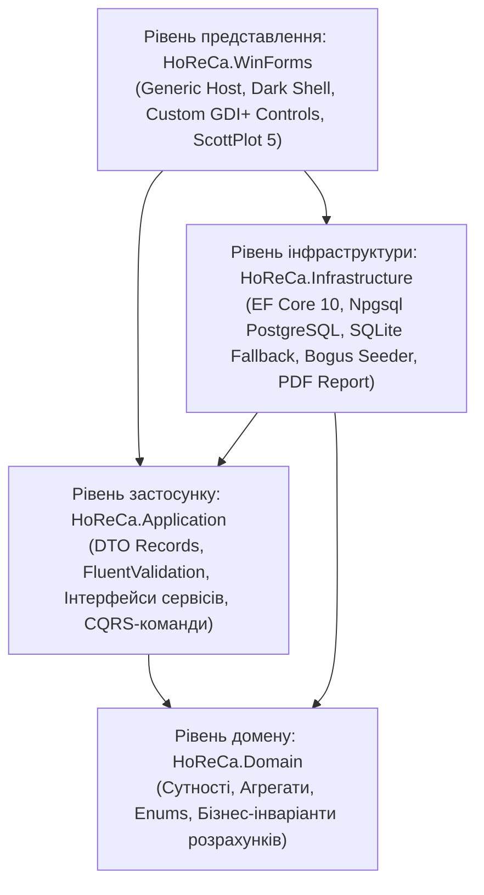
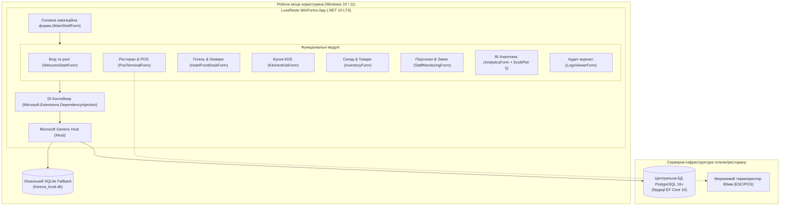
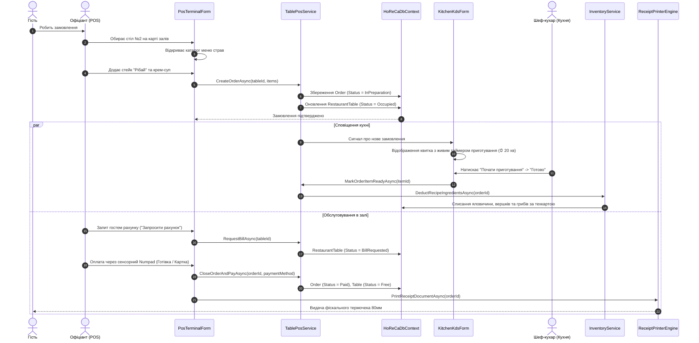

# Архітектурна специфікація та дизайн системи LuxeResto HoReCa OS

Цей документ містить повний інженерний аналіз предметної області, опис архітектурних шаблонів, моделі багатопотоковості, життєвого циклу залежностей та конвеєрів обробки даних у системі **LuxeResto (GrandLux Resort & Restaurant Complex)**.

---

## 1. Аналіз предметної області (HoReCa Domain Analysis)

Індустрія **HoReCa** (*Hotel, Restaurant, Catering/Cafe*) має низку жорстких бізнес-вимог до надійності, швидкодії та консистентності даних:
1. **Ресторанний фронт-офіс (POS - Point of Sale):**
   - Висока інтенсивність операцій у години пік (zero-latency реакція інтерфейсу).
   - Інтерактивна візуалізація залів з миттєвим відображенням статусів столів (*Вільний*, *Зайнятий*, *Рахунок*, *Бронь*).
   - Каталог меню з категоризацією, таймерами приготування та фотографіями страв.
   - Підтримка модифікаторів замовлення, розділення рахунків та розрахунку чайових.
2. **Кухонний монітор (KDS - Kitchen Display System):**
   - Автоматична маршрутизація гарячих і холодних страв до кухарів одразу після підтвердження офіціантом.
   - Живі таймери приготування з кольоровою градацією (зелений -> помаранчевий -> червоний при простроченні).
   - Звукові сповіщення про нові квитки та завершення приготування.
3. **Складський облік та технологічні карти (Inventory & Tech Cards):**
   - Автоматичне списання інгредієнтів (сировини) зі складу за калькуляційними картами під час приготування або закриття замовлення.
   - Моніторинг мінімальних залишків (*Safety Stock Thresholds*) з попередженням про дефіцит.
   - Журналювання руху партій товарів (надходження, внутрішнє переміщення, списання).
4. **Готельний номерний фонд (PMS - Property Management System):**
   - 2D-шахівниця номерів (*Room Rack Calendar Matrix*) для візуалізації зайнятості за датами.
   - Бронювання, поселення (Check-in), виселення (Check-out) та переведення витрат ресторану на номер гостя (*Room Charge*).
5. **Фіскальний контур та аналітика:**
   - Друк фіскальних чеків стандарту 80 мм на термопринтерах ESC/POS через драйвер GDI+.
   - Аналітичні дашборди виручки, середнього чека, оборотності столів та ефективності персоналу в реальному часі.

---

## 2. Шари чистої архітектури (Clean Architecture)

Система побудована за принципами **Clean Architecture** Роберта Мартіна та **Domain-Driven Design (DDD)**. Всі бізнес-правила повністю ізольовані від фреймворку UI (Windows Forms) та провайдерів збереження даних.



### Відповідальність рівнів:

1. **[`HoReCa.Domain`](file:///C:/Users/Yurii/source/repos/- MASTERY/WinForms-HoReCa-Mastery/src/HoReCa.Domain):**
   - Повна відсутність зовнішніх залежностей від UI чи ORM.
   - Агрегати та сутності: [`RestaurantTable`](file:///C:/Users/Yurii/source/repos/- MASTERY/WinForms-HoReCa-Mastery/src/HoReCa.Domain/Entities/RestaurantTable.cs), [`Order`](file:///C:/Users/Yurii/source/repos/- MASTERY/WinForms-HoReCa-Mastery/src/HoReCa.Domain/Entities/Order.cs), [`OrderItem`](file:///C:/Users/Yurii/source/repos/- MASTERY/WinForms-HoReCa-Mastery/src/HoReCa.Domain/Entities/OrderItem.cs), [`MenuItem`](file:///C:/Users/Yurii/source/repos/- MASTERY/WinForms-HoReCa-Mastery/src/HoReCa.Domain/Entities/MenuItem.cs), [`Room`](file:///C:/Users/Yurii/source/repos/- MASTERY/WinForms-HoReCa-Mastery/src/HoReCa.Domain/Entities/Room.cs), [`RoomBooking`](file:///C:/Users/Yurii/source/repos/- MASTERY/WinForms-HoReCa-Mastery/src/HoReCa.Domain/Entities/RoomBooking.cs), [`InventoryItem`](file:///C:/Users/Yurii/source/repos/- MASTERY/WinForms-HoReCa-Mastery/src/HoReCa.Domain/Entities/InventoryItem.cs).
   - Бізнес-калькуляції інкапсульовані всередині моделей (наприклад, метод `Order.RecalculateTotals()` самостійно розраховує суму, знижку, чайові та податок).

2. **[`HoReCa.Application`](file:///C:/Users/Yurii/source/repos/- MASTERY/WinForms-HoReCa-Mastery/src/HoReCa.Application):**
   - Незмінні контракти DTO (C# 10 `record`): `CreateOrderDto`, `TableDetailDto`, `RoomBookingDto`.
   - Декларативна валідація за допомогою FluentValidation: [`CreateOrderRequestValidator`](file:///C:/Users/Yurii/source/repos/- MASTERY/WinForms-HoReCa-Mastery/src/HoReCa.Application/Validators/CreateOrderRequestValidator.cs), [`CreateBookingRequestValidator`](file:///C:/Users/Yurii/source/repos/- MASTERY/WinForms-HoReCa-Mastery/src/HoReCa.Application/Validators/CreateBookingRequestValidator.cs).
   - Інтерфейси бізнес-сервісів: `ITablePosService`, `IRoomBookingService`, `IKitchenService`, `IInventoryService`, `IAnalyticsService`, `IAuthService`.

3. **[`HoReCa.Infrastructure`](file:///C:/Users/Yurii/source/repos/- MASTERY/WinForms-HoReCa-Mastery/src/HoReCa.Infrastructure):**
   - Реалізація бази даних через **EF Core 10**: [`HoReCaDbContext`](file:///C:/Users/Yurii/source/repos/- MASTERY/WinForms-HoReCa-Mastery/src/HoReCa.Infrastructure/Persistence/HoReCaDbContext.cs).
   - Стратегія подвійної БД: робота з PostgreSQL (основний кластер) та автоматичний перехід на локальний SQLite при відсутності мережі.
   - Фабрика контекстів `IDbContextFactory<HoReCaDbContext>` для ізольованих одиниць роботи в багатопотоковому середовищі.
   - Детерміністичний сидер демонстраційних даних [`DbSeeder`](file:///C:/Users/Yurii/source/repos/- MASTERY/WinForms-HoReCa-Mastery/src/HoReCa.Infrastructure/Persistence/DbSeeder.cs) на базі бібліотеки Bogus.

4. **[`HoReCa.WinForms`](file:///C:/Users/Yurii/source/repos/- MASTERY/WinForms-HoReCa-Mastery/src/HoReCa.WinForms):**
   - Точка входу через **Microsoft Generic Host** (`IHostBuilder`).
   - Централізоване налаштування кольорів [`ThemePalette`](file:///C:/Users/Yurii/source/repos/- MASTERY/WinForms-HoReCa-Mastery/src/HoReCa.WinForms/Common/ThemePalette.cs) (нейтральна темна графітова гама без агресивного контрасту).
   - Спеціалізовані кастомні контроли: [`FloorTableWidget`](file:///C:/Users/Yurii/source/repos/- MASTERY/WinForms-HoReCa-Mastery/src/HoReCa.WinForms/Controls/FloorTableWidget.cs) (інтерактивні столики з захистом тексту від виходу за межі), `CashierNumpadControl`, `DishCardControl`.
   - Інтерактивна апаратна аналітика на **ScottPlot 5**.
   - Потокобезпечний Serilog Sink [`SerilogRichTextBoxSink`](file:///C:/Users/Yurii/source/repos/- MASTERY/WinForms-HoReCa-Mastery/src/HoReCa.WinForms/Common/SerilogRichTextBoxSink.cs).

---

## 3. Діаграма C4 Container Architecture



---

## 4. Наскрізний життєвий цикл замовлення (End-to-End Order Flow)

Діаграма послідовності демонструє життєвий цикл замовлення від моменту відкриття столика до друку фіскального чека та списання сировини зі складу:



---

## 5. Багатопотоковість та запобігання дедлокам у Windows Forms

Windows Forms використовує **Single-Threaded Apartment (STA)** модель: всі візуальні елементи управління належать єдиному потоку UI (UI Thread). 

### Ключові інженерні правила реалізації:
1. **Захист від Cross-Thread Exceptions:**
   - Будь-яка взаємодія з елементами WinForms з фонового потоку обов'язково викликається через перевірку `InvokeRequired`:
   ```csharp
   if (InvokeRequired)
   {
       BeginInvoke(new Action(() => UpdateStatus(text)));
       return;
   }
   _lblStatus.Text = text;
   ```
2. **Асинхронність без блокування (`ConfigureAwait`):**
   - В обробниках подій форм (`async void`) виклики сервісів здійснюються через `await`. Оскільки за замовчуванням у WinForms `SynchronizationContext` активний, продовження виконання повертається в потік UI без дедлоків.
3. **Ізоляція EF Core в багатопотокових сценаріях:**
   - Об'єкт `DbContext` у Entity Framework Core **не є потокобезпечним** (`not thread-safe`).
   - Реєстрація `AddDbContextFactory<HoReCaDbContext>()` дозволяє кожному асинхронному сервісу або діалогу відкривати власний короткоживучий контекст через `await using var context = await _contextFactory.CreateDbContextAsync();`, що унеможливлює стан гонитви (*Race Condition*).

---

## 6. Управління пам'яттю та ресурсами Win32 GDI+

Windows обмежує процес квотою в **10 000 GDI-дескрипторів** (`GDI Handles`). Неконтрольоване створення пензлів (`Brush`), пер (`Pen`) та шрифтів (`Font`) у методах `OnPaint` призводить до вичерпання ресурсів ОС та падіння процесу з помилкою `A generic error occurred in GDI+`.

### Рішення, застосовані в LuxeResto:
1. **Кешування статичних ресурсів у [`ThemePalette.cs`](file:///C:/Users/Yurii/source/repos/- MASTERY/WinForms-HoReCa-Mastery/src/HoReCa.WinForms/Common/ThemePalette.cs):**
   - Усі кольори та базові шрифти створені одноразово як `public static readonly`.
2. **Обов'язковий детерміністичний диспозинг через `using`:**
   ```csharp
   protected override void OnPaint(PaintEventArgs e)
   {
       base.OnPaint(e);
       using var pen = new Pen(_borderColor, 1.5f);
       using var brush = new SolidBrush(_fillColor);
       e.Graphics.FillPath(brush, path);
       e.Graphics.DrawPath(pen, path);
   }
   ```
3. **Double Buffering:**
   - Для всіх кастомних віджетів (`FloorTableWidget`, `WelcomeStartForm`) активовано `DoubleBuffered = true` або прапорці `SetStyle(ControlStyles.AllPaintingInWmPaint | ControlStyles.UserPaint | ControlStyles.OptimizedDoubleBuffer, true);`. Це усуває мерехтіння (*flickering*) при перемальовуванні та перетягуванні елементів.
