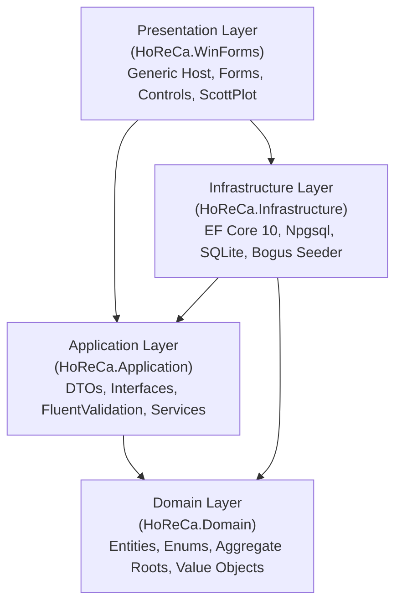
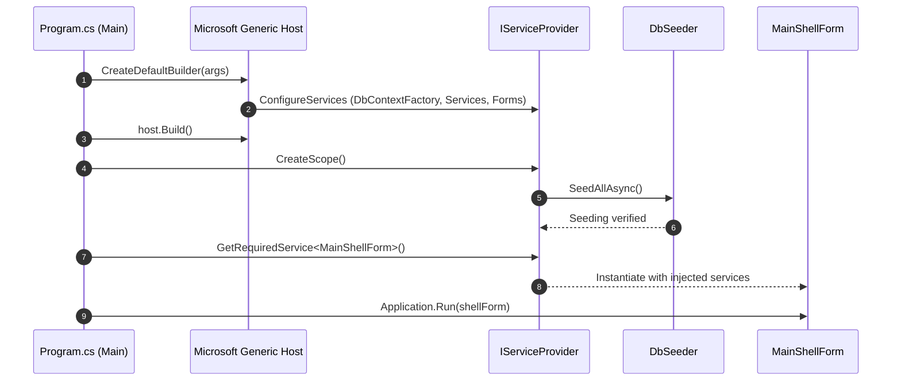
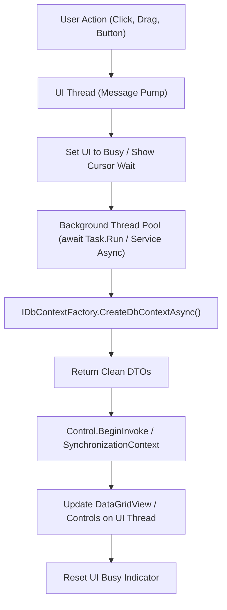

# Architecture & Design Specifications

This document outlines the architectural patterns, runtime concurrency models, dependency injection lifetimes, and data flow pipelines implemented in the **WinForms-HoReCa-Mastery** solution.

---

## 1. Clean Architecture Layers

The system strictly follows Clean Architecture and Domain-Driven Design (DDD) principles to ensure decoupling of business rules from graphical user interface frameworks and external storage adapters.



### Layer Responsibilities

1. **HoReCa.Domain**:
   - Zero external dependencies.
   - Core domain models: `Guest`, `Room`, `RoomBooking`, `RestaurantTable`, `TableZone`, `MenuItem`, `MenuCategory`, `Order`, `OrderItem`, `InventoryItem`, `Payment`.
   - Business calculations encapsulated within entities (e.g., `Order.RecalculateTotals()`, `InventoryItem.IsLowStock`).

2. **HoReCa.Application**:
   - Application boundaries, contracts, and transfer representations.
   - Declarative data validation via FluentValidation (`CreateBookingRequestValidator`, `CreateOrderRequestValidator`).
   - Service interfaces (`ITablePosService`, `IRoomBookingService`, `IKitchenService`, `IInventoryService`, `IAnalyticsService`, `IReceiptPrintService`).
   - Read/write Data Transfer Objects (DTOs) with immutable records.

3. **HoReCa.Infrastructure**:
   - Persistence layer implemented via Entity Framework Core 10.
   - Dual-database provider support: PostgreSQL as the primary production engine and SQLite for offline zero-configuration deployment.
   - Context factory registration (`IDbContextFactory<HoReCaDbContext>`) ensuring isolated units of work across desktop UI threads.
   - Automated deterministic data seed generator (`DbSeeder`) using Bogus.

4. **HoReCa.WinForms**:
   - Application entry point with Microsoft Generic Host (`IHostBuilder`).
   - High-DPI support (`ApplicationConfiguration.Initialize()`).
   - Custom OwnerDraw controls (`FloorTableWidget`, `DishCardControl`, `RoomRackControl`, `CashierNumpadControl`, `KitchenTicketControl`).
   - Real-time diagnostics sink for Serilog (`SerilogRichTextBoxSink`).
   - GDI+ 80mm thermal receipt rendering and fiscal print engine (`ReceiptPrinterEngine`).

---

## 2. Microsoft Generic Host & Dependency Injection

Traditional Windows Forms applications rely on static entry points (`Application.Run(new Form1())`) and static state. This enterprise solution adopts `Microsoft.Extensions.Hosting.Host` to provide modern configuration, options binding, logging, and dependency injection.



### Service Lifetime Matrix

| Service / Component | Lifetime | Justification |
| :--- | :--- | :--- |
| `IDbContextFactory<HoReCaDbContext>` | **Singleton** | Thread-safe factory for generating lightweight, transient `DbContext` instances per operation. |
| `ITablePosService` | **Scoped / Transient** | Executes transactional table reservations, order creation, and POS payments. |
| `IRoomBookingService` | **Scoped / Transient** | Manages hotel front-desk operations, room availability matrices, and check-in/out workflows. |
| `IKitchenService` | **Scoped / Transient** | Powers kitchen display board state changes and order item progression. |
| `IInventoryService` | **Scoped / Transient** | Handles inventory reconciliation and stock replenishment. |
| `IAnalyticsService` | **Scoped / Transient** | Computes KPI summaries and 7-day revenue aggregation for ScottPlot charting. |
| `IReceiptPrintService` | **Transient** | Stateless thermal receipt string formatting and GDI+ print document generation. |
| Forms (`MainShellForm`, `PosTerminalForm`, etc.) | **Transient** | Created on demand by the shell container; prevents memory leaks from stale form references. |

---

## 3. UI Threading & Asynchronous Concurrency

To ensure the Windows Forms UI message loop remains responsive (60 FPS, zero UI freezes), all database I/O and intensive computations run asynchronously using `async`/`await`.



### Key Principles

1. **DbContext Concurrency Protection**:
   `DbContext` is not thread-safe. Instead of sharing a scoped context across multiple asynchronous event handlers, services leverage `IDbContextFactory<HoReCaDbContext>`. Each service method instantiates a short-lived `await using var context = await dbContextFactory.CreateDbContextAsync(ct);`.

2. **Cross-Thread UI Dispatching**:
   When background log events arrive via Serilog or timer tick events trigger, updates are marshaled to the UI thread using `control.InvokeRequired` and `control.BeginInvoke(...)` to prevent `InvalidOperationException`.

3. **Double Buffering & Flicker Prevention**:
   All custom controls and parent container forms activate the following styles during initialization:
   ```csharp
   SetStyle(ControlStyles.AllPaintingInWmPaint |
            ControlStyles.UserPaint |
            ControlStyles.OptimizedDoubleBuffer |
            ControlStyles.ResizeRedraw, true);
   DoubleBuffered = true;
   ```
