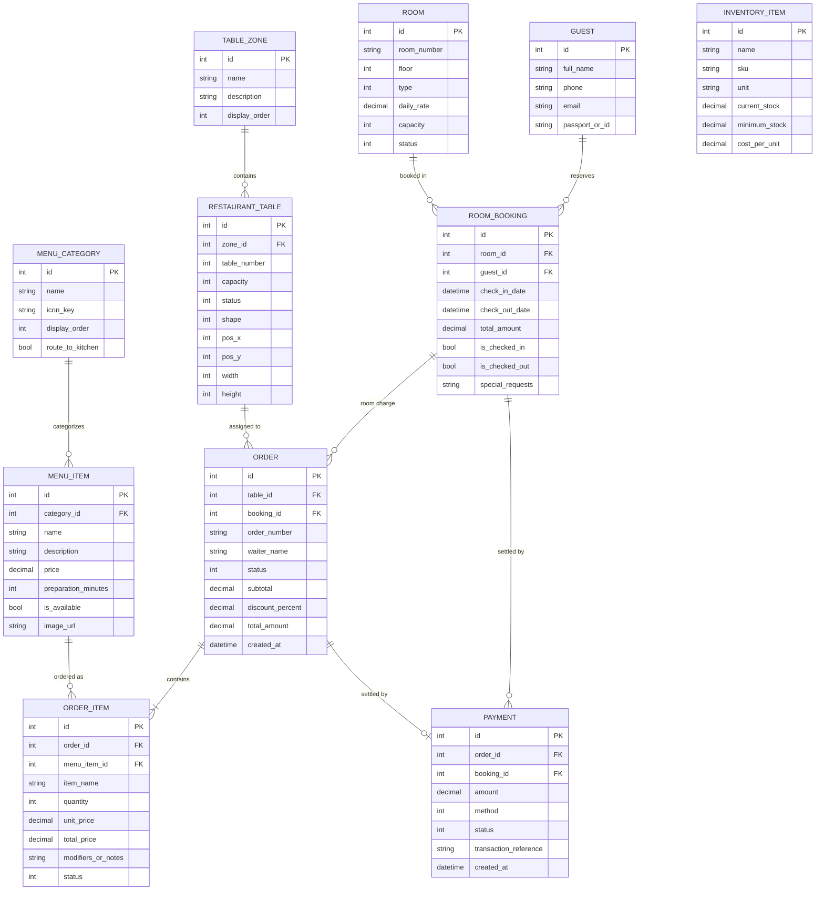

# Database Schema & Relational Specifications

This document specifies the PostgreSQL relational schema, Entity Framework Core mappings, constraints, and indexes utilized by the **WinForms-HoReCa-Mastery** system.

---

## 1. Entity-Relationship Diagram

---

## 2. Table Specifications & Indexes

### Hotel Domain Tables

#### `Guests`
| Column | Type | Constraints | Description |
| :--- | :--- | :--- | :--- |
| `Id` | `int` | Primary Key, Identity | Unique guest identifier |
| `FullName` | `varchar(150)` | NOT NULL | Full name of the hotel guest |
| `Phone` | `varchar(30)` | NOT NULL | Contact phone number |
| `Email` | `varchar(100)` | NULL | Electronic mail address |
| `PassportOrId`| `varchar(50)` | NULL | Identification document number |
| `CreatedAt` | `timestamptz` | NOT NULL | Record creation timestamp |

#### `Rooms`
| Column | Type | Constraints | Description |
| :--- | :--- | :--- | :--- |
| `Id` | `int` | Primary Key, Identity | Unique room identifier |
| `RoomNumber` | `varchar(20)` | NOT NULL, UNIQUE INDEX | Room identifier number |
| `Floor` | `int` | NOT NULL | Floor location |
| `Type` | `int` | NOT NULL (Enum) | 1=Standard, 2=Comfort, 3=Deluxe, 4=PresidentialSuite |
| `DailyRate` | `decimal(12,2)`| NOT NULL | Price per night |
| `Capacity` | `int` | NOT NULL | Maximum guest capacity |
| `Status` | `int` | NOT NULL (Enum) | 1=Available, 2=Occupied, 3=Reserved, 4=Cleaning, 5=Maintenance |

#### `RoomBookings`
| Column | Type | Constraints | Description |
| :--- | :--- | :--- | :--- |
| `Id` | `int` | Primary Key, Identity | Unique reservation identifier |
| `RoomId` | `int` | FK -> `Rooms.Id`, NOT NULL | Reserved hotel room |
| `GuestId` | `int` | FK -> `Guests.Id`, NOT NULL | Booking holder |
| `CheckInDate` | `date` | NOT NULL, INDEX | Arrival date |
| `CheckOutDate`| `date` | NOT NULL, INDEX | Departure date |
| `TotalAmount` | `decimal(12,2)`| NOT NULL | Calculated accommodation cost |
| `IsCheckedIn` | `bool` | NOT NULL | Guest currently physically checked in |
| `IsCheckedOut`| `bool` | NOT NULL | Reservation completed and finalized |
| `SpecialRequests`| `varchar(500)`| NULL | Dietary or accommodation preferences |

---

### Restaurant & POS Tables

#### `TableZones`
| Column | Type | Constraints | Description |
| :--- | :--- | :--- | :--- |
| `Id` | `int` | Primary Key, Identity | Zone unique identifier |
| `Name` | `varchar(100)` | NOT NULL | Zone name (e.g., Main Hall, Terrace, VIP Lounge) |
| `Description` | `varchar(250)` | NULL | Location description |
| `DisplayOrder` | `int` | NOT NULL | Sort ordering |

#### `Tables`
| Column | Type | Constraints | Description |
| :--- | :--- | :--- | :--- |
| `Id` | `int` | Primary Key, Identity | Table unique identifier |
| `ZoneId` | `int` | FK -> `TableZones.Id` | Assigned zone |
| `TableNumber` | `int` | NOT NULL, INDEX | Physical table number |
| `Capacity` | `int` | NOT NULL | Number of guest seats |
| `Status` | `int` | NOT NULL (Enum) | 1=Free, 2=Occupied, 3=BillRequested, 4=Reserved |
| `Shape` | `int` | NOT NULL (Enum) | 1=Round, 2=Square, 3=Rectangle |
| `PositionX` | `int` | NOT NULL | 2D interactive canvas X coordinate (pixels) |
| `PositionY` | `int` | NOT NULL | 2D interactive canvas Y coordinate (pixels) |
| `Width` | `int` | NOT NULL | Control rendering width |
| `Height` | `int` | NOT NULL | Control rendering height |

#### `Orders` & `OrderItems`
- `Orders.OrderNumber`: Unique human-readable code (e.g., `ORD-2026-0042`) with unique index.
- Precision of `decimal(12,2)` applied across all unit prices, discounts, and line totals.
- Foreign key constraints configured with `DeleteBehavior.Cascade` between `Orders` and `OrderItems` to ensure referential integrity.

---

## 3. Seed Data Specification

The database seeder automatically initializes realistic enterprise mock data if the database is unpopulated:
- **3 Table Zones**: Основний Зал, Літня Тераса, VIP Лаундж.
- **14 Tables**: Placed at configured 2D coordinate positions with round and rectangular shapes.
- **6 Menu Categories**: Сніданки, Перші страви, Основні страви, Десерти, Гарячі напої, Бар.
- **16 Menu Items**: Formatted with prices, prep times, and Ukrainian culinary names.
- **7 Hotel Rooms**: Covering Standard, Comfort, Deluxe, and Presidential Suite tiers.
- **8 Core Inventory Items**: Tracking coffee beans, dairy, meats, spirits, and olive oil with low-stock warnings.
