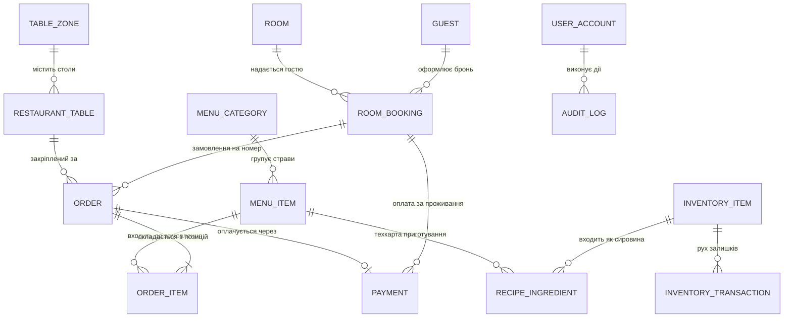

# Специфікація схеми бази даних LuxeResto HoReCa OS

У цьому документі детально описано реляційну схему бази даних комплексу, зв'язки між сутностями, типи даних, обмеження цілісності, індекси та стратегію міграцій для **PostgreSQL 16+** та **SQLite 3**.

---

## 1. Повна діаграма сутностей (Entity-Relationship Diagram)



---

## 2. Детальний опис таблиць бази даних

### 2.1. Ресторанний модуль

#### Таблиця `TableZones` (Зали ресторану)
| Колонка | Тип даних | Обмеження | Опис |
| :--- | :--- | :--- | :--- |
| `Id` | `int` | Primary Key, Identity | Унікальний ідентифікатор зони/залу |
| `Name` | `varchar(100)` | Not Null | Назва залу («Основний зал», «Літня тераса», «VIP Лаундж») |
| `Description` | `varchar(255)` | Nullable | Короткий опис або розташування |
| `DisplayOrder`| `int` | Not Null, Default 0 | Порядок сортування в табах POS |

#### Таблиця `RestaurantTables` (Столики)
| Колонка | Тип даних | Обмеження | Опис |
| :--- | :--- | :--- | :--- |
| `Id` | `int` | Primary Key, Identity | Унікальний ID столика |
| `ZoneId` | `int` | Foreign Key -> `TableZones(Id)` | Прив'язка до залу |
| `TableNumber`| `int` | Not Null, Unique | Номер столика, видимий офіціантові |
| `Capacity` | `int` | Not Null | Кількість посадкових місць (2, 4, 6, 8, 10) |
| `Status` | `int` | Enum (`TableStatus`) | 0 = Free, 1 = Reserved, 2 = Occupied, 3 = BillRequested |
| `Shape` | `int` | Enum (`TableShape`) | 0 = Round, 1 = Square, 2 = Rectangle |
| `PositionX` | `int` | Not Null | Координата X на інтерактивній схемі залу |
| `PositionY` | `int` | Not Null | Координата Y на інтерактивній схемі залу |
| `Width` | `int` | Not Null | Ширина віджета столика в пікселях |
| `Height` | `int` | Not Null | Висота віджета столика в пікселях |

#### Таблиця `MenuCategories` (Категорії меню)
| Колонка | Тип даних | Обмеження | Опис |
| :--- | :--- | :--- | :--- |
| `Id` | `int` | Primary Key, Identity | ID категорії |
| `Name` | `varchar(100)` | Not Null | Назва («Холодні закуски», «Гарячі страви», «Десерти») |
| `DisplayOrder`| `int` | Not Null | Порядок сортування в каруселі категорій |
| `RouteToKitchen`| `bool` | Not Null, Default true | Чи відправляються позиції категорії на KDS кухні |

#### Таблиця `MenuItems` (Страви та напої)
| Колонка | Тип даних | Обмеження | Опис |
| :--- | :--- | :--- | :--- |
| `Id` | `int` | Primary Key, Identity | ID страви |
| `CategoryId` | `int` | Foreign Key -> `MenuCategories(Id)` | Батьківська категорія |
| `Name` | `varchar(150)` | Not Null | Повна назва страви |
| `Description` | `varchar(500)` | Nullable | Склад, інгредієнти, рекомендації подачі |
| `Price` | `decimal(10,2)`| Not Null | Роздрібна ціна (у національній валюті ₴) |
| `PreparationMinutes` | `int` | Not Null, Default 15 | Нормативний час приготування для KDS-таймера |
| `IsAvailable` | `bool` | Not Null, Default true | Доступність у меню (Stop-List) |
| `ImageUrl` | `varchar(255)` | Nullable | Відносний шлях до фотографії страви в Assets |

#### Таблиця `Orders` (Замовлення)
| Колонка | Тип даних | Обмеження | Опис |
| :--- | :--- | :--- | :--- |
| `Id` | `int` | Primary Key, Identity | ID замовлення |
| `OrderNumber`| `varchar(30)` | Not Null, Unique | Фіскальний номер замовлення (напр. «ORD-2026-0042») |
| `TableId` | `int` | Foreign Key -> `RestaurantTables(Id)` | Стіл, за яким створено замовлення |
| `WaiterId` | `int` | Foreign Key -> `Users(Id)` | Офіціант, закріплений за замовленням |
| `BookingId` | `int` | Nullable, FK -> `RoomBookings(Id)` | Заповнюється при замовленні на номер готелю |
| `CreatedAt` | `timestamp` | Not Null | Дата та час відкриття замовлення |
| `ClosedAt` | `timestamp` | Nullable | Дата та час закриття й оплати |
| `Status` | `int` | Enum (`OrderStatus`) | 0 = New, 1 = InKitchen, 2 = Ready, 3 = Served, 4 = Paid, 5 = Cancelled |
| `SubTotal` | `decimal(10,2)`| Not Null | Сума без знижки та податків |
| `Discount` | `decimal(10,2)`| Not Null, Default 0 | Сума наданої знижки |
| `Tax` | `decimal(10,2)`| Not Null, Default 0 | ПДВ / акцизний збір |
| `TotalAmount`| `decimal(10,2)`| Not Null | Підсумкова сума до сплати |

#### Таблиця `OrderItems` (Рядки замовлення)
| Колонка | Тип даних | Обмеження | Опис |
| :--- | :--- | :--- | :--- |
| `Id` | `int` | Primary Key, Identity | ID рядка замовлення |
| `OrderId` | `int` | Foreign Key -> `Orders(Id)` | Замовлення-власник |
| `MenuItemId`| `int` | Foreign Key -> `MenuItems(Id)` | Замовлена страва |
| `Quantity` | `int` | Not Null, Check > 0 | Кількість порцій |
| `UnitPrice` | `decimal(10,2)`| Not Null | Ціна на момент формування замовлення |
| `TotalPrice` | `decimal(10,2)`| Not Null | `Quantity * UnitPrice` |
| `ItemStatus` | `int` | Enum (`OrderItemStatus`) | Статус приготування: 0 = Queued, 1 = Cooking, 2 = Done |
| `SpecialNotes`| `varchar(255)`| Nullable | Коментар кухарю («без цибулі», «medium rare») |

---

### 2.2. Готельний модуль

#### Таблиця `Rooms` (Номерний фонд)
| Колонка | Тип даних | Обмеження | Опис |
| :--- | :--- | :--- | :--- |
| `Id` | `int` | Primary Key, Identity | ID номера |
| `RoomNumber` | `varchar(10)` | Not Null, Unique | Номер кімнати («101», «204-Deluxe») |
| `RoomType` | `int` | Enum (`RoomType`) | 0 = Standard, 1 = Superior, 2 = JuniorSuite, 3 = PresidentialSuite |
| `Floor` | `int` | Not Null | Поверх розташування |
| `Capacity` | `int` | Not Null | Максимальна кількість гостей |
| `BasePrice` | `decimal(10,2)`| Not Null | Вартість доби проживання |
| `Status` | `int` | Enum (`RoomStatus`) | 0 = Available, 1 = Occupied, 2 = Maintenance, 3 = Cleaning |

#### Таблиця `RoomBookings` (Бронювання та поселення)
| Колонка | Тип даних | Обмеження | Опис |
| :--- | :--- | :--- | :--- |
| `Id` | `int` | Primary Key, Identity | ID бронювання |
| `BookingNumber`| `varchar(30)` | Not Null, Unique | Номер броні («BKG-2026-0104») |
| `RoomId` | `int` | Foreign Key -> `Rooms(Id)` | Заброньований номер |
| `GuestId` | `int` | Foreign Key -> `Guests(Id)` | Гість-замовник |
| `CheckInDate` | `date` | Not Null | Дата заїзду (Check-In) |
| `CheckOutDate`| `date` | Not Null | Дата виїзду (Check-Out) |
| `TotalCost` | `decimal(10,2)`| Not Null | Повна розрахована вартість проживання |
| `Status` | `int` | Enum (`BookingStatus`) | 0 = Reserved, 1 = CheckedIn, 2 = CheckedOut, 3 = Cancelled |

---

### 2.3. Складський облік (Inventory)

#### Таблиця `InventoryItems` (Сировина та запаси)
| Колонка | Тип даних | Обмеження | Опис |
| :--- | :--- | :--- | :--- |
| `Id` | `int` | Primary Key, Identity | ID сировини |
| `Sku` | `varchar(50)` | Not Null, Unique | Артикул товару на складі |
| `Name` | `varchar(120)` | Not Null | Найменування («Яловичина витриманий рібай», «Вершки 33%») |
| `CurrentStock`| `decimal(10,3)`| Not Null | Поточний фізичний залишок |
| `UnitOfMeasure`| `varchar(20)` | Not Null | Одиниця виміру («кг», «л», «шт») |
| `SafetyThreshold`| `decimal(10,3)`| Not Null | Критичний поріг (при падінні нижче — статус Danger) |
| `UnitCost` | `decimal(10,2)`| Not Null | Собівартість одиниці |

---

## 3. Стратегія подвійної персистентності (Dual-Persistence Strategy)

Система підтримує роботу в двох режимах через конфігураційний ключ у `appsettings.json`:

```json
{
  "Database": {
    "Provider": "Sqlite" // або "PostgreSql"
  },
  "ConnectionStrings": {
    "DefaultConnection": "Data Source=horeca_local.db",
    "PostgreSql": "Host=localhost;Port=5432;Database=horeca_db;Username=postgres;Password=postgres",
    "SqliteFallback": "Data Source=horeca_local.db"
  }
}
```

1. **Enterprise режим (PostgreSQL):**
   - Використовує конектор `Npgsql.EntityFrameworkCore.PostgreSQL`.
   - Забезпечує повну паралельну роботу десятків терміналів у ресторані та на рецепції з високим рівнем транзакційної ізоляції (`ReadCommitted`).
2. **Автономний режим (SQLite Fallback):**
   - Використовує `Microsoft.EntityFrameworkCore.Sqlite`.
   - Не потребує встановлення жодних серверів баз даних; файл `horeca_local.db` створюється автоматично при старті програми.
   - Ідеально підходить для демонстрації, локального тестування та роботи при аварійному відключенні зв'язку із сервером.
