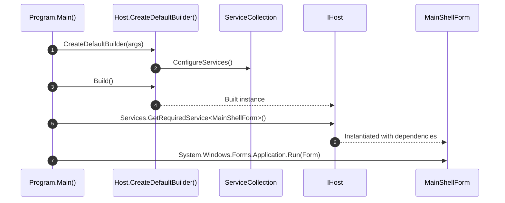

# Lesson 01: Microsoft Generic Host & Dependency Injection in Windows Forms

## 1. Overview

Traditional Windows Forms applications often start from a static `Main` method:
```csharp
[STAThread]
static void Main()
{
    Application.EnableVisualStyles();
    Application.SetCompatibleTextRenderingDefault(false);
    Application.Run(new Form1());
}
```
In enterprise environments, this pattern leads to tightly-coupled code, static state managers, and untestable user interfaces. In this lesson, we transform Windows Forms into a modern .NET 10 architecture using `Microsoft.Extensions.Hosting`.

---

## 2. Setting Up Generic Host

By creating an `IHost` inside `Program.cs`, we gain:
- Unified configuration via `appsettings.json` and environment variables.
- Structured logging via Serilog.
- Comprehensive Dependency Injection (`IServiceCollection`).
- Lifecycle management and graceful shutdown.



---

## 3. Implementation Code

### Entry Point (`Program.cs`)

```csharp
using Microsoft.Extensions.Configuration;
using Microsoft.Extensions.DependencyInjection;
using Microsoft.Extensions.Hosting;
using Serilog;
using System.Windows.Forms;

namespace HoReCa.WinForms;

static class Program
{
    [STAThread]
    static void Main(string[] args)
    {
        ApplicationConfiguration.Initialize();

        var host = Host.CreateDefaultBuilder(args)
            .ConfigureAppConfiguration((context, config) =>
            {
                config.AddJsonFile("appsettings.json", optional: true, reloadOnChange: true);
                config.AddEnvironmentVariables();
            })
            .UseSerilog((context, services, configuration) =>
            {
                configuration
                    .ReadFrom.Configuration(context.Configuration)
                    .Enrich.FromLogContext();
            })
            .ConfigureServices((context, services) =>
            {
                // Register Infrastructure, Application, and UI services
                ConfigureApplicationServices(services, context.Configuration);
            })
            .Build();

        using var scope = host.Services.CreateScope();
        var mainForm = scope.ServiceProvider.GetRequiredService<MainShellForm>();

        System.Windows.Forms.Application.Run(mainForm);
    }
}
```

---

## 4. Registering Forms in the DI Container

Forms should generally be registered as **Transient** so that when a form is closed, its resources can be garbage-collected without retaining stale state:

```csharp
services.AddTransient<MainShellForm>();
services.AddTransient<PosTerminalForm>();
services.AddTransient<HotelFrontDeskForm>();
services.AddTransient<KitchenDisplayForm>();
services.AddTransient<InventoryForm>();
services.AddTransient<AnalyticsForm>();
```

### Constructor Injection inside Forms

```csharp
public partial class PosTerminalForm : Form
{
    private readonly ITablePosService _posService;
    private readonly IReceiptPrintService _printService;
    private readonly ILogger<PosTerminalForm> _logger;

    public PosTerminalForm(
        ITablePosService posService,
        IReceiptPrintService printService,
        ILogger<PosTerminalForm> logger)
    {
        _posService = posService;
        _printService = printService;
        _logger = logger;
        InitializeComponent();
    }
}
```

---

## 5. Key Takeaways

1. **Namespace Collision**: When an application project is named `HoReCa.Application`, typing `Application.Run()` resolves to the namespace rather than `System.Windows.Forms.Application`. Always qualify `System.Windows.Forms.Application.Run()`.
2. **High-DPI**: Call `ApplicationConfiguration.Initialize()` before resolving or instantiating any UI controls.
3. **Transient Forms**: Do not register modal forms or document windows as singletons to prevent memory leaks.
