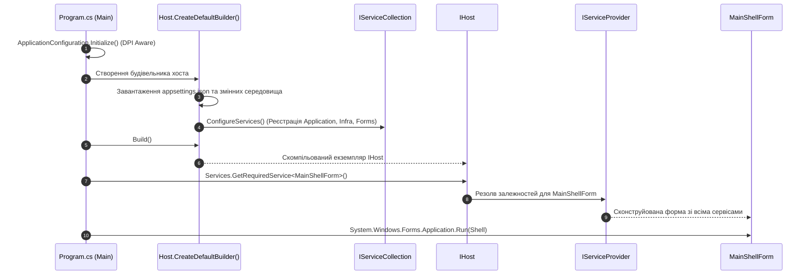

# Практичний гайд 01: Microsoft Generic Host та Dependency Injection у Windows Forms

## 1. Теоретична база та інженерний контекст

У традиційних застосунках Windows Forms точку входу зазвичай реалізовано примітивно:
```csharp
[STAThread]
static void Main()
{
    Application.EnableVisualStyles();
    Application.SetCompatibleTextRenderingDefault(false);
    Application.Run(new Form1());
}
```
Такий підхід породжує класичні архітектурні проблеми корпоративного ПЗ:
- Використання статичних класів-одинаків (*Singletons / ServiceLocators*), які неможливо ізолювати в тестах.
- Жорстка прив'язка форм до конкретних класів баз даних (`new HoReCaDbContext()`).
- Неможливість централізованого логування помилок через єдиний pipeline.
- Труднощі з налаштуванням конфігурації для різних середовищ (*Development / Staging / Production*).

У сучасній екосистемі **.NET 10** стандартом побудови будь-яких застосунків (Web, Desktop, Worker Services) є **Microsoft Generic Host** (`Microsoft.Extensions.Hosting`). Використання Generic Host у WinForms перетворює десктопний клієнт на повноцінне enterprise-рішення з вбудованим контейнером впровадження залежностей (**Dependency Injection**), структурованим логуванням Serilog та конфігурацією з `appsettings.json`.

---

## 2. Архітектурна схема ініціалізації хоста

Діаграма послідовності демонструє, як створюється хост, реєструються сервіси та запускається головна форма:



---

## 3. Детальний розбір реалізації в проєкті

### 3.1. Точка входу: [`Program.cs`](file:///C:/Users/Yurii/source/repos/- MASTERY/WinForms-HoReCa-Mastery/src/HoReCa.WinForms/Program.cs)

У файлі [`Program.cs`](file:///C:/Users/Yurii/source/repos/- MASTERY/WinForms-HoReCa-Mastery/src/HoReCa.WinForms/Program.cs) запуск програми налаштовано наступним чином:

```csharp
namespace HoReCa.WinForms;

static class Program
{
    [STAThread]
    static void Main(string[] args)
    {
        // 1. Активація сучасного рендерингу шрифтів та High-DPI масштабування
        ApplicationConfiguration.Initialize();

        // 2. Створення Microsoft Generic Host
        var host = Host.CreateDefaultBuilder(args)
            .ConfigureAppConfiguration((context, config) =>
            {
                config.SetBasePath(AppContext.BaseDirectory);
                config.AddJsonFile("appsettings.json", optional: true, reloadOnChange: true);
                config.AddEnvironmentVariables();
            })
            .UseSerilog((context, services, configuration) =>
            {
                configuration
                    .MinimumLevel.Information()
                    .Enrich.FromLogContext()
                    .WriteTo.Console();
            })
            .ConfigureServices((context, services) =>
            {
                // Реєстрація шарів Clean Architecture
                services.AddApplicationServices();
                services.AddInfrastructureServices(context.Configuration);
                services.AddWinFormsPresentation();
            })
            .Build();

        // 3. Автоматичний запуск міграцій та сидера Bogus
        using (var scope = host.Services.CreateScope())
        {
            var dbContext = scope.ServiceProvider.GetRequiredService<HoReCaDbContext>();
            dbContext.Database.EnsureCreated();
            DbSeeder.SeedAsync(dbContext).GetAwaiter().GetResult();
        }

        // 4. Запуск головної оболонки через DI-контейнер
        var mainShell = host.Services.GetRequiredService<MainShellForm>();
        Application.Run(mainShell);
    }
}
```

### 3.2. Реєстрація форм і віджетів: [`DependencyInjection.cs`](file:///C:/Users/Yurii/source/repos/- MASTERY/WinForms-HoReCa-Mastery/src/HoReCa.WinForms/DependencyInjection.cs)

Форми мають різний життєвий цикл залежностей:
- **`Singleton`:** Головна форма [`MainShellForm.cs`](file:///C:/Users/Yurii/source/repos/- MASTERY/WinForms-HoReCa-Mastery/src/HoReCa.WinForms/Forms/MainShellForm.cs), шина подій та монітор пам'яті.
- **`Transient`:** Модальні вікна редагування замовлень ([`CreateBookingDialog.cs`](file:///C:/Users/Yurii/source/repos/- MASTERY/WinForms-HoReCa-Mastery/src/HoReCa.WinForms/Forms/CreateBookingDialog.cs)), які повинні створюватися щоразу з чистим станом.

---

## 4. Підводні камені та типові помилки

> [!WARNING]
> **Життєвий цикл DbContext у Windows Forms:**
> Ніколи не реєструйте `HoReCaDbContext` як `Singleton`! У десктопних застосунках користувач може одночасно відкрити монітор кухні KDS та вносити замовлення на касі. Спроба паралельного звернення до одного екземпляра `DbContext` призведе до винятку `InvalidOperationException: A second operation was started on this context instance before a previous operation completed`.
> **Правильне рішення:** використання `IDbContextFactory<HoReCaDbContext>` або створення `IServiceScope` для кожного окремого фонового завдання.

---

## 5. Практичний чек-лист для закріплення
1. [ ] Перевірити, що вхідний потік позначений атрибутом `[STAThread]`.
2. [ ] Переконатися, що `ApplicationConfiguration.Initialize()` викликається до створення будь-яких контролів.
3. [ ] Усі форми резолвляться виключно через `host.Services.GetRequiredService<TForm>()`.
4. [ ] Ресурси `IHost` коректно звільняються при виході з програми.
