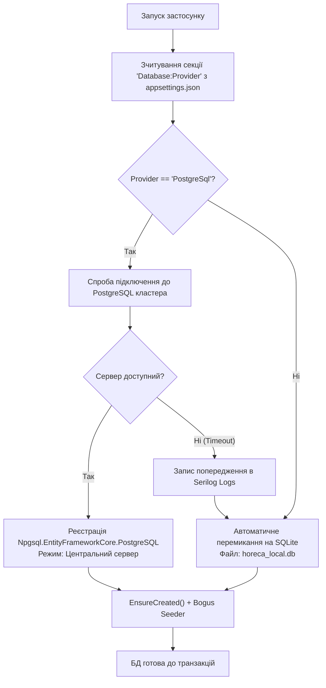

# Практичний гайд 02: Стратегія подвійної бази даних (PostgreSQL + SQLite Fallback)

## 1. Теоретична база та бізнес-контекст

У сфері **HoReCa** надійність бази даних — це питання безперервності бізнесу. Якщо центральний сервер ресторану або хмарний кластер PostgreSQL стає недоступним через обрив інтернет-кабелю, офіціанти не можуть зупинити видачу рахунків, а кухня не повинна припиняти готувати страви.

Для вирішення цієї проблеми в архітектурі **LuxeResto** застосовано **стратегію подвійної персистентності (*Dual-Persistence Strategy*)**:
1. **Основний режим (PostgreSQL 16+):** Використовується в робочій мережі комплексу для багатокористувацької синхронізації десятків терміналів POS, моніторів шеф-кухаря та робочих станцій рецепції готелю.
2. **Автономний режим (SQLite 3 Fallback):** Вмикається автоматично або через конфігурацію. Не потребує встановлення жодного сервера СУБД, база даних зберігається у файлі `horeca_local.db`.

---

## 2. Архітектурна схема перемикання провайдерів



---

## 3. Детальний розбір реалізації в проєкті

### 3.1. Конфігурація сервісів: [`DependencyInjection.cs`](file:///C:/Users/Yurii/source/repos/- MASTERY/WinForms-HoReCa-Mastery/src/HoReCa.Infrastructure/DependencyInjection.cs)

У проєкті [`HoReCa.Infrastructure`](file:///C:/Users/Yurii/source/repos/- MASTERY/WinForms-HoReCa-Mastery/src/HoReCa.Infrastructure) вибір бази даних реалізовано так:

```csharp
public static IServiceCollection AddInfrastructureServices(this IServiceCollection services, IConfiguration configuration)
{
    var provider = configuration["Database:Provider"] ?? "Sqlite";
    var pgConn = configuration.GetConnectionString("PostgreSql");
    var sqliteConn = configuration.GetConnectionString("SqliteFallback") ?? "Data Source=horeca_local.db";

    if (provider.Equals("PostgreSql", StringComparison.OrdinalIgnoreCase) && !string.IsNullOrEmpty(pgConn))
    {
        services.AddDbContextFactory<HoReCaDbContext>(options =>
            options.UseNpgsql(pgConn, b => b.MigrationsAssembly(typeof(HoReCaDbContext).Assembly.FullName)));
    }
    else
    {
        services.AddDbContextFactory<HoReCaDbContext>(options =>
            options.UseSqlite(sqliteConn, b => b.MigrationsAssembly(typeof(HoReCaDbContext).Assembly.FullName)));
    }

    return services;
}
```

### 3.2. Детерміністичний сидер даних: [`DbSeeder.cs`](file:///C:/Users/Yurii/source/repos/- MASTERY/WinForms-HoReCa-Mastery/src/HoReCa.Infrastructure/Persistence/DbSeeder.cs)

Сидер використовує бібліотеку **Bogus** із зафіксованим `Randomizer.Seed = new Random(2026)` для того, щоб під час кожного тестування або демонстрації генерувалися однакові реалістичні дані:
- 3 зали ресторану (Основний зал, Літня тераса, VIP Лаундж).
- 16 столиків із точним просторовим розташуванням без перекриття.
- 42 страви з цінами, часом приготування та зв'язком з якісними фотографіями в `Assets/Images/Dishes/`.
- 10 номерів готелю різних категорій та початкові бронювання.

---

## 4. Підводні камені та типові помилки

> [!IMPORTANT]
> **Відмінності синтаксису SQLite та PostgreSQL:**
> - SQLite не підтримує типи `decimal` нативно (зберігає як `TEXT` або `REAL`), що може викликати помилки округлення копійок. В [`HoReCaDbContext.cs`](file:///C:/Users/Yurii/source/repos/- MASTERY/WinForms-HoReCa-Mastery/src/HoReCa.Infrastructure/Persistence/HoReCaDbContext.cs) налаштовано автоматичне перетворення через `HasPrecision(10, 2)`.
> - SQLite має обмеження на паралельні операції запису (`database is locked`). Застосування фабрики `IDbContextFactory` з транзакціями малого обсягу повністю нівелює цю проблему.

---

## 5. Практичний чек-лист для закріплення
1. [ ] Перевірити наявність файлу `appsettings.json` у вихідній директорії бінарних файлів.
2. [ ] Перевірити генерацію файлу `horeca_local.db` при відсутності сервера PostgreSQL.
3. [ ] Переконатися, що сидер заповнює таблиці лише за умови, що база даних пуста.
