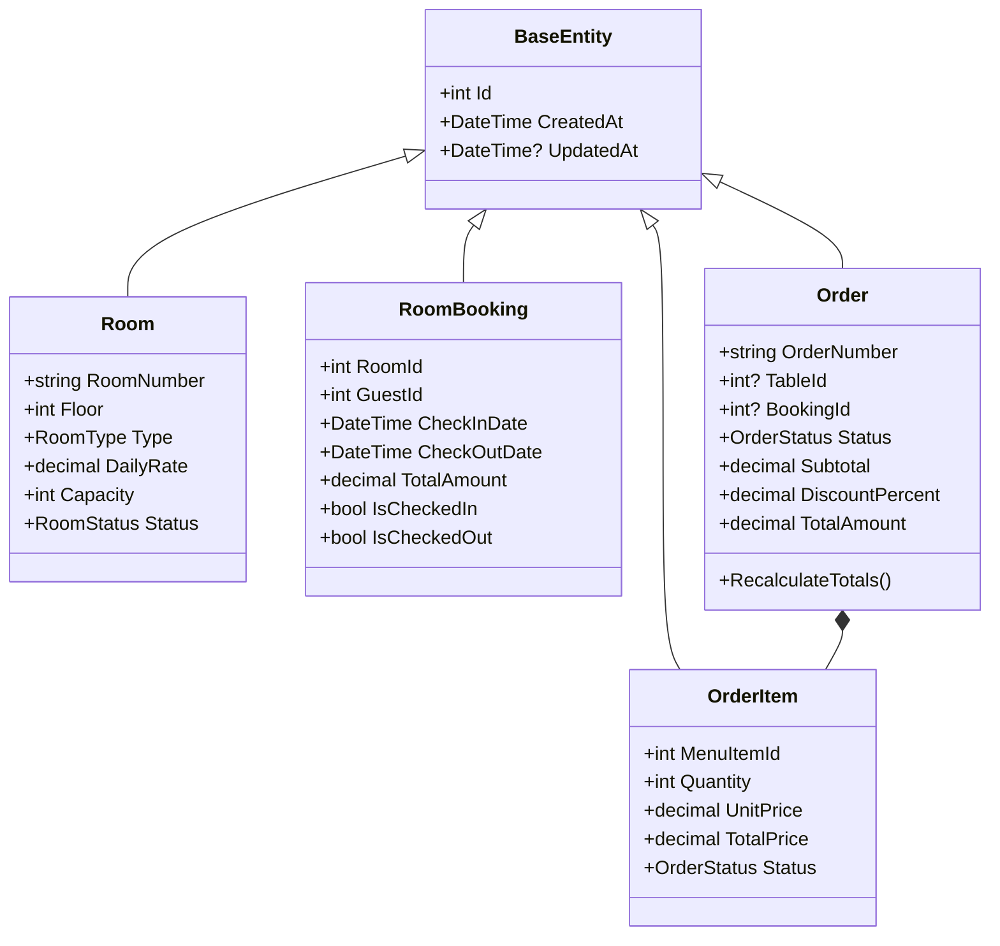

# Lesson 03: Domain Modeling & Encapsulation in HoReCa

## 1. Overview

An enterprise application requires rich domain models where business rules and invariants are encapsulated within the entities, rather than being scattered across UI event handlers.

In this lesson, we examine:
- Aggregate roots and entity relationships.
- Strongly-typed domain enums.
- Encapsulated calculation methods (`RecalculateTotals()`, `IsLowStock`).

---

## 2. Domain Structure

The domain contains two primary subdomains: **Hotel (Front-Desk)** and **Restaurant (POS & Kitchen)**.



---

## 3. Encapsulating Business Logic

### Order Calculation Logic

Rather than computing order totals in the UI, the `Order` entity owns its calculation invariant:

```csharp
public class Order : BaseEntity
{
    public string OrderNumber { get; set; } = string.Empty;
    public decimal Subtotal { get; set; }
    public decimal DiscountPercent { get; set; }
    public decimal TotalAmount { get; set; }

    public ICollection<OrderItem> Items { get; set; } = new List<OrderItem>();

    public void RecalculateTotals()
    {
        Subtotal = Items.Sum(i => i.Quantity * i.UnitPrice);
        
        if (DiscountPercent > 0)
        {
            var discount = Subtotal * (DiscountPercent / 100m);
            TotalAmount = Math.Max(0, Subtotal - discount);
        }
        else
        {
            TotalAmount = Subtotal;
        }

        UpdatedAt = DateTime.UtcNow;
    }
}
```

### Inventory Threshold Logic

```csharp
public class InventoryItem : BaseEntity
{
    public string Name { get; set; } = string.Empty;
    public string SKU { get; set; } = string.Empty;
    public decimal CurrentStock { get; set; }
    public decimal MinimumStock { get; set; }
    public decimal CostPerUnit { get; set; }

    public bool IsLowStock => CurrentStock <= MinimumStock;
}
```

---

## 4. Key Takeaways

1. **Entities are not pure bags of getters/setters**: Encapsulating mutations (e.g. recalculating totals or changing status) ensures consistency regardless of whether the call originates from a desktop UI, a unit test, or an automated batch worker.
2. **Precision in Money**: Always use `decimal` for prices, discounts, and totals with EF Core precision mapping `HasPrecision(12, 2)`.
