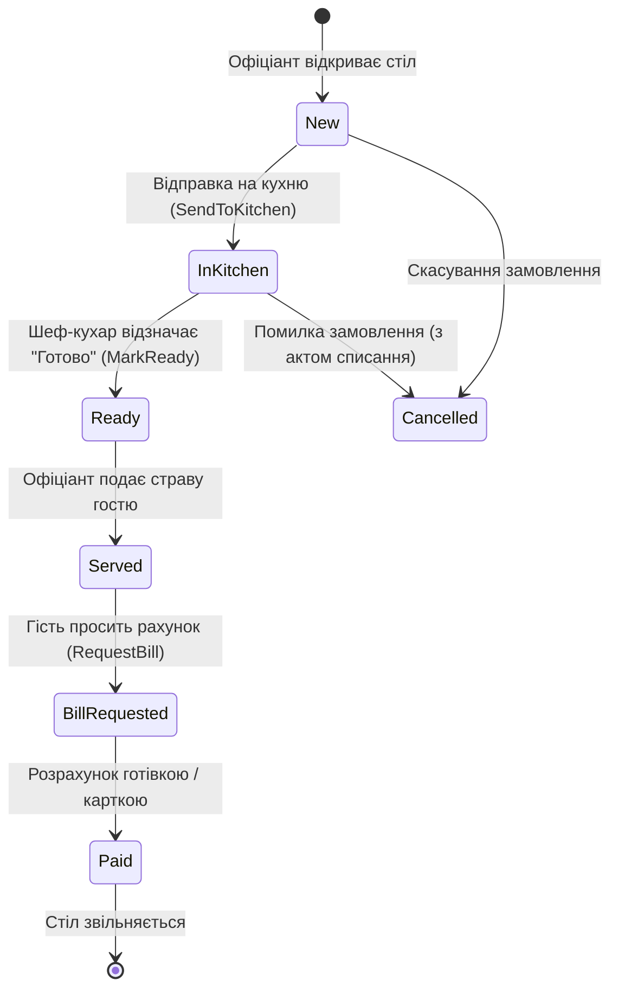

# Практичний гайд 03: Domain-Driven Design (DDD) та бізнес-інваріанти у ресторанному комплексі

## 1. Теоретична база та концепція DDD

У багатьох аматорських проєктах класи моделей є «анемічними» (*Anemic Domain Model*): вони містять лише гетери і сетери `{ get; set; }`, а вся логіка калькуляцій та перевірок розкидана по UI-формах. Це призводить до катастрофічних наслідків у фінансовому секторі (наприклад, сума замовлення порахована на касі відрізняється від суми, списаної на складі).

За принципами **Domain-Driven Design (DDD)** сутність повинна самостійно захищати свої бізнес-інваріанти:
- Стан замовлення може змінюватися тільки за чіткими правилами життєвого циклу.
- Калькуляція знижок, чайових та податків інкапсульована в метод сутності.
- Сутності не залежать від інтерфейсу чи бібліотек збереження даних.

---

## 2. Діаграма станів замовлення (Order State Lifecycle)



---

## 3. Детальний розбір реалізації в проєкті

### 3.1. Агрегат замовлення: [`Order.cs`](file:///C:/Users/Yurii/source/repos/- MASTERY/WinForms-HoReCa-Mastery/src/HoReCa.Domain/Entities/Order.cs)

У сутності [`Order`](file:///C:/Users/Yurii/source/repos/- MASTERY/WinForms-HoReCa-Mastery/src/HoReCa.Domain/Entities/Order.cs) бізнес-логіка розрахунку чека реалізована наступним чином:

```csharp
public class Order : BaseEntity
{
    public string OrderNumber { get; set; } = string.Empty;
    public int TableId { get; set; }
    public OrderStatus Status { get; set; } = OrderStatus.New;
    public List<OrderItem> Items { get; set; } = new();

    public decimal SubTotal { get; private set; }
    public decimal DiscountAmount { get; private set; }
    public decimal TaxAmount { get; private set; }
    public decimal TipAmount { get; private set; }
    public decimal TotalAmount { get; private set; }

    public void RecalculateTotals(decimal discountPercent = 0, decimal tipPercent = 0, decimal taxRate = 0.05m)
    {
        SubTotal = Items.Sum(i => i.Quantity * i.UnitPrice);
        DiscountAmount = Math.Round(SubTotal * (discountPercent / 100m), 2);
        var taxableBase = SubTotal - DiscountAmount;
        TaxAmount = Math.Round(taxableBase * taxRate, 2);
        TipAmount = Math.Round(taxableBase * (tipPercent / 100m), 2);
        TotalAmount = taxableBase + TaxAmount + TipAmount;
    }
}
```

### 3.2. Сутність столика: [`RestaurantTable.cs`](file:///C:/Users/Yurii/source/repos/- MASTERY/WinForms-HoReCa-Mastery/src/HoReCa.Domain/Entities/RestaurantTable.cs)

Столик зберігає просторові координати для інтерактивного полотна зали, форму (`Round`, `Square`, `Rectangle`) та поточний статус:
```csharp
public class RestaurantTable : BaseEntity
{
    public int TableNumber { get; set; }
    public int ZoneId { get; set; }
    public int Capacity { get; set; }
    public TableStatus Status { get; set; } = TableStatus.Free;
    public TableShape Shape { get; set; } = TableShape.Rectangle;
    public int PositionX { get; set; }
    public int PositionY { get; set; }
    public int Width { get; set; }
    public int Height { get; set; }
}
```

---

## 4. Підводні камені та типові помилки

> [!WARNING]
> **Округлення банківське vs фінансове:**
> За замовчуванням метод `Math.Round(val, 2)` у C# використовує банківське округлення (*Banker's Rounding* або *ToEven*). У фіскальному обліку ресторанів законодавство вимагає стандартного комерційного округлення `MidpointRounding.AwayFromZero`, інакше сума в чеку може відрізнятися на 1 копійку від суми позицій.

---

## 5. Практичний чек-лист для закріплення
1. [ ] Перевірити, що зміна суми замовлення відбувається виключно через метод `RecalculateTotals()`.
2. [ ] Переконатися, що додавання нової страви перевіряє статус замовлення (не можна додавати позиції в оплачений чек).
3. [ ] Написати юніт-тест для перевірки калькуляції знижки 10% та чайових 5%.
