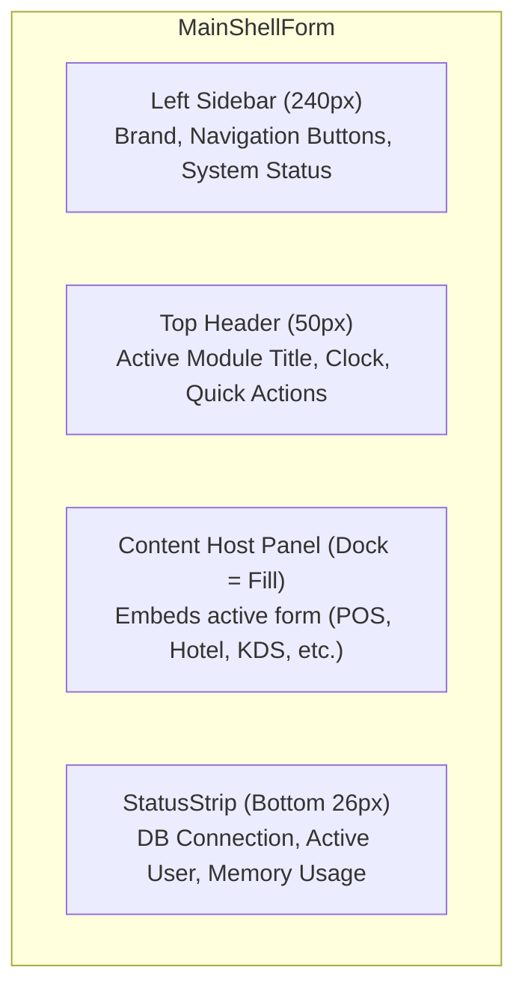

# Lesson 04: Modern Dark Shell & Navigation Architecture

## 1. Overview

Enterprise desktop applications should avoid opening dozens of overlapping top-level windows. A modern approach uses a **Shell Architecture** with a permanent sidebar, header, and a dynamic content host panel (`contentPanel`) that swaps child user controls or top-level forms hosted with `TopLevel = false`.

---

## 2. Shell Layout Structure



---

## 3. Dynamic Form Hosting Pattern

To host a form inside a panel container without borders or caption bars:

```csharp
private Form? _activeForm;

public void NavigateTo<TForm>() where TForm : Form
{
    // Resolve form from DI container
    var form = _serviceProvider.GetRequiredService<TForm>();

    // Dispose old active form
    if (_activeForm != null)
    {
        pnlContent.Controls.Remove(_activeForm);
        _activeForm.Dispose();
    }

    _activeForm = form;

    // Configure form as child of panel
    form.TopLevel = false;
    form.FormBorderStyle = FormBorderStyle.None;
    form.Dock = DockStyle.Fill;

    pnlContent.Controls.Add(form);
    pnlContent.Tag = form;
    form.Show();
}
```

---

## 4. Theme & Styling Strategy

A unified color palette keeps enterprise software cohesive and ergonomic during long working shifts:

```csharp
public static class ThemePalette
{
    public static readonly Color BackgroundDark = Color.FromArgb(15, 23, 42);    // Slate 900
    public static readonly Color SurfaceDark    = Color.FromArgb(30, 41, 59);    // Slate 800
    public static readonly Color SurfaceCard    = Color.FromArgb(51, 65, 85);    // Slate 700
    public static readonly Color PrimaryAccent  = Color.FromArgb(16, 185, 129);  // Emerald 500
    public static readonly Color CyanAccent     = Color.FromArgb(6, 182, 212);   // Cyan 500
    public static readonly Color RubyAccent     = Color.FromArgb(239, 68, 68);   // Red 500
    public static readonly Color TextPrimary    = Color.FromArgb(248, 250, 252); // Slate 50
    public static readonly Color TextMuted      = Color.FromArgb(148, 163, 184); // Slate 400
}
```

---

## 5. Live Status Updates with System Timers

To display a live clock and monitor memory in the `StatusStrip`:

```csharp
var timer = new System.Windows.Forms.Timer { Interval = 1000 };
timer.Tick += (s, e) =>
{
    lblClock.Text = DateTime.Now.ToString("HH:mm:ss | dd.MM.yyyy");
    var memMb = GC.GetTotalMemory(false) / (1024.0 * 1024.0);
    lblMemory.Text = $"RAM: {memMb:F1} MB";
};
timer.Start();
```
