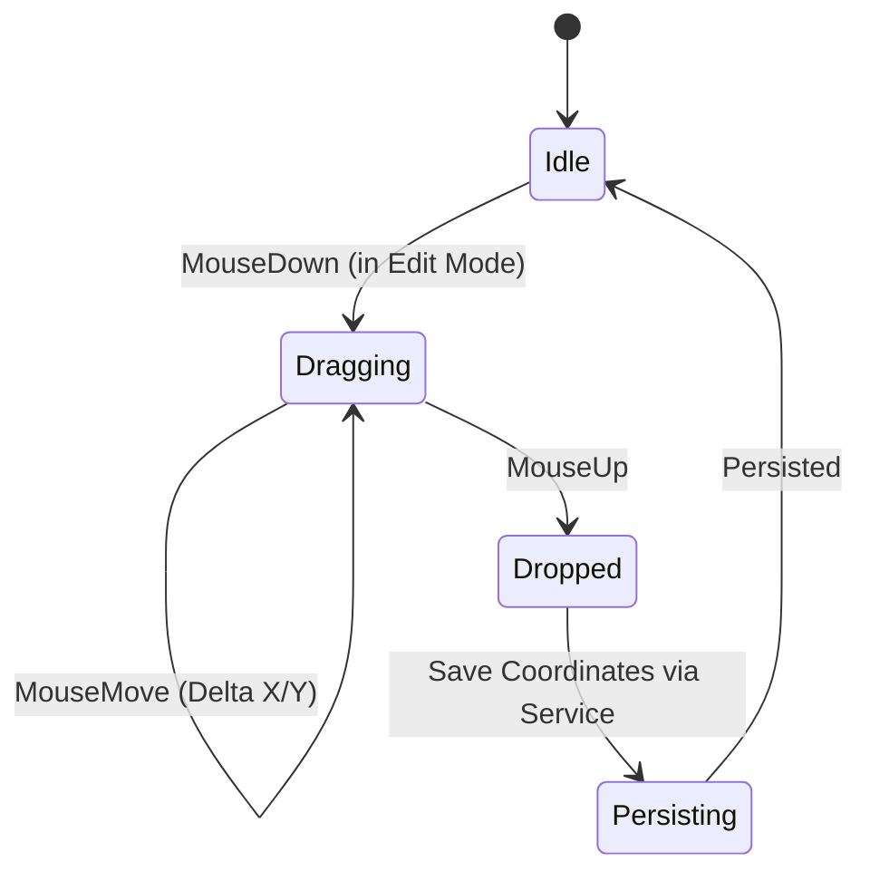

# Lesson 05: Interactive Floor Plan & Drag-and-Drop Mechanics

## 1. Overview

In restaurant management, managers need the freedom to re-arrange physical tables to mirror the dining room layout. This lesson demonstrates how to build an interactive 2D canvas with draggable custom user controls and coordinate persistence.

---

## 2. The Custom FloorTableWidget Control

Each table on the floor plan is rendered by `FloorTableWidget`, a custom `UserControl` that supports:
- Circular or rectangular shapes based on `TableShape`.
- Color status indication: Green (Free), Amber (Occupied), Cyan (Bill Requested), Blue (Reserved).
- Drag-and-drop movement when in "Edit Layout" mode.
- Click selection for opening active orders.



---

## 3. Implementing Drag Mechanics

```csharp
public partial class FloorTableWidget : UserControl
{
    private bool _isDragging;
    private Point _dragStartPoint;
    public bool EditModeEnabled { get; set; }

    public event EventHandler<Point>? PositionChanged;

    protected override void OnMouseDown(MouseEventArgs e)
    {
        base.OnMouseDown(e);
        if (e.Button == MouseButtons.Left && EditModeEnabled)
        {
            _isDragging = true;
            _dragStartPoint = e.Location;
            BringToFront();
        }
    }

    protected override void OnMouseMove(MouseEventArgs e)
    {
        base.OnMouseMove(e);
        if (_isDragging)
        {
            var deltaX = e.X - _dragStartPoint.X;
            var deltaY = e.Y - _dragStartPoint.Y;

            Left = Math.Max(0, Left + deltaX);
            Top = Math.Max(0, Top + deltaY);
        }
    }

    protected override void OnMouseUp(MouseEventArgs e)
    {
        base.OnMouseUp(e);
        if (_isDragging)
        {
            _isDragging = false;
            PositionChanged?.Invoke(this, Location);
        }
    }
}
```

---

## 4. Custom GDI+ Rendering with Anti-Aliasing

```csharp
protected override void OnPaint(PaintEventArgs e)
{
    var g = e.Graphics;
    g.SmoothingMode = SmoothingMode.AntiAlias;

    var rect = new Rectangle(2, 2, Width - 5, Height - 5);
    using var brush = new SolidBrush(GetStatusColor(Table.Status));
    using var pen = new Pen(Color.FromArgb(200, 255, 255, 255), 2);

    if (Table.Shape == TableShape.Round)
    {
        g.FillEllipse(brush, rect);
        g.DrawEllipse(pen, rect);
    }
    else
    {
        g.FillRectangle(brush, rect);
        g.DrawRectangle(pen, rect);
    }

    // Draw Table Number and Capacity
    var text = $"№ {Table.TableNumber}\n({Table.Capacity} місць)";
    using var font = new Font("Segoe UI", 9, FontStyle.Bold);
    using var textBrush = new SolidBrush(Color.White);
    var sf = new StringFormat { Alignment = StringAlignment.Center, LineAlignment = StringAlignment.Center };
    g.DrawString(text, font, textBrush, rect, sf);
}
```

---

## 5. Persistence via Asynchronous Application Service

When dragging completes, the parent form catches `PositionChanged` and informs `ITablePosService`:

```csharp
widget.PositionChanged += async (s, newPos) =>
{
    try
    {
        await _posService.UpdateTablePositionAsync(new UpdateTablePositionRequest(widget.Table.Id, newPos.X, newPos.Y));
        _logger.LogInformation("Saved table {TableNumber} coordinates ({X}, {Y})", widget.Table.TableNumber, newPos.X, newPos.Y);
    }
    catch (Exception ex)
    {
        _logger.LogError(ex, "Failed to persist table coordinates");
    }
};
```
