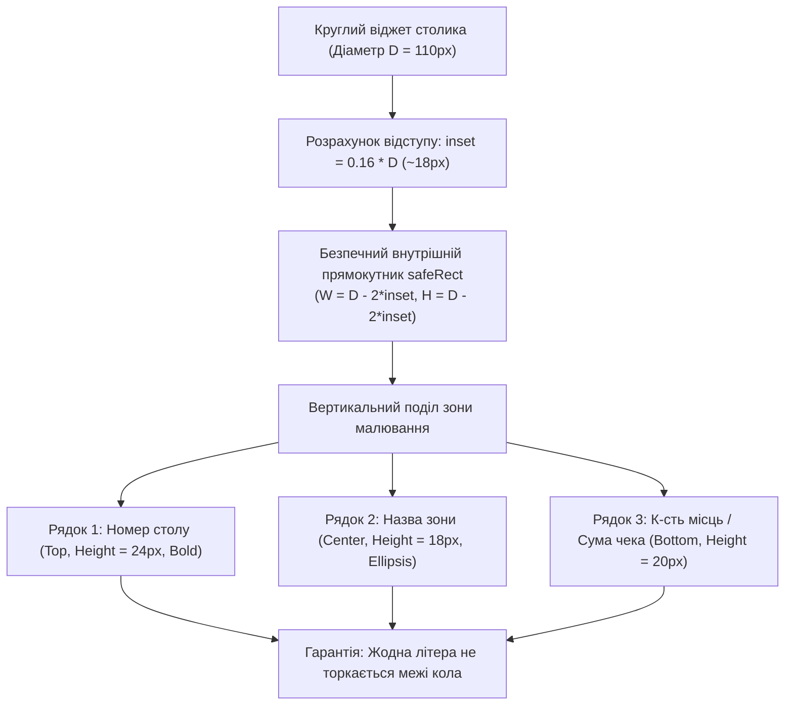

# Практичний гайд 05: Інтерактивна карта залів ресторану (Floor Plan) та розрахунок безпечної геометрії

## 1. Теоретична база та інженерний виклик

У ресторанах розташування столиків динамічно змінюється (банкетна розстановка, додавання літнього майданчика, злиття столів). Простий список столів у випадаючому списку є вкрай незручним для офіціантів під час запари. Необхідна **інтерактивна візуальна схема зали (Floor Plan)**.

При реалізації віджетів столів у WinForms виникають дві критичні математичні та графічні задачі:
1. **Проблема перекриття (Collision):** Столики з різних залів або при початковій генерації не повинні накладатися один на одного.
2. **Проблема вилізання тексту за межі круглих столів:** Оскільки текст малюється у прямокутних межах (`Rectangle`), на круглих столах кути прямокутника виходять за окружність, спричиняючи візуальне псування інтерфейсу.

---

## 2. Математика безпечного вписування прямокутника в коло

Для кола діаметром $D$ та радіусом $R = \frac{D}{2}$, довжина хорди на відстані $Y$ від центру визначається теоремою Піфагора. Щоб гарантувати, що блок тексту з відступами повністю поміщається всередині кола, прямокутник тексту обмежується відступом:
$$\text{Safe Inset} = 0.16 \times D$$



---

## 3. Детальний розбір реалізації в проєкті

### 3.1. Кастомний віджет столика: [`FloorTableWidget.cs`](file:///C:/Users/Yurii/source/repos/- MASTERY/WinForms-HoReCa-Mastery/src/HoReCa.WinForms/Controls/FloorTableWidget.cs)

У методі `OnPaint` віджета [`FloorTableWidget`](file:///C:/Users/Yurii/source/repos/- MASTERY/WinForms-HoReCa-Mastery/src/HoReCa.WinForms/Controls/FloorTableWidget.cs) застосовано розрахунок безпечної геометрії та згладжування GDI+:

```csharp
protected override void OnPaint(PaintEventArgs e)
{
    base.OnPaint(e);
    var g = e.Graphics;
    g.SmoothingMode = SmoothingMode.AntiAlias;
    g.TextRenderingHint = TextRenderingHint.ClearTypeGridFit;

    Rectangle safeRect;
    if (Shape == TableShape.Round)
    {
        int insetX = (int)(Width * 0.16f);
        int insetY = (int)(Height * 0.16f);
        safeRect = new Rectangle(insetX, insetY, Width - 2 * insetX, Height - 2 * insetY);
    }
    else
    {
        safeRect = new Rectangle(10, 8, Width - 20, Height - 16);
    }

    // Відмальовка форми (коло або закруглений прямокутник)
    using var bgBrush = new SolidBrush(GetStatusColor(Status));
    using var borderPen = new Pen(IsSelected ? Color.White : ThemePalette.BorderLight, IsSelected ? 2.5f : 1.2f);

    if (Shape == TableShape.Round)
    {
        g.FillEllipse(bgBrush, 2, 2, Width - 5, Height - 5);
        g.DrawEllipse(borderPen, 2, 2, Width - 5, Height - 5);
    }
    else
    {
        DrawRoundedRectangle(g, new Rectangle(2, 2, Width - 5, Height - 5), 8, bgBrush, borderPen);
    }

    // Текстовий рендеринг строго всередині safeRect
    DrawTableText(g, safeRect);
}
```

### 3.2. Просторовий розподіл столів: [`DbSeeder.cs`](file:///C:/Users/Yurii/source/repos/- MASTERY/WinForms-HoReCa-Mastery/src/HoReCa.Infrastructure/Persistence/DbSeeder.cs)

Щоб столики різних залів не накладалися в режимі «Всі зали», полотно розділене на просторові сектори:
- **Основний зал (Столи 1–8):** Лівий сектор ($X: 40 \dots 480$, $Y: 40 \dots 185$).
- **Літня тераса (Столи 11–16):** Правий сектор ($X: 660 \dots 960$, $Y: 40 \dots 185$).
- **VIP Лаундж (Столи 21–22):** Нижня лаундж-зона ($X: 200 \dots 440$, $Y: 320 \dots 330$).

---

## 4. Підводні камені та типові помилки

> [!TIP]
> **Плавний Drag-and-Drop без затримок:**
> При перетягуванні столика мишею оновлення координат у базі даних не слід робити на кожен піксель події `MouseMove`. Використовуйте підхід відкладеного збереження (*Debounce* або збереження у події `MouseUp`), оновлюючи на кожен рух миші лише локальні координати контрола (`Left`, `Top`).

---

## 5. Практичний чек-лист для закріплення
1. [ ] Перевірити, що круглі столи мають розмір не менше 110x110 px для комфортного розміщення тексту.
2. [ ] Переконатися, що довгі назви залів обрізаються з трьома крапками (`StringTrimming.EllipsisCharacter`).
3. [ ] Перевірити, що статусний індикатор (зелена/червона крапка) не перекриває номер столу.
