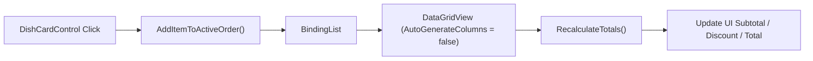

# Lesson 06: POS Order Management & DataGridView Binding

## 1. Overview

The Point of Sale (POS) terminal is the mission-critical core of any restaurant. Fast order entry, item modification, table order switching, and real-time total recalculation are vital. In this lesson, we master binding order items to `DataGridView`, optimizing row selection, and managing live item collections.

---

## 2. Order Line Item Data Flow



---

## 3. DataGridView Configuration Best Practices

Configuring `DataGridView` programmatically ensures predictable column layouts, disables unwanted auto-generation, and enforces high-DPI friendliness:

```csharp
private void ConfigureOrderGrid()
{
    dgvOrderItems.AutoGenerateColumns = false;
    dgvOrderItems.AllowUserToAddRows = false;
    dgvOrderItems.AllowUserToDeleteRows = false;
    dgvOrderItems.SelectionMode = DataGridViewSelectionMode.FullRowSelect;
    dgvOrderItems.MultiSelect = false;
    dgvOrderItems.RowHeadersVisible = false;
    dgvOrderItems.BackgroundColor = ThemePalette.SurfaceDark;
    dgvOrderItems.BorderStyle = BorderStyle.None;

    dgvOrderItems.Columns.AddRange(new DataGridViewColumn[]
    {
        new DataGridViewTextBoxColumn
        {
            DataPropertyName = nameof(OrderItemViewModel.ItemName),
            HeaderText = "Страва",
            AutoSizeMode = DataGridViewAutoSizeColumnMode.Fill
        },
        new DataGridViewTextBoxColumn
        {
            DataPropertyName = nameof(OrderItemViewModel.Quantity),
            HeaderText = "К-ть",
            Width = 55
        },
        new DataGridViewTextBoxColumn
        {
            DataPropertyName = nameof(OrderItemViewModel.UnitPrice),
            HeaderText = "Ціна",
            Width = 75,
            DefaultCellStyle = { Format = "N2" }
        },
        new DataGridViewTextBoxColumn
        {
            DataPropertyName = nameof(OrderItemViewModel.TotalPrice),
            HeaderText = "Сума",
            Width = 85,
            DefaultCellStyle = { Format = "N2", Font = new Font("Segoe UI", 9, FontStyle.Bold) }
        }
    });
}
```

---

## 4. BindingList vs ObservableCollection

While WPF and MAUI rely on `ObservableCollection<T>`, Windows Forms standard data-binding was architected around `System.ComponentModel.BindingList<T>`. `BindingList<T>` automatically raises `ListChanged` events that `DataGridView` listens to, ensuring changes to items trigger automatic UI repaints without requiring manual `dgv.Refresh()`.

```csharp
private readonly BindingList<OrderItemViewModel> _orderItems = new();

private void InitializeOrderBinding()
{
    dgvOrderItems.DataSource = _orderItems;
    _orderItems.ListChanged += (s, e) => RecalculateOrderTotals();
}
```

---

## 5. Adding & Modifying Items

```csharp
public void AddMenuItem(MenuItemDto item)
{
    var existing = _orderItems.FirstOrDefault(i => i.MenuItemId == item.Id && i.Modifiers == null);
    if (existing != null)
    {
        existing.Quantity++;
        existing.TotalPrice = existing.Quantity * existing.UnitPrice;
        _orderItems.ResetItem(_orderItems.IndexOf(existing));
    }
    else
    {
        _orderItems.Add(new OrderItemViewModel
        {
            MenuItemId = item.Id,
            ItemName = item.Name,
            UnitPrice = item.Price,
            Quantity = 1,
            TotalPrice = item.Price
        });
    }
}
```
