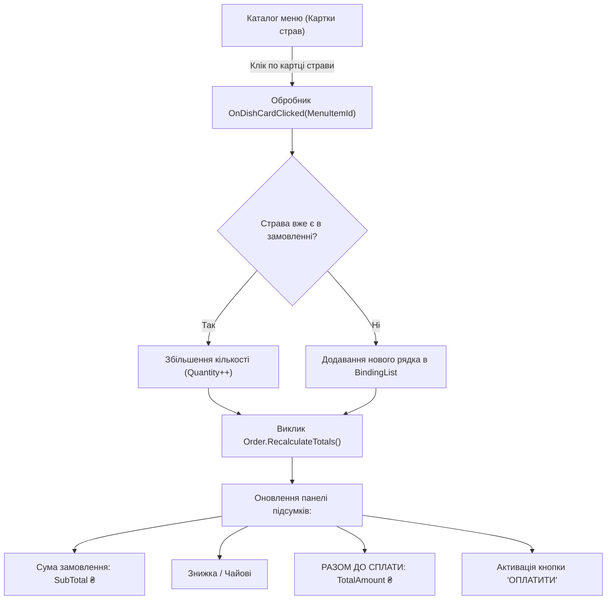

# Практичний гайд 06: Робоче місце касира (POS Terminal) та DataGridView кошика

## 1. Теоретична база та інженерні виклики

**POS-термінал (*Point of Sale*)** ресторану — це найбільш навантажений модуль системи. Касир та офіціант здійснюють сотні дій за годину. Інтерфейс повинен відповідати суворим ергономічним вимогам:
- **Адаптивність категорій:** Кнопки фільтрації за категоріями страв не повинні створювати нативних потворних білих скролбарів Windows, які з'являються у стандартних `FlowLayoutPanel`.
- **Візуальний каталог з фотографіями:** Кожна картка страви містить якісне зображення, точну ціну у великому шрифті та нормативний час приготування.
- **Таблиця замовлення (Кошик):** Швидке додавання, зміна кількості порцій (+ / -), видалення позицій та перерахунок проміжних підсумків без затримок.

---

## 2. Архітектурна схема обробки кошика замовлення



---

## 3. Детальний розбір реалізації в проєкті

### 3.1. Адаптивна шапка категорій без системних скролбарів: [`PosTerminalForm.cs`](file:///C:/Users/Yurii/source/repos/- MASTERY/WinForms-HoReCa-Mastery/src/HoReCa.WinForms/Forms/PosTerminalForm.cs)

Класична проблема WinForms: `FlowLayoutPanel` із `AutoScroll = true` при переповненні додає 17-піксельний білий системний Win32 scrollbar, що перекриває кнопки. В [`PosTerminalForm.cs`](file:///C:/Users/Yurii/source/repos/- MASTERY/WinForms-HoReCa-Mastery/src/HoReCa.WinForms/Forms/PosTerminalForm.cs) проблему вирішено за допомогою авто-перенесення рядків:

```csharp
_pnlCategoryTabs = new FlowLayoutPanel
{
    Dock = DockStyle.Top,
    AutoSize = true,
    AutoSizeMode = AutoSizeMode.GrowAndShrink,
    WrapContents = true,  // Автоматичне перенесення кнопок на 2-й рядок при звуженні
    AutoScroll = false,   // Жодних білих нативних смуг прокрутки
    BackColor = Color.Transparent,
    Margin = new Padding(0),
    Padding = new Padding(0, 4, 0, 4)
};
```

### 3.2. Картка страви з фотографією: `CreateDishCard`

Кожна страва створюється як стильний блок розміром 170x165 px із зображенням, назвою, бейджем часу та зеленою ціною:
```csharp
var card = new Panel
{
    Size = new Size(170, 165),
    BackColor = ThemePalette.BackgroundCard,
    Margin = new Padding(6),
    Cursor = Cursors.Hand
};

// Завантаження фотографії страви з Assets
var pic = new PictureBox
{
    Dock = DockStyle.Top,
    Height = 90,
    SizeMode = PictureBoxSizeMode.Zoom,
    Image = LoadDishImage(dish.ImageUrl)
};
```

---

## 4. Підводні камені та типові помилки

> [!WARNING]
> **Мерехтіння DataGridView при частих оновленнях:**
> При додаванні страв або зміні кількості стандартний `DataGridView` може неприємно блимати. 
> **Рішення:** увімкнення подвійної буферизації через рефлексію для сітки замовлень:
> `typeof(DataGridView).InvokeMember("DoubleBuffered", BindingFlags.NonPublic | BindingFlags.Instance | BindingFlags.SetProperty, null, _gridOrder, new object[] { true });`.

---

## 5. Практичний чек-лист для закріплення
1. [ ] Перевірити коректність перенесення категорій при зміні роздільної здатності екрана.
2. [ ] Переконатися, що натискання «+1» та «-1» миттєво оновлює суму «РАЗОМ ДО СПЛАТИ».
3. [ ] Перевірити наявність плейсхолдера для страв, у яких відсутнє зображення на диску.
