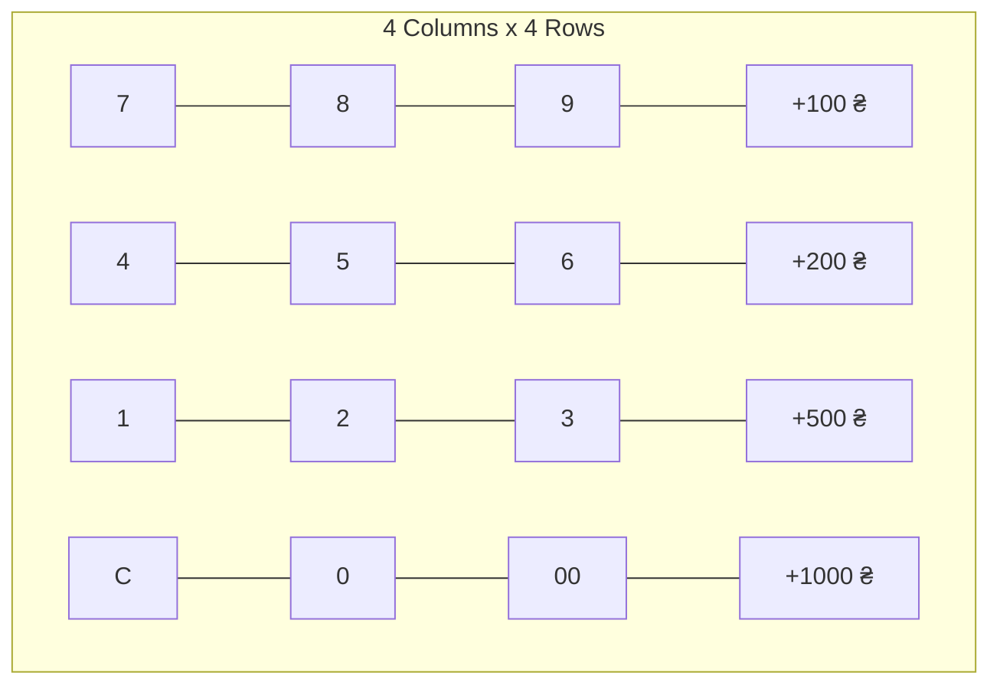

# Lesson 07: Touch-Friendly Cashier Numpad with TableLayoutPanel

## 1. Overview

In point-of-sale environments, staff frequently operate touchscreens without physical keyboards. A dedicated on-screen numpad with large touch targets and quick-cash denomination buttons (e.g. 100, 200, 500, 1000 ₴) dramatically accelerates payment processing.

In this lesson, we build `CashierNumpadControl` using `TableLayoutPanel`.

---

## 2. Why TableLayoutPanel?

`TableLayoutPanel` arranges child controls in a proportional grid (percentage-based rows and columns). When the containing form or dialog is resized, buttons automatically scale proportionally without tedious manual coordinate recalculation.



---

## 3. Implementation of CashierNumpadControl

```csharp
public partial class CashierNumpadControl : UserControl
{
    public event EventHandler<string>? DigitPressed;
    public event EventHandler<decimal>? QuickAmountAdded;
    public event EventHandler? ClearPressed;
    public event EventHandler? BackspacePressed;

    public CashierNumpadControl()
    {
        InitializeComponent();
        SetupLayout();
    }

    private void SetupLayout()
    {
        var tlp = new TableLayoutPanel
        {
            Dock = DockStyle.Fill,
            ColumnCount = 4,
            RowCount = 4
        };

        for (int c = 0; c < 4; c++)
            tlp.ColumnStyles.Add(new ColumnStyle(SizeType.Percent, 25f));
        for (int r = 0; r < 4; r++)
            tlp.RowStyles.Add(new RowStyle(SizeType.Percent, 25f));

        // Digits 1-9, 0, 00, Clear
        AddButton(tlp, "7", (s, e) => DigitPressed?.Invoke(this, "7"), 0, 0);
        AddButton(tlp, "8", (s, e) => DigitPressed?.Invoke(this, "8"), 1, 0);
        AddButton(tlp, "9", (s, e) => DigitPressed?.Invoke(this, "9"), 2, 0);
        AddQuickButton(tlp, "+100 ₴", 100m, 3, 0);

        AddButton(tlp, "4", (s, e) => DigitPressed?.Invoke(this, "4"), 0, 1);
        AddButton(tlp, "5", (s, e) => DigitPressed?.Invoke(this, "5"), 1, 1);
        AddButton(tlp, "6", (s, e) => DigitPressed?.Invoke(this, "6"), 2, 1);
        AddQuickButton(tlp, "+200 ₴", 200m, 3, 1);

        AddButton(tlp, "1", (s, e) => DigitPressed?.Invoke(this, "1"), 0, 2);
        AddButton(tlp, "2", (s, e) => DigitPressed?.Invoke(this, "2"), 1, 2);
        AddButton(tlp, "3", (s, e) => DigitPressed?.Invoke(this, "3"), 2, 2);
        AddQuickButton(tlp, "+500 ₴", 500m, 3, 2);

        AddButton(tlp, "C", (s, e) => ClearPressed?.Invoke(this, EventArgs.Empty), 0, 3, ThemePalette.RubyAccent);
        AddButton(tlp, "0", (s, e) => DigitPressed?.Invoke(this, "0"), 1, 3);
        AddButton(tlp, "00", (s, e) => DigitPressed?.Invoke(this, "00"), 2, 3);
        AddQuickButton(tlp, "+1000 ₴", 1000m, 3, 3);

        Controls.Add(tlp);
    }

    private void AddButton(TableLayoutPanel tlp, string text, EventHandler onClick, int col, int row, Color? bg = null)
    {
        var btn = new Button
        {
            Text = text,
            Dock = DockStyle.Fill,
            FlatStyle = FlatStyle.Flat,
            BackColor = bg ?? ThemePalette.SurfaceCard,
            ForeColor = Color.White,
            Font = new Font("Segoe UI", 14, FontStyle.Bold),
            Margin = new Padding(3)
        };
        btn.FlatAppearance.BorderSize = 0;
        btn.Click += onClick;
        tlp.Controls.Add(btn, col, row);
    }

    private void AddQuickButton(TableLayoutPanel tlp, string text, decimal amount, int col, int row)
    {
        var btn = new Button
        {
            Text = text,
            Dock = DockStyle.Fill,
            FlatStyle = FlatStyle.Flat,
            BackColor = Color.FromArgb(16, 185, 129), // Emerald
            ForeColor = Color.White,
            Font = new Font("Segoe UI", 11, FontStyle.Bold),
            Margin = new Padding(3)
        };
        btn.FlatAppearance.BorderSize = 0;
        btn.Click += (s, e) => QuickAmountAdded?.Invoke(this, amount);
        tlp.Controls.Add(btn, col, row);
    }
}
```

---

## 4. Key Takeaways

1. **Touch Ergonomics**: Provide at least 48x48 pixel targets for buttons so operators can rapidly enter amounts without misclicks.
2. **Event Decoupling**: The numpad should not know what textbox or state it is updating; it merely fires typed events (`DigitPressed`, `QuickAmountAdded`, `ClearPressed`).
