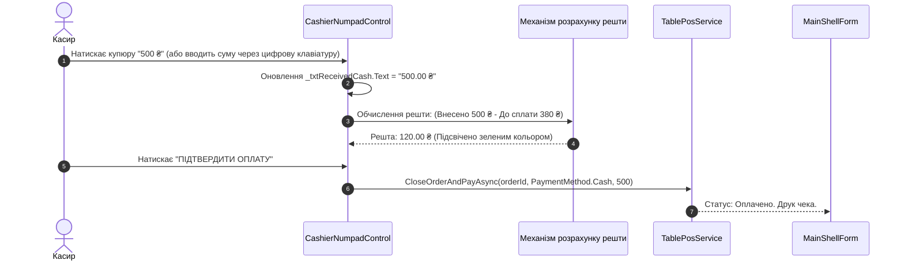

# Практичний гайд 07: Сенсорна цифрова клавіатура (Touch Numpad) та швидка оплата

## 1. Теоретична база та ергономіка касира

На робочих місцях офіціантів та касирів рідко використовують звичайну фізичну клавіатуру — на касових моноблоках використовують сенсорні екрани (*Touchscreen*). Введення суми готівки від гостя за допомогою маленьких полів введення призводить до частих помилок касира та затримок у черзі.

**Вимоги до сенсорного касового Numpad:**
- Великі кнопки (мінімум 48x48 px), зручні для натискання пальцем без стилуса.
- Фіксована сітка `TableLayoutPanel` (3 стовпчики для цифр 1–9, 0, 00, Backspace).
- Блок «гарячих купюр» швидкого розрахунку: кнопки швидкої суми (100, 200, 500, 1000 ₴), які миттєво заповнюють суму отриманої готівки.
- Автоматичний підрахунок решти в реальному часі.

---

## 2. Архітектурна схема розрахунку оплати



---

## 3. Детальний розбір реалізації в проєкті

### 3.1. Кастомний компонент: [`CashierNumpadControl.cs`](file:///C:/Users/Yurii/source/repos/- MASTERY/WinForms-HoReCa-Mastery/src/HoReCa.WinForms/Controls/CashierNumpadControl.cs)

Побудова сітки кнопок у `TableLayoutPanel` із рівномірним розподілом простору:

```csharp
public class CashierNumpadControl : UserControl
{
    private readonly TableLayoutPanel _tlpNumpad;
    private readonly TextBox _txtDisplay;

    public CashierNumpadControl()
    {
        _tlpNumpad = new TableLayoutPanel
        {
            Dock = DockStyle.Fill,
            ColumnCount = 3,
            RowCount = 4
        };

        for (int i = 0; i < 3; i++) _tlpNumpad.ColumnStyles.Add(new ColumnStyle(SizeType.Percent, 33.33f));
        for (int i = 0; i < 4; i++) _tlpNumpad.RowStyles.Add(new RowStyle(SizeType.Percent, 25f));

        string[] btnLabels = { "1", "2", "3", "4", "5", "6", "7", "8", "9", "C", "0", "⌫" };
        for (int i = 0; i < btnLabels.Length; i++)
        {
            var btn = CreateNumpadButton(btnLabels[i]);
            _tlpNumpad.Controls.Add(btn, i % 3, i / 3);
        }
    }
}
```

---

## 4. Підводні камені та типові помилки

> [!WARNING]
> **Недостатня сума готівки:**
> Якщо внесена готівка менша за суму до сплати, поле решти має блокувати закриття замовлення та підсвічуватися кольором `ThemePalette.Danger`, запобігаючи помилковій видачі чека без оплати.

---

## 5. Практичний чек-лист для закріплення
1. [ ] Перевірити функціонування клавіші `⌫` (Backspace) та повного скидання `C` (Clear).
2. [ ] Переконатися, що решта розраховується з точністю до копійки.
3. [ ] Перевірити роботу блоку швидких банкнот (100, 200, 500, 1000 ₴).
