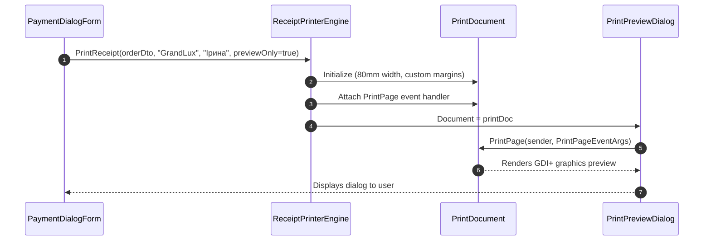

# Lesson 08: Thermal Receipt Printing with GDI+ & PrintDocument

## 1. Overview

Point of Sale systems rely on 80mm or 58mm POS thermal printers (ESC/POS or Windows Driver). In .NET, `System.Drawing.Printing.PrintDocument` allows precise graphic rendering of fiscal checks, typography, line separators, and logos.

---

## 2. Printing Pipeline



---

## 3. Formatting Fixed-Width Fiscal Text

For ESC/POS or receipt text generation, a fixed-width 40-character template ensures alignment across thermal rolls:

```csharp
public static class ReceiptTextFormatter
{
    public static string GenerateTextReceipt(OrderDto order, string businessName, string cashierName)
    {
        var sb = new StringBuilder();
        string line = new('=', 40);
        string dash = new('-', 40);

        sb.AppendLine(CenterText(businessName.ToUpperInvariant(), 40));
        sb.AppendLine(CenterText("ГОТЕЛЬНО-РЕСТОРАННИЙ КОМПЛЕКС", 40));
        sb.AppendLine(CenterText("м. Чернівці, вул. Головна, 100", 40));
        sb.AppendLine(CenterText("ПН 382910481940 | ФІСКАЛЬНИЙ ЧЕК", 40));
        sb.AppendLine(line);
        sb.AppendLine($"ЧЕК №: {order.OrderNumber}");
        sb.AppendLine($"ДАТА: {order.CreatedAt:dd.MM.yyyy HH:mm:ss}");
        sb.AppendLine($"КАСИР: {cashierName}");
        if (order.TableNumber.HasValue)
            sb.AppendLine($"СТОЛИК: № {order.TableNumber.Value}");
        sb.AppendLine(dash);

        sb.AppendLine(string.Format("{0,-20} {1,4} {2,6} {3,7}", "НАЗВА", "К-ТЬ", "ЦІНА", "СУМА"));
        sb.AppendLine(dash);

        foreach (var item in order.Items)
        {
            string name = item.ItemName.Length > 20 ? item.ItemName[..19] + "…" : item.ItemName;
            sb.AppendLine(string.Format(CultureInfo.InvariantCulture, "{0,-20} {1,4} {2,6:F0} {3,7:F2}", 
                name, item.Quantity, item.UnitPrice, item.TotalPrice));
        }

        sb.AppendLine(dash);
        sb.AppendLine($"ПІДСУМОК:                      {order.Subtotal.ToString("F2", CultureInfo.InvariantCulture),10} ₴");
        sb.AppendLine(line);
        sb.AppendLine($"ДО СПЛАТИ:                     {order.TotalAmount.ToString("F2", CultureInfo.InvariantCulture),10} ₴");
        sb.AppendLine(line);

        return sb.ToString();
    }
}
```

---

## 4. GDI+ PrintPage Drawing

In `ReceiptPrinterEngine`, we handle the `PrintPage` event:

```csharp
private void OnPrintPage(object sender, PrintPageEventArgs e, OrderDto order, string businessName, string cashier)
{
    var g = e.Graphics;
    using var fontRegular = new Font("Courier New", 9, FontStyle.Regular);
    using var fontBold = new Font("Courier New", 10, FontStyle.Bold);
    using var brush = new SolidBrush(Color.Black);

    float y = 10;
    float lineHeight = fontRegular.GetHeight(g) + 2;

    string receiptContent = GenerateTextReceipt(order, businessName, cashier);
    foreach (var line in receiptContent.Split('\n'))
    {
        var trimmed = line.TrimEnd('\r');
        var font = trimmed.Contains("ДО СПЛАТИ") || trimmed.Contains("ФІСКАЛЬНИЙ ЧЕК") ? fontBold : fontRegular;
        g.DrawString(trimmed, font, brush, 10, y);
        y += lineHeight;
    }

    e.HasMorePages = false;
}
```

---

## 5. Previewing without Physical Hardware

During development and automated testing, physical POS hardware is often absent. Using `PrintPreviewDialog` enables instant visual verification:

```csharp
using var preview = new PrintPreviewDialog
{
    Document = printDoc,
    Width = 450,
    Height = 700,
    StartPosition = FormStartPosition.CenterParent
};
preview.ShowDialog();
```
