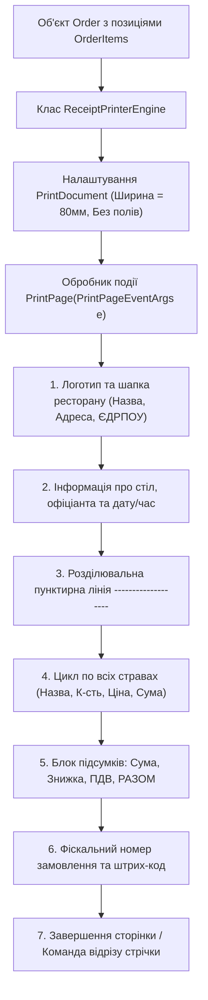

# Практичний гайд 08: Генерація та друк фіскальних термочеків (80 мм) через GDI+ PrintDocument

## 1. Теоретична база та стандарти чекового друку

У ресторанах та готелях стандартом де-факто є спеціалізовані **термопринтери рулонного паперу шириною 80 мм** (або 58 мм) з інтерфейсами USB, Ethernet чи Bluetooth (протокол ESC/POS).

Для друку фіскального чека безпосередньо з Windows Forms використовується клас `System.Drawing.Printing.PrintDocument`. На відміну від офісних принтерів формату А4, у чековому друці діють специфічні інженерні правила:
1. **Ширина друку:** Рівно 280–300 пікселів при 96/203 DPI (приблизно 40–42 символи в рядку).
2. **Моноширинний шрифт:** Використання шрифтів фіксованої ширини (`Cascadia Code`, `Consolas`, `Courier New`) гарантує, що стовпчики кількості та ціни будуть вирівняні ідеально по правій межі.
3. **Динамічна довжина чека:** Довжина стрічки невідома заздалегідь — вона залежить від кількості замовлених страв. Потрібно точно обчислювати фінальну координату `Y` та команду відрізу паперу (*Paper Cut*).

---

## 2. Архітектурна схема генерації чека



---

## 3. Детальний розбір реалізації в проєкті

### 3.1. Генерація чека: [`ReceiptPrinterEngine.cs`](file:///C:/Users/Yurii/source/repos/- MASTERY/WinForms-HoReCa-Mastery/src/HoReCa.WinForms/Controls/ReceiptPrinterEngine.cs)

```csharp
public static void PrintReceipt(Order order, PrintPageEventArgs e)
{
    var g = e.Graphics;
    using var fontHeader = new Font("Segoe UI", 11f, FontStyle.Bold);
    using var fontMono = new Font("Cascadia Code", 8.5f, FontStyle.Regular);
    using var fontMonoBold = new Font("Cascadia Code", 9f, FontStyle.Bold);
    using var brush = new SolidBrush(Color.Black);

    float startX = 10;
    float startY = 15;
    float printableWidth = 280;

    // Шапка
    g.DrawString("LUXERESTO RESORT & RESTAURANT", fontHeader, brush, startX + 15, startY);
    startY += 20;
    g.DrawString("м. Київ, вул. Хрещатик, 1 | Тел: +380 44 000-00-00", fontMono, brush, startX, startY);
    startY += 25;
    g.DrawString(new string('-', 38), fontMono, brush, startX, startY);
    startY += 15;

    // Рядки замовлення
    foreach (var item in order.Items)
    {
        string name = item.MenuItem.Name.Length > 20 ? item.MenuItem.Name[..18] + ".." : item.MenuItem.Name.PadRight(20);
        string line = $"{name} {item.Quantity}x {item.UnitPrice,7:N2}";
        g.DrawString(line, fontMono, brush, startX, startY);
        startY += 16;
    }

    // Підсумок
    startY += 10;
    g.DrawString(new string('=', 38), fontMono, brush, startX, startY);
    startY += 18;
    g.DrawString($"РАЗОМ ДО СПЛАТИ: {order.TotalAmount,18:N2} ₴", fontMonoBold, brush, startX, startY);
}
```

### 3.2. Генерація PDF-дубліката: [`PdfReportService.cs`](file:///C:/Users/Yurii/source/repos/- MASTERY/WinForms-HoReCa-Mastery/src/HoReCa.Infrastructure/Services/PdfReportService.cs)

Для формування звітності для бухгалтерії та надсилання електронного чека гостю на email система генерує векторний PDF-документ.

---

## 4. Підводні камені та типові помилки

> [!WARNING]
> **Пам'ять графічних контекстів при друку:**
> Об'єкт `PrintPageEventArgs.Graphics` не повинен викликати `Dispose()`, оскільки Windows керує його життєвим циклом під час формування черги диспетчера друку (*Print Spooler*). Проте всі власні пензлі та шрифти повинні очищуватися через `using`.

---

## 5. Практичний чек-лист для закріплення
1. [ ] Перевірити друк чека у віртуальний принтер «Microsoft Print to PDF».
2. [ ] Переконатися, що колонки кількості та сум вирівняні по правому краю.
3. [ ] Перевірити коректне відображення символу гривні «₴» у моноширинному шрифті.
