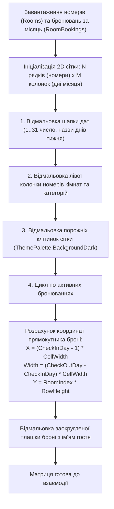

# Практичний гайд 09: Модуль рецепції готелю: 2D-шахівниця номерного фонду (Room Rack)

## 1. Теоретична база та завдання шахівниці

У готельних системах керування майном (**PMS** - *Property Management System*) базовим інструментом портьє є **Room Rack (шахівниця або шаховий календар номерного фонду)**.

**Функціонал шахівниці:**
- **Осі матриці:** По вертикалі розміщені поверхи та номери кімнат (з інформацією про категорію номера: *Standard, Superior, Suite*), по горизонталі — календарна шкала днів обраного місяця.
- **Візуалізація зайнятості:** Кожне бронювання відображається кольоровою смугою, яка простягається від дати заїзду (`CheckInDate`) до дати виїзду (`CheckOutDate`).
- **Швидкі операції:** Клік по вільній клітинці відкриває модальне вікно створення нової броні. Клік по зайнятому блоку дозволяє переглянути деталі гостя або здійснити Check-out.

---

## 2. Архітектурна схема рендерингу матриці



---

## 3. Детальний розбір реалізації в проєкті

### 3.1. Форма рецепції: [`HotelFrontDeskForm.cs`](file:///C:/Users/Yurii/source/repos/- MASTERY/WinForms-HoReCa-Mastery/src/HoReCa.WinForms/Forms/HotelFrontDeskForm.cs)

У формі рецепції матрицю реалізовано через високоефективний кастомний рендеринг у події `Paint`:

```csharp
private void DrawRoomRackMatrix(Graphics g, Rectangle bounds)
{
    int cellWidth = 38;
    int rowHeight = 36;
    int headerHeight = 32;
    int roomColWidth = 140;

    // Шапка дат
    for (int day = 1; day <= _daysInMonth; day++)
    {
        int x = roomColWidth + (day - 1) * cellWidth;
        g.DrawString(day.ToString(), ThemePalette.SmallFont, Brushes.White, x + 8, 8);
    }

    // Номери та бронювання
    for (int r = 0; r < _rooms.Count; r++)
    {
        int y = headerHeight + r * rowHeight;
        var room = _rooms[r];
        g.DrawString($"№ {room.RoomNumber} ({room.Type})", ThemePalette.BodyFont, Brushes.White, 8, y + 8);

        // Пошук броней для цього номера
        var bookings = _bookings.Where(b => b.RoomId == room.Id);
        foreach (var b in bookings)
        {
            int startX = roomColWidth + (b.CheckInDate.Day - 1) * cellWidth;
            int width = (b.CheckOutDate.Day - b.CheckInDate.Day) * cellWidth;
            DrawBookingBar(g, new Rectangle(startX, y + 4, width - 2, rowHeight - 8), b);
        }
    }
}
```

---

## 4. Підводні камені та типові помилки

> [!TIP]
> **Перехід між місяцями:**
> Якщо бронювання починається в поточному місяці, а закінчується в наступному, довжина смужки на календарі поточного місяця має обмежуватися останнім днем (`_daysInMonth`), інакше блок вийде за межі полотна.

---

## 5. Практичний чек-лист для закріплення
1. [ ] Перевірити роботу перемикання місяців календаря (Вперед / Назад).
2. [ ] Переконатися, що броні вихідних днів підсвічуються коректно.
3. [ ] Перевірити реакцію на подвійний клік по клітинці для швидкого поселення гостя.
