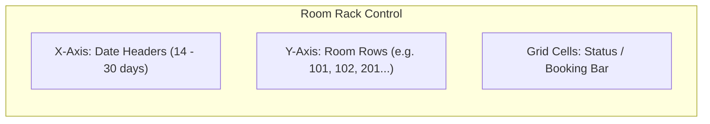

# Lesson 09: Hotel Front-Desk Matrix & Room Rack Visualization

## 1. Overview

Hotel Property Management Systems (PMS) depend heavily on the **Room Rack** (a 2D calendar matrix where the Y-axis lists hotel rooms and the X-axis represents calendar dates). At a glance, receptionists can identify occupancy, upcoming check-ins, vacant rooms, and room maintenance statuses.

---

## 2. Room Rack Architecture



---

## 3. Implementing RoomRackControl with Custom GDI+

Rather than instantiating hundreds of nested panel controls (which causes sluggish scrolling and high GDI handle usage), `RoomRackControl` is drawn directly onto a single canvas:

```csharp
public partial class RoomRackControl : UserControl
{
    private List<RoomDto> _rooms = new();
    private List<BookingDto> _bookings = new();
    private DateTime _startDate = DateTime.Today;
    private const int DaysCount = 14;
    private const int RowHeight = 36;
    private const int RoomColWidth = 110;
    private const int DayColWidth = 55;

    public RoomRackControl()
    {
        InitializeComponent();
        DoubleBuffered = true;
        SetStyle(ControlStyles.AllPaintingInWmPaint | ControlStyles.UserPaint | ControlStyles.OptimizedDoubleBuffer, true);
    }

    public void SetData(List<RoomDto> rooms, List<BookingDto> bookings, DateTime startDate)
    {
        _rooms = rooms;
        _bookings = bookings;
        _startDate = startDate;
        Invalidate();
    }

    protected override void OnPaint(PaintEventArgs e)
    {
        var g = e.Graphics;
        g.Clear(ThemePalette.SurfaceDark);

        // 1. Draw Date Header Row
        for (int d = 0; d < DaysCount; d++)
        {
            var date = _startDate.AddDays(d);
            var x = RoomColWidth + d * DayColWidth;
            var headerRect = new Rectangle(x, 0, DayColWidth, RowHeight);

            using var brush = new SolidBrush(ThemePalette.SurfaceCard);
            g.FillRectangle(brush, headerRect);
            g.DrawRectangle(Pens.Gray, headerRect);

            var text = $"{date:dd.MM}\n{date:ddd}";
            TextRenderer.DrawText(g, text, Font, headerRect, Color.White, TextFormatFlags.HorizontalCenter | TextFormatFlags.VerticalCenter);
        }

        // 2. Draw Room Rows
        for (int r = 0; r < _rooms.Count; r++)
        {
            var room = _rooms[r];
            var y = RowHeight + r * RowHeight;
            var roomRect = new Rectangle(0, y, RoomColWidth, RowHeight);

            // Draw Room Number & Category
            TextRenderer.DrawText(g, $"{room.RoomNumber} ({room.Type})", Font, roomRect, Color.LightSteelBlue, TextFormatFlags.VerticalCenter | TextFormatFlags.Left);

            // Draw Day Cells
            for (int d = 0; d < DaysCount; d++)
            {
                var curDate = _startDate.AddDays(d);
                var cellRect = new Rectangle(RoomColWidth + d * DayColWidth, y, DayColWidth, RowHeight);
                g.DrawRectangle(Pens.DimGray, cellRect);

                // Highlight booked interval
                var hasBooking = _bookings.Any(b => b.RoomId == room.Id && curDate >= b.CheckInDate && curDate < b.CheckOutDate);
                if (hasBooking)
                {
                    using var bookedBrush = new SolidBrush(Color.FromArgb(180, 239, 68, 68)); // Red / Occupied
                    g.FillRectangle(bookedBrush, Rectangle.Inflate(cellRect, -2, -4));
                }
            }
        }
    }
}
```

---

## 4. TileView in ListView for Quick Room Selection

In addition to the matrix, `ListView` in `View.Tile` mode provides compact room cards:

```csharp
lvRooms.View = View.Tile;
lvRooms.TileSize = new Size(180, 70);

foreach (var room in rooms)
{
    var item = new ListViewItem(new[]
    {
        $"Кімната {room.RoomNumber}",
        $"{room.Type} - {room.DailyRate:F0} ₴/доба",
        room.Status.ToString()
    });
    lvRooms.Items.Add(item);
}
```
