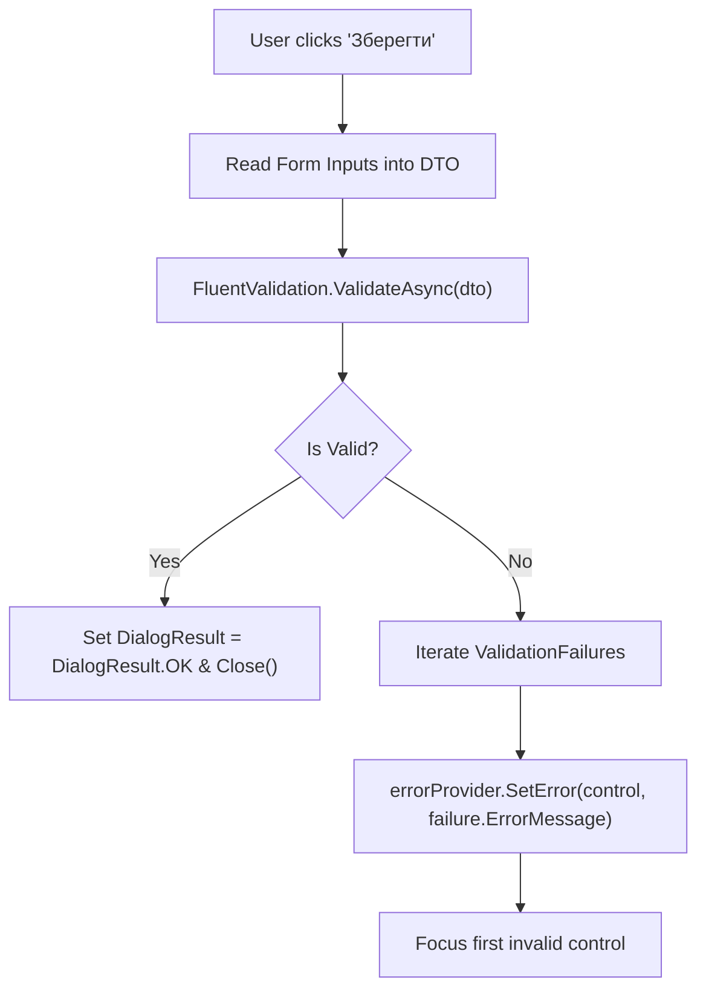

# Lesson 10: Modal Dialogs, Input Masking & ErrorProvider Validation

## 1. Overview

Data entry forms (e.g. creating hotel bookings, editing guest records) require strict validation to prevent corrupted database records. In Windows Forms, the canonical validation pattern combines `MaskedTextBox`, `DateTimePicker`, `ErrorProvider`, and `FluentValidation`.

---

## 2. The Validation Architecture



---

## 3. Implementing the New Booking Dialog

```csharp
public partial class NewBookingDialogForm : Form
{
    private readonly IValidator<CreateBookingRequest> _validator;
    private readonly ErrorProvider _errorProvider = new();

    public CreateBookingRequest? ResultRequest { get; private set; }

    public NewBookingDialogForm(IValidator<CreateBookingRequest> validator)
    {
        _validator = validator;
        InitializeComponent();
        SetupValidation();
    }

    private void SetupValidation()
    {
        _errorProvider.BlinkStyle = ErrorBlinkStyle.NeverBlink;

        // Mask for Ukrainian phone numbers
        mtbPhone.Mask = "+38 (000) 000-00-00";

        // Date constraints
        dtpCheckIn.MinDate = DateTime.Today;
        dtpCheckOut.MinDate = DateTime.Today.AddDays(1);
    }

    private async void btnSave_Click(object sender, EventArgs e)
    {
        _errorProvider.Clear();

        var request = new CreateBookingRequest(
            RoomId: (int)cbRoom.SelectedValue!,
            GuestFullName: txtFullName.Text.Trim(),
            GuestPhone: mtbPhone.Text.Trim(),
            GuestEmail: string.IsNullOrWhiteSpace(txtEmail.Text) ? null : txtEmail.Text.Trim(),
            PassportOrId: txtPassport.Text.Trim(),
            CheckInDate: dtpCheckIn.Value.Date,
            CheckOutDate: dtpCheckOut.Value.Date,
            SpecialRequests: txtNotes.Text.Trim()
        );

        var validationResult = await _validator.ValidateAsync(request);

        if (!validationResult.IsValid)
        {
            foreach (var failure in validationResult.Errors)
            {
                var targetControl = failure.PropertyName switch
                {
                    nameof(request.GuestFullName) => (Control)txtFullName,
                    nameof(request.GuestPhone) => mtbPhone,
                    nameof(request.CheckOutDate) => dtpCheckOut,
                    _ => txtFullName
                };

                _errorProvider.SetError(targetControl, failure.ErrorMessage);
            }
            return;
        }

        ResultRequest = request;
        DialogResult = DialogResult.OK;
        Close();
    }
}
```

---

## 4. Key Takeaways

1. **`BlinkStyle.NeverBlink`**: Blinking error icons irritate users. Setting `NeverBlink` displays a steady red indicator.
2. **`DialogResult`**: Always set `DialogResult = DialogResult.OK` only after successful validation.
3. **Decoupled Rules**: By expressing validation rules in `FluentValidation`, the exact same rules are testable via unit tests without spinning up WinForms message loops.
