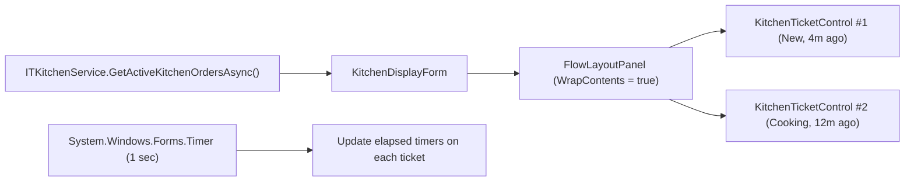

# Lesson 11: Kitchen Display System (KDS) with FlowLayoutPanel & Elapsed Timers

## 1. Overview

In modern kitchens, thermal paper tickets are replaced by a **Kitchen Display System (KDS)**. Chefs monitor live tickets arranged horizontally, track elapsed preparation times, and "bump" orders to the next stage (Cooking -> Ready -> Served) with audio cues.

---

## 2. KDS Architecture



---

## 3. The KitchenTicketControl

Each order is rendered as an isolated ticket card:

```csharp
public partial class KitchenTicketControl : UserControl
{
    private readonly OrderDto _order;
    public event EventHandler<int>? BumpRequested;

    public KitchenTicketControl(OrderDto order)
    {
        _order = order;
        InitializeComponent();
        SetupCard();
    }

    private void SetupCard()
    {
        lblHeader.Text = $"ЧЕК #{_order.OrderNumber} (Стіл {_order.TableNumber})";
        lblWaiter.Text = $"Офіціант: {_order.WaiterName}";
        
        foreach (var item in _order.Items)
        {
            var itemRow = new Label
            {
                Text = $"{item.Quantity}x {item.ItemName}" + (string.IsNullOrEmpty(item.ModifiersOrNotes) ? "" : $" ({item.ModifiersOrNotes})"),
                Dock = DockStyle.Top,
                Font = new Font("Segoe UI", 10, FontStyle.Regular),
                ForeColor = Color.White,
                AutoSize = true
            };
            pnlItems.Controls.Add(itemRow);
        }

        btnBump.Click += (s, e) => BumpRequested?.Invoke(this, _order.Id);
    }

    public void UpdateElapsed()
    {
        var elapsed = DateTime.UtcNow - _order.CreatedAt.ToUniversalTime();
        lblTimer.Text = $"{elapsed.Minutes:D2}:{elapsed.Seconds:D2}";

        // Critical delay threshold (> 15 min): highlight red
        if (elapsed.TotalMinutes >= 15)
        {
            pnlHeader.BackColor = ThemePalette.RubyAccent;
        }
        else if (elapsed.TotalMinutes >= 8)
        {
            pnlHeader.BackColor = Color.FromArgb(245, 158, 11); // Amber
        }
        else
        {
            pnlHeader.BackColor = ThemePalette.PrimaryAccent; // Emerald
        }
    }
}
```

---

## 4. Acoustic Notifications via SystemSounds

When a new ticket arrives from a waiter's terminal, the kitchen system plays an alert sound:

```csharp
private void PlayNewOrderSound()
{
    try
    {
        System.Media.SystemSounds.Beep.Play();
    }
    catch
    {
        // Suppress audio failures on headless environments
    }
}
```

---

## 5. FlowLayoutPanel Auto-Scroll & Wrapping

Setting `FlowLayoutPanel.WrapContents = true` and `AutoScroll = true` guarantees tickets wrap naturally across any monitor aspect ratio (16:9, 21:9, or 4:3).
