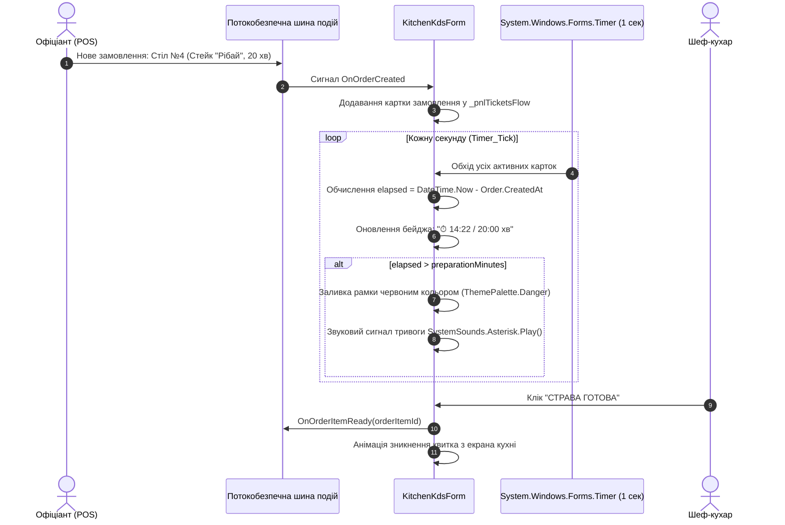

# Практичний гайд 11: KDS (Kitchen Display System): черга замовлень шеф-кухаря та динамічні таймери

## 1. Теоретична база та роль KDS у ресторані

Традиційна передача паперових чеків-бігунків на кухню призводить до хаосу: чеки губляться, засолюються жиром біля плит, черговість приготування порушується, а страви для одного столу готуються неодночасно (один гість уже поїв, а другий ще чекає свою страву).

**KDS (Kitchen Display System)** — це спеціалізований цифровий монітор кухні, який:
- Миттєво виводить замовлення у вигляді інтерактивного квитка одразу після підтвердження офіціантом на POS-касі.
- Запускає живий таймер зворотного відліку або хронометражу часу приготування.
- Змінює кольори квитка:
  - 🟢 **Зелений (норма):** Пройшло < 70% нормативного часу приготування.
  - 🟡 **Помаранчевий (увага):** Пройшло 70–100% нормативного часу.
  - 🔴 **Червоний (прострочення):** Час приготування перевищено, квиток вимагає негайної уваги шефа.
- Дозволяє шеф-кухарю в 1 клік змінити статус страви («Готується» -> «Готово»), сповіщаючи офіціанта в залі.

---

## 2. Архітектурна схема функціонування KDS



---

## 3. Детальний розбір реалізації в проєкті

### 3.1. Монітор кухні: [`KitchenKdsForm.cs`](file:///C:/Users/Yurii/source/repos/- MASTERY/WinForms-HoReCa-Mastery/src/HoReCa.WinForms/Forms/KitchenKdsForm.cs)

```csharp
public class KitchenKdsForm : Form
{
    private readonly System.Windows.Forms.Timer _refreshTimer;
    private readonly FlowLayoutPanel _pnlTicketsFlow;

    public KitchenKdsForm(IKitchenService kitchenService)
    {
        _refreshTimer = new System.Windows.Forms.Timer { Interval = 1000 };
        _refreshTimer.Tick += (s, e) => UpdateTicketTimers();
        _refreshTimer.Start();
    }

    private void UpdateTicketTimers()
    {
        foreach (Control ctrl in _pnlTicketsFlow.Controls)
        {
            if (ctrl is Panel ticket && ticket.Tag is OrderKdsDto dto)
            {
                var elapsed = DateTime.UtcNow - dto.CreatedAt;
                var totalMinutes = dto.MaxPreparationMinutes;
                var lblTimer = ticket.Controls.Find("lblTimer", true).FirstOrDefault() as Label;

                if (lblTimer != null)
                {
                    lblTimer.Text = $"⏱ {elapsed:mm\:ss} / {totalMinutes} хв";
                    if (elapsed.TotalMinutes >= totalMinutes)
                    {
                        ticket.BackColor = ThemePalette.Danger;
                        lblTimer.ForeColor = Color.White;
                    }
                    else if (elapsed.TotalMinutes >= totalMinutes * 0.7)
                    {
                        ticket.BackColor = ThemePalette.Warning;
                    }
                }
            }
        }
    }
}
```

---

## 4. Підводні камені та типові помилки

> [!WARNING]
> **Таймери у Windows Forms:**
> Використовуйте саме `System.Windows.Forms.Timer`, а не `System.Timers.Timer` чи `System.Threading.Timer`. `System.Windows.Forms.Timer` спрацьовує безпосередньо в черзі повідомлень потоку UI (`WM_TIMER`), тому при зверненні до лейблів карток не виникає винятків крос-потокового доступу.

---

## 5. Практичний чек-лист для закріплення
1. [ ] Перевірити коректне спрацювання колірної сигналізації при перевищенні нормативу.
2. [ ] Переконатися, що таймер зупиняється (`Stop()`) при закритті форми кухні.
3. [ ] Перевірити роботу кнопки «Готово» та оновлення статусу в базі даних.
