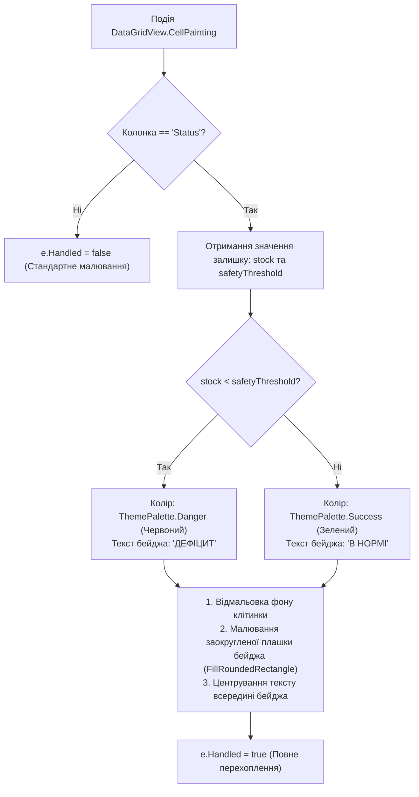

# Практичний гайд 12: Складський облік, списання за техкартами та кастомний CellPainting у DataGridView

## 1. Теоретична база та принципи складського обліку

У ресторанному бізнесі контроль залишків сировини є основою рентабельності. Основні виклики:
- **Списання за технологічними картами:** Гість замовляє «Борщ український», але зі складу списується не «борщ», а сировина за рецептом: яловичина (150г), буряк (100г), картопля (80г), сметана (30г).
- **Критичні залишки (*Safety Stock Thresholds*):** При падінні залишку товару нижче встановленого ліміту система повинна візуально попередити завскладу.
- **Ефективний рендеринг у DataGridView:** Щоб таблиця залишків на 1000+ позицій виглядала як сучасний веб-застосунок, замість стандартного сірого тексту застосовується кастомний рендеринг події `CellPainting`.

---

## 2. Архітектурна схема кастомного малювання бейджів залишків



---

## 3. Детальний розбір реалізації в проєкті

### 3.1. Кастомне малювання бейджів: [`InventoryForm.cs`](file:///C:/Users/Yurii/source/repos/- MASTERY/WinForms-HoReCa-Mastery/src/HoReCa.WinForms/Forms/InventoryForm.cs)

```csharp
private void GridStock_CellPainting(object? sender, DataGridViewCellPaintingEventArgs e)
{
    if (e.RowIndex < 0 || e.ColumnIndex != _colStatus.Index) return;

    e.PaintBackground(e.ClipBounds, true);
    var item = _gridStock.Rows[e.RowIndex].DataBoundItem as InventoryItemDto;
    if (item == null) return;

    bool isLow = item.CurrentStock <= item.SafetyThreshold;
    Color badgeColor = isLow ? ThemePalette.Danger : ThemePalette.Success;
    string badgeText = isLow ? "⚠ ДЕФІЦИТ" : "✓ В НОРМІ";

    var rect = new Rectangle(e.CellBounds.X + 8, e.CellBounds.Y + 4, e.CellBounds.Width - 16, e.CellBounds.Height - 8);
    using var brush = new SolidBrush(badgeColor);
    using var pen = new Pen(Color.FromArgb(50, 255, 255, 255));
    
    // Малювання заокругленого бейджа
    e.Graphics.SmoothingMode = SmoothingMode.AntiAlias;
    DrawRoundedBadge(e.Graphics, rect, brush, pen, badgeText);

    e.Handled = true; // Запобігання повторному малюванню Windows Forms
}
```

### 3.2. Діалог замовлення у постачальника: [`SupplierOrderDialog.cs`](file:///C:/Users/Yurii/source/repos/- MASTERY/WinForms-HoReCa-Mastery/src/HoReCa.WinForms/Forms/SupplierOrderDialog.cs)

Дозволяє в 1 клік створити заявку на поповнення дефіцитних позицій складу.

---

## 4. Підводні камені та типові помилки

> [!IMPORTANT]
> **Не забувайте `e.Handled = true`:**
> Якщо в обробнику `CellPainting` ви намалювали власний бейдж, але забули виставити `e.Handled = true`, стандартний механізм Windows Forms відмалює поверх вашого бейджа системний текст, що призведе до розмиття зображення.

---

## 5. Практичний чек-лист для закріплення
1. [ ] Перевірити, що при списанні замовлення залишки зменшуються відповідно до техкарти.
2. [ ] Переконатися, що позиції з нульовим залишком підсвічуються як «ДЕФІЦИТ».
3. [ ] Перевірити швидкість прокрутки DataGridView на великій кількості товарів (не повинно бути затримок).
