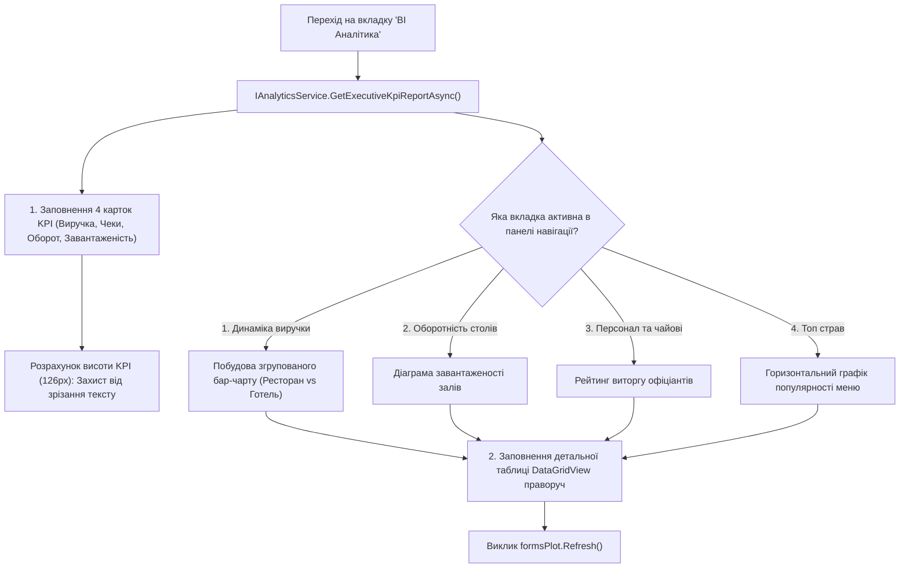

# Практичний гайд 13: Executive BI-аналітика: апаратне прискорення ScottPlot 5 та KPI-дашборди

## 1. Теоретична база та вибір бібліотеки візуалізації

Керівники ресторанно-готельних комплексів вимагають наочних звітів у реальному часі:
- Динаміка виручки ресторану та готелю за 7 днів з групуванням за джерелами доходу.
- Оборотність кожного столика та завантаженість номерного фонду.
- Рейтинг офіціантів за виручкою та сумою зароблених чайових.
- Топ-8 найпопулярніших страв за кількістю замовлень.

У старих версіях .NET для цього використовувався застарілий `System.Windows.Forms.DataVisualization.Charting` (MSChart), який працює повільно, не підтримує сучасне згладжування та складний для темних тем. 

В архітектурі **LuxeResto** інтегровано **ScottPlot 5** — передову high-performance графічну бібліотеку для .NET, яка підтримує апаратне прискорення через OpenGL/DirectX та чудово інтегрується з Windows Forms.

---

## 2. Архітектурна схема побудови аналітичного екрана



---

## 3. Детальний розбір реалізації в проєкті

### 3.1. Форма аналітики: [`AnalyticsForm.cs`](file:///C:/Users/Yurii/source/repos/- MASTERY/WinForms-HoReCa-Mastery/src/HoReCa.WinForms/Forms/AnalyticsForm.cs)

Налаштування згрупованого бар-чарту виручки за 7 днів із ручними підписами дат:

```csharp
private void RenderRevenueDynamics(ExecutiveAnalyticsDto data)
{
    _plotRevenue.Plot.Clear();
    ApplyDarkTheme(_plotRevenue.Plot);

    var days = data.DailyRevenues;
    double[] xs = Enumerable.Range(0, days.Count).Select(i => (double)i).ToArray();
    double[] restaurantSales = days.Select(d => (double)d.RestaurantRevenue).ToArray();
    double[] hotelSales = days.Select(d => (double)d.HotelRevenue).ToArray();

    // Згруповані стовпчики: Синій (Ресторан) та Зелений (Готель)
    var barRest = _plotRevenue.Plot.Add.Bars(xs.Select(x => x - 0.18).ToArray(), restaurantSales);
    barRest.Color = ScottPlot.Color.FromHex("#0080FF");
    barRest.LegendText = "Ресторан";

    var barHotel = _plotRevenue.Plot.Add.Bars(xs.Select(x => x + 0.18).ToArray(), hotelSales);
    barHotel.Color = ScottPlot.Color.FromHex("#00D084");
    barHotel.LegendText = "Готель";

    // Ручна шкала дат по осі X
    Tick[] ticks = new Tick[days.Count];
    for (int i = 0; i < days.Count; i++)
    {
        ticks[i] = new Tick(i, days[i].Date.ToString("dd.MM (ddd)"));
    }
    _plotRevenue.Plot.Axes.Bottom.TickGenerator = new NumericManual(ticks);

    _plotRevenue.Plot.ShowLegend(Edge.Bottom);
    _plotRevenue.Refresh();
}
```

### 3.2. Геометрія карток KPI без обрізання тексту

Щоб уникнути відомої проблеми зрізання хвостиків букв («текст виїжджає вниз»), висоту панелі встановлено в **126 px**, а всередині кожної картки застосовано фіксований вертикальний розподіл:
- Заголовок: 20 px
- Значення (грошова сума): 40 px
- Підпис / пояснення: 22 px
- Запас до нижньої рамки картки: > 12 px

---

## 4. Підводні камені та типові помилки

> [!WARNING]
> **Перемальовування ScottPlot при ресайзі:**
> При зміні розмірів форми не викликайте `_plotRevenue.Refresh()` у кожному мікро-кроці події `Resize`. Використовуйте відкладений таймер або оновлюйте графік лише після стабілізації розмірів вікна, щоб уникнути падіння FPS.

---

## 5. Практичний чек-лист для закріплення
1. [ ] Перевірити коректність перемикання між 4 аналітичними вкладками.
2. [ ] Переконатися, що кнопка «Оновити дані» не обрізається по ширині.
3. [ ] Перевірити, що легенда графіків відображається внизу без перекриття стовпчиків.
