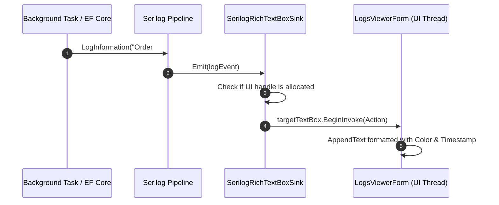

# Lesson 14: Thread-Safe Serilog Sink for Real-Time RichTextBox Diagnostics

## 1. Overview

Diagnosing issues in production desktop apps is difficult without instant log visibility. In this lesson, we build a custom **Serilog Sink** (`ILogEventSink`) that streams log entries in real-time into a `RichTextBox` control with syntax highlighting for LogLevels (Information = Green, Warning = Amber, Error = Red, Debug = Gray), completely thread-safe across background threads.

---

## 2. Cross-Thread Logging Architecture



---

## 3. Implementing SerilogRichTextBoxSink

```csharp
using Serilog.Core;
using Serilog.Events;
using System.Drawing;
using System.Windows.Forms;

namespace HoReCa.WinForms.Diagnostics;

public class SerilogRichTextBoxSink : ILogEventSink
{
    private readonly RichTextBox _target;
    private readonly int _maxLines;

    public SerilogRichTextBoxSink(RichTextBox target, int maxLines = 1000)
    {
        _target = target;
        _maxLines = maxLines;
    }

    public void Emit(LogEvent logEvent)
    {
        if (_target.IsDisposed || !_target.IsHandleCreated) return;

        var message = logEvent.RenderMessage();
        var timestamp = logEvent.Timestamp.ToString("HH:mm:ss.fff");
        var level = logEvent.Level.ToString().ToUpperInvariant();
        var color = GetLevelColor(logEvent.Level);

        _target.BeginInvoke(new Action(() =>
        {
            if (_target.IsDisposed) return;

            // Trim old lines if exceeding buffer limit
            if (_target.Lines.Length > _maxLines)
            {
                _target.Select(0, _target.GetFirstCharIndexFromLine(100));
                _target.SelectedText = "";
            }

            // Append Timestamp & Level
            _target.SelectionStart = _target.TextLength;
            _target.SelectionLength = 0;

            _target.SelectionColor = Color.DarkGray;
            _target.AppendText($"[{timestamp}] ");

            _target.SelectionColor = color;
            _target.AppendText($"[{level}] ");

            _target.SelectionColor = Color.Gainsboro;
            _target.AppendText($"{message}{Environment.NewLine}");

            if (logEvent.Exception != null)
            {
                _target.SelectionColor = Color.Salmon;
                _target.AppendText($"{logEvent.Exception}{Environment.NewLine}");
            }

            _target.ScrollToCaret();
        }));
    }

    private static Color GetLevelColor(LogEventLevel level) => level switch
    {
        LogEventLevel.Verbose => Color.Gray,
        LogEventLevel.Debug => Color.CornflowerBlue,
        LogEventLevel.Information => Color.MediumSeaGreen,
        LogEventLevel.Warning => Color.Orange,
        LogEventLevel.Error or LogEventLevel.Fatal => Color.IndianRed,
        _ => Color.White
    };
}
```

---

## 4. Attaching the Sink to the Logger

In `Program.cs` or inside `LogsViewerForm`:

```csharp
public void AttachSink(RichTextBox richTextBox)
{
    var sink = new SerilogRichTextBoxSink(richTextBox);
    Log.Logger = new LoggerConfiguration()
        .MinimumLevel.Debug()
        .WriteTo.Sink(sink)
        .CreateLogger();
}
```

---

## 5. Key Takeaways

1. **`BeginInvoke` vs `Invoke`**: Always use `BeginInvoke` (asynchronous message queuing) rather than `Invoke` (synchronous waiting) inside log sinks to avoid deadlock if the UI thread is waiting for the background task to complete.
2. **Buffer Limits**: Unconstrained appending to `RichTextBox` causes memory bloat. Enforce a maximum line threshold (e.g. 1000 lines).
