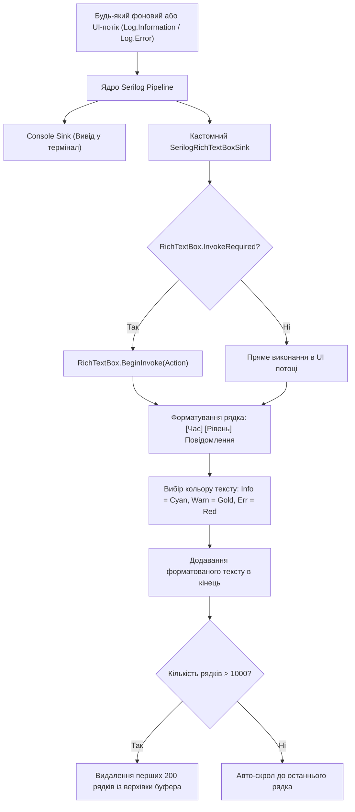

# Практичний гайд 14: Діагностика та аудит: потокобезпечний кастомний Serilog Sink для RichTextBox

## 1. Теоретична база та завдання живого аудиту

У процесі експлуатації комплексу виникають непередбачувані ситуації (обрив зв'язку з принтером, збій фіскалізації, помилка авторизації користувача). Для швидкої локалізації проблем системним адміністраторам необхідне **вікно системного журналу в реальному часі** безпосередньо всередині робочого місця.

**Виклики реалізації:**
- **Потокобезпека:** Події логування генеруються з десятків паралельних потоків (фонові таски списання складу, таймери KDS, HTTP-запити).
- **Підсвічування синтаксису:** Повідомлення рівня `Information`, `Warning` та `Error` мають підсвічуватися відповідними кольорами палітри.
- **Управління пам'яттю:** Контрол `RichTextBox` не може накопичувати нескінченну кількість тексту — після 1000 рядків старі повідомлення повинні автоматично видалятися з верхівки буфера.

---

## 2. Архітектурна схема конвеєра логування



---

## 3. Детальний розбір реалізації в проєкті

### 3.1. Кастомний Sink: [`SerilogRichTextBoxSink.cs`](file:///C:/Users/Yurii/source/repos/- MASTERY/WinForms-HoReCa-Mastery/src/HoReCa.WinForms/Common/SerilogRichTextBoxSink.cs)

```csharp
public class SerilogRichTextBoxSink : ILogEventSink
{
    private readonly RichTextBox _target;
    private readonly IFormatProvider? _formatProvider;

    public SerilogRichTextBoxSink(RichTextBox target, IFormatProvider? formatProvider = null)
    {
        _target = target;
        _formatProvider = formatProvider;
    }

    public void Emit(LogEvent logEvent)
    {
        if (_target.IsDisposed) return;

        if (_target.InvokeRequired)
        {
            _target.BeginInvoke(new Action(() => Emit(logEvent)));
            return;
        }

        Color color = logEvent.Level switch
        {
            LogEventLevel.Information => ThemePalette.Info,
            LogEventLevel.Warning => ThemePalette.Warning,
            LogEventLevel.Error or LogEventLevel.Fatal => ThemePalette.Danger,
            _ => ThemePalette.TextMuted
        };

        var message = logEvent.RenderMessage(_formatProvider);
        var timestamp = logEvent.Timestamp.ToString("HH:mm:ss.fff");

        _target.SelectionStart = _target.TextLength;
        _target.SelectionLength = 0;
        _target.SelectionColor = color;
        _target.AppendText($"[{timestamp}] [{logEvent.Level,-3}] {message}
");
        _target.ScrollToCaret();

        // Захист від переповнення пам'яті
        if (_target.Lines.Length > 1000)
        {
            _target.Select(0, _target.GetFirstCharIndexFromLine(150));
            _target.SelectedText = "";
        }
    }
}
```

### 3.2. Форма перегляду журналів: [`LogsViewerForm.cs`](file:///C:/Users/Yurii/source/repos/- MASTERY/WinForms-HoReCa-Mastery/src/HoReCa.WinForms/Forms/LogsViewerForm.cs)

Форма містить фільтрацію за рівнями логів, рядок пошуку за ключовим словом та кнопку експорту в текстовий файл.

---

## 4. Підводні камені та типові помилки

> [!WARNING]
> **Блокуючий `Invoke` vs неблокуючий `BeginInvoke`:**
> Ніколи не використовуйте `_target.Invoke()` всередині Serilog Sink! Якщо фоновий потік генерує сотні повідомлень логу під час блокування UI-потоку, використання синхронного `Invoke` призведе до мертвого блокування (*Deadlock*). Використовуйте виключно асинхронний `BeginInvoke`.

---

## 5. Практичний чек-лист для закріплення
1. [ ] Перевірити появу логу при старті та зміні статусів замовлень.
2. [ ] Переконатися, що помилки підсвічуються червоним кольором.
3. [ ] Перевірити роботу автоматичного очищення старих рядків при досягненні ліміту.
