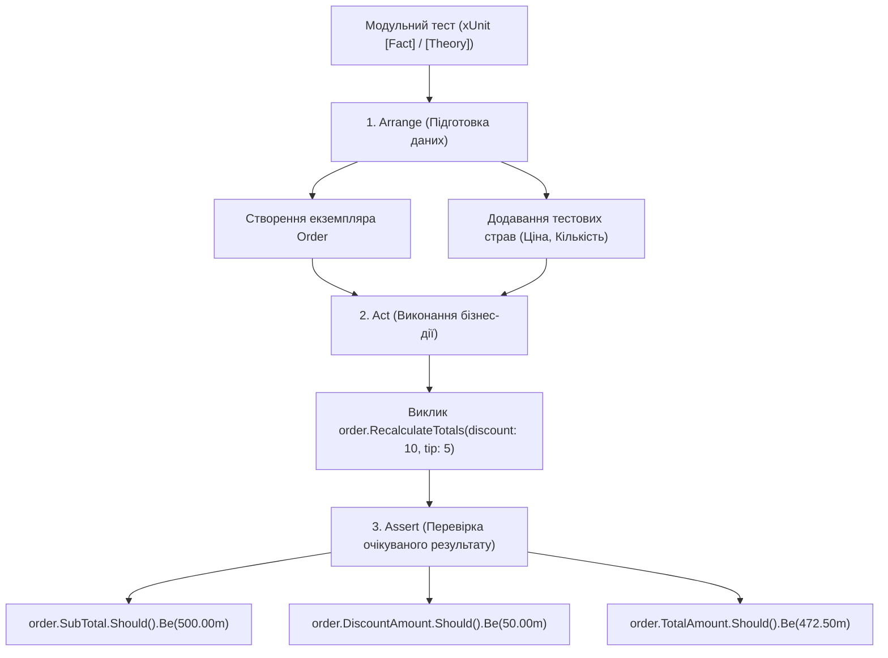

# Практичний гайд 15: Модульне тестування (Unit Testing) бізнес-логіки та калькуляцій (xUnit)

## 1. Теоретична база та стратегія тестування

У фінансових та ресторанних системах тестування через графічний інтерфейс вручну займає занадто багато часу та не гарантує покриття всіх крайових випадків (*Edge Cases*):
- Чи правильно нараховуються чайові при наявності акційної знижки?
- Що відбувається при спробі додати страву з від'ємною кількістю порцій?
- Чи генерується коректний статус дефіциту, коли залишок товару рівно дорівнює страховому запасу?

У проєкті [`HoReCa.Tests`](file:///C:/Users/Yurii/source/repos/- MASTERY/WinForms-HoReCa-Mastery/tests/HoReCa.Tests) реалізовано набір модульних тестів за допомогою фреймворків **xUnit** та **FluentAssertions**.

---

## 2. Архітектурна схема структури тестів (AAA Pattern)



---

## 3. Детальний розбір реалізації в проєкті

### 3.1. Юніт-тести калькуляцій замовлення: `OrderCalculationsTests.cs`

```csharp
public class OrderCalculationsTests
{
    [Fact]
    public void RecalculateTotals_WithDiscountAndTip_CalculatesCorrectFinancials()
    {
        // Arrange
        var order = new Order { OrderNumber = "TEST-01" };
        order.Items.Add(new OrderItem { Quantity = 2, UnitPrice = 200m }); // 400 ₴
        order.Items.Add(new OrderItem { Quantity = 1, UnitPrice = 100m }); // 100 ₴
        // SubTotal = 500 ₴

        // Act: 10% знижки, 5% чайових, 5% податку
        order.RecalculateTotals(discountPercent: 10, tipPercent: 5, taxRate: 0.05m);

        // Assert
        order.SubTotal.Should().Be(500.00m);
        order.DiscountAmount.Should().Be(50.00m); // 500 * 0.10
        order.TaxAmount.Should().Be(22.50m);       // (500 - 50) * 0.05
        order.TipAmount.Should().Be(22.50m);       // (500 - 50) * 0.05
        order.TotalAmount.Should().Be(495.00m);     // 450 + 22.50 + 22.50
    }
}
```

### 3.2. Тестування порогів складу: `InventoryThresholdTests.cs`

```csharp
[Theory]
[InlineData(10.0, 5.0, false)]  // Залишок 10 > поріг 5 -> Норма
[InlineData(5.0, 5.0, true)]    // Залишок 5 == поріг 5 -> Дефіцит
[InlineData(2.5, 5.0, true)]    // Залишок 2.5 < поріг 5 -> Дефіцит
public void InventoryItem_IsLowStock_DetectsThresholdCorrectly(decimal stock, decimal threshold, bool expectedLow)
{
    var item = new InventoryItem { CurrentStock = stock, SafetyThreshold = threshold };
    item.IsLowStock.Should().Be(expectedLow);
}
```

---

## 4. Підводні камені та типові помилки

> [!TIP]
> **Тестуйте чисту доменну модель:**
> Unit-тести повинні виконуватися за частки мілісекунди. Вони не повинні підключатися до реальної бази даних, запускати хост чи створювати екземпляри Windows Forms.

---

## 5. Практичний чек-лист для закріплення
1. [ ] Запустити тести через консоль: `dotnet test`.
2. [ ] Переконатися, що всі 30 тестів проходять зі статусом `Passed`.
3. [ ] Додати параметризований тест `[Theory]` для перевірки нульової кількості страв.
