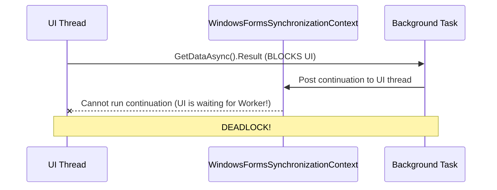

# Lesson 17: Asynchronous UI Patterns & Preventing Deadlocks

## 1. Overview

In Windows Forms, UI controls are bound to the single-threaded apartment (STA) thread. Blocking this thread with synchronous calls (`.Result`, `.Wait()`) causes the dreaded "Not Responding" title bar and complete application freezes. This lesson explores non-blocking async/await, cancellation tokens, and safe UI dispatching.

---

## 2. The Danger of `.Result` and `.Wait()`

In Windows Forms, the `SynchronizationContext` posts callbacks back to the UI thread. If the UI thread is synchronously waiting via `.Result`, the async method cannot resume, creating a circular deadlock:



**Rule**: Never use `.Result` or `.Wait()`. Always write `async void` for top-level event handlers and `async Task` for all underlying services.

---

## 3. Safe Asynchronous Event Handling

```csharp
private async void btnRefresh_Click(object sender, EventArgs e)
{
    try
    {
        btnRefresh.Enabled = false;
        Cursor = Cursors.WaitCursor;

        using var cts = new CancellationTokenSource(TimeSpan.FromSeconds(10));
        var items = await _inventoryService.GetAllInventoryAsync(txtSearch.Text, cts.Token);

        dgvInventory.DataSource = items;
    }
    catch (OperationCanceledException)
    {
        MessageBox.Show("Операцію було скасовано за таймаутом.", "Попередження", MessageBoxButtons.OK, MessageBoxIcon.Warning);
    }
    catch (Exception ex)
    {
        _logger.LogError(ex, "Error refreshing inventory");
        MessageBox.Show($"Помилка завантаження: {ex.Message}", "Помилка", MessageBoxButtons.OK, MessageBoxIcon.Error);
    }
    finally
    {
        btnRefresh.Enabled = true;
        Cursor = Cursors.Default;
    }
}
```

---

## 4. Cross-Thread Dispatching with `InvokeRequired`

When a background thread or timer event needs to update a control:

```csharp
public void UpdateStatusIndicator(bool isConnected)
{
    if (InvokeRequired)
    {
        BeginInvoke(new Action(() => UpdateStatusIndicator(isConnected)));
        return;
    }

    lblDbStatus.Text = isConnected ? "БД: Підключено" : "БД: Офлайн";
    lblDbStatus.ForeColor = isConnected ? Color.LightGreen : Color.LightCoral;
}
```
