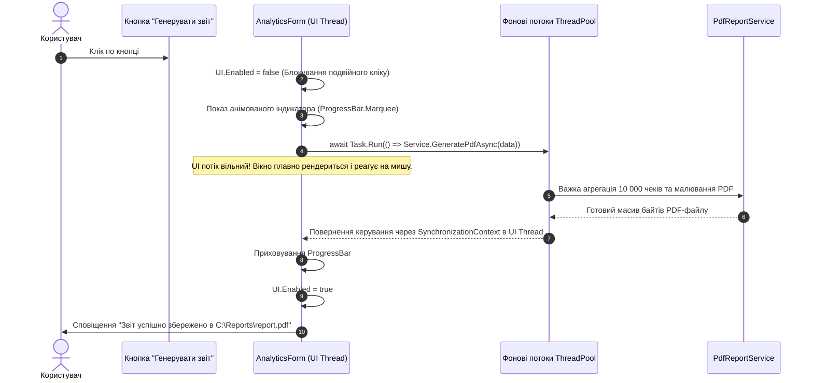

# Практичний гайд 17: Асинхронність у Windows Forms: запобігання зависанню інтерфейсу (ANR)

## 1. Теоретична база та модель черги повідомлень Win32

Будь-який застосунок Windows Forms керується циклом обробки повідомлень ОС (**Windows Message Loop**). Коли користувач натискає кнопку, Windows поміщає в чергу потоку повідомлення `WM_LBUTTONDOWN`. Якщо в обробнику події викликати «довгу» синхронну операцію (наприклад, генерацію важкого PDF-звіту або запит до сервера через `Thread.Sleep(5000)`), цикл обробки блокується.

**Наслідки блокування UI-потоку:**
- Вікно перестає реагувати на кліки та перетягування.
- Операційна система домальовує у заголовку вікна напис **«(Не відповідає)» / «Application Not Responding»**.
- Полотно форми біліє, елементи керування перестають перемальовуватися.

Для запобігання цьому в .NET 10 використовується модель **TAP (Task-based Asynchronous Pattern)** на базі ключових слів `async` та `await`.

---

## 2. Архітектурна схема обробки асинхронної операції



---

## 3. Детальний розбір реалізації в проєкті

### 3.1. Асинхронний обробник із блокуванням повторних натискань

```csharp
private async void BtnExportPdf_Click(object? sender, EventArgs e)
{
    _btnExportPdf.Enabled = false;
    _lblStatus.Text = "⏳ Генерація фінансового звіту...";
    _progressBar.Visible = true;

    try
    {
        using var cts = new CancellationTokenSource(TimeSpan.FromSeconds(30)); // Таймаут 30 сек
        
        // Виконання важкої операції у фоновому пулі потоків
        var pdfPath = await Task.Run(async () =>
        {
            return await _pdfReportService.GenerateFinancialReportAsync(_currentData, cts.Token);
        });

        _lblStatus.Text = "✓ Звіт сформовано!";
        Process.Start(new ProcessStartInfo(pdfPath) { UseShellExecute = true });
    }
    catch (OperationCanceledException)
    {
        _lblStatus.Text = "⚠ Операцію скасовано через таймаут.";
    }
    catch (Exception ex)
    {
        Log.Error(ex, "Помилка експорту PDF");
        MessageBox.Show($"Помилка експорту: {ex.Message}", "Помилка", MessageBoxButtons.OK, MessageBoxIcon.Error);
    }
    finally
    {
        _btnExportPdf.Enabled = true;
        _progressBar.Visible = false;
    }
}
```

---

## 4. Підводні камені та типові помилки

> [!WARNING]
> **Антипатерн `async void`:**
> Використовуйте `async void` **виключно** для обробників подій WinForms (`private async void Button_Click`). Для всіх інших сервісних методів завжди повертайте `Task` або `Task<T>`. Необроблений виняток у звичайному методі `async void` призводить до миттєвого аварійного завершення всього процесу застосунку (*Process Crash*).

---

## 5. Практичний чек-лист для закріплення
1. [ ] Перевірити, що всі виклики бази даних використовують `await`.
2. [ ] Переконатися, що тривалі операції мають кнопку скасування через `CancellationTokenSource`.
3. [ ] Перевірити, що кнопки блокуються на час виконання операції, щоб уникнути повторних відправок замовлення.
