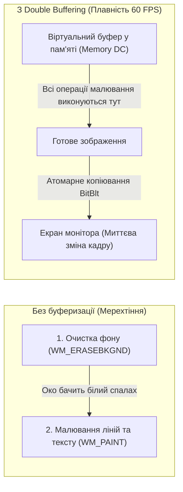

# Практичний гайд 18: Кастомний рендеринг OwnerDraw, Double Buffering та ліквідація мерехтіння

## 1. Теоретична база: Чому виникає мерехтіння (Flickering)

У графічній підсистемі Windows Forms перемальовування контрола за замовчуванням відбувається у два окремі етапи:
1. Повідомлення `WM_ERASEBKGND`: Windows зафарбовує фоновий прямокутник стандартним кольором (найчастіше світло-сірим).
2. Повідомлення `WM_PAINT`: Контрол малює поверх фону свій текст, рамки та зображення.

Коли форма містить багато елементів або користувач перетягує столик на карті залів, між цими двома етапами проходить кілька мілісекунд. Людське око фіксує проміжний стан фону — виникає відчуття розриву картинки та **дратівливого мерехтіння (flickering)**.

---

## 2. Механізм апаратної подвійної буферизації (Double Buffering)

Замість прямого малювання на екранній поверхні відеокарти:
1. Виділяється невидимий буфер у пам'яті (*Off-screen Bitmap*).
2. Усі операції GDI+ (фон, лінії, закруглені кути, шрифти) малюються у віртуальний буфер.
3. Готова скомпільована картинка за один атомарний виклик Win32 API функції `BitBlt` копіюється на екран. Мерехтіння стає фізично неможливим.



---

## 3. Детальний розбір реалізації в проєкті

### 3.1. Активація подвійної буферизації у віджетах: [`FloorTableWidget.cs`](file:///C:/Users/Yurii/source/repos/- MASTERY/WinForms-HoReCa-Mastery/src/HoReCa.WinForms/Controls/FloorTableWidget.cs)

У конструкторі кастомного контрола вмикаються системні прапорці стилю:

```csharp
public FloorTableWidget()
{
    SetStyle(
        ControlStyles.AllPaintingInWmPaint | // Ігнорувати WM_ERASEBKGND, малювати фон у WM_PAINT
        ControlStyles.UserPaint |            // Малювати самостійно, без втручання стандартного Win32
        ControlStyles.OptimizedDoubleBuffer |// Активація внутрішнього віртуального буфера
        ControlStyles.ResizeRedraw |         // Перемальовувати при зміні розмірів
        ControlStyles.SupportsTransparentBackColor, true);

    UpdateStyles();
    DoubleBuffered = true;
}
```

### 3.2. Управління пам'яттю GDI+ дескрипторів: [`ThemePalette.cs`](file:///C:/Users/Yurii/source/repos/- MASTERY/WinForms-HoReCa-Mastery/src/HoReCa.WinForms/Common/ThemePalette.cs)

Створення `new Font("Segoe UI", 12f)` всередині методу `OnPaint` під час руху миші створює сотні нових GDI-об'єктів за секунду. Коли їхня кількість сягає ліміту ОС (10 000 дескрипторів), застосунок падає. 

**Рішення:** Кешування шрифтів у статичному класі [`ThemePalette`](file:///C:/Users/Yurii/source/repos/- MASTERY/WinForms-HoReCa-Mastery/src/HoReCa.WinForms/Common/ThemePalette.cs) або утилізація локальних ресурсів через `using var pen = new Pen(...)`.

---

## 4. Підводні камені та типові помилки

> [!WARNING]
> **Не забувайте вимикати SmoothingMode для чітких ліній:**
> Режим `SmoothingMode.AntiAlias` чудово підходить для заокруглених кутів та кіл, але для прямих 1-піксельних розділювачів він робить лінію розмитою (напівпрозорою 2-піксельною). Для сіток та розділювачів вимикайте згладжування: `g.SmoothingMode = SmoothingMode.None`.

---

## 5. Практичний чек-лист для закріплення
1. [ ] Перевірити, що всі кастомні віджети мають увімкнений `DoubleBuffered = true`.
2. [ ] Перевірити відсутність витоку GDI-дескрипторів у диспетчері завдань Windows (колонки «GDI Objects» та «USER Objects»).
3. [ ] Переконатися, що перетягування столів відбувається абсолютно плавно.
