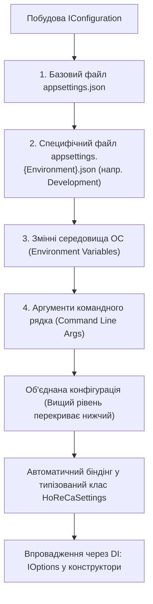

# Практичний гайд 19: Управління конфігурацією: патерн IOptions, appsettings.json та змінні середовища

## 1. Теоретична база: Чому не `ConfigurationManager.AppSettings`

У старих проєктних шаблонах конфігурація зчитувалася через `App.config` за допомогою застарілого `ConfigurationManager.AppSettings["MyKey"]`. Такий підхід має суттєві недоліки:
- Тільки плоска структура типу «ключ-значення» без вкладеності.
- Відсутність типізації (все повертається як звичайний рядок `string`).
- Неможливість динамічного перезавантаження конфігурації без перезапуску застосунку (*Reload on Change*).

У **.NET 10** використовується сучасний конфігураційний конвеєр на базі **Microsoft.Extensions.Configuration** та патерну **Options Pattern** (`IOptions<T>`, `IOptionsSnapshot<T>`).

---

## 2. Архітектурна схема зчитування та пріоритетів конфігурації



---

## 3. Детальний розбір реалізації в проєкті

### 3.1. Структура файлу `appsettings.json`

```json
{
  "Database": {
    "Provider": "Sqlite"
  },
  "ConnectionStrings": {
    "DefaultConnection": "Data Source=horeca_local.db",
    "PostgreSql": "Host=localhost;Port=5432;Database=horeca_db;Username=postgres;Password=postgres",
    "SqliteFallback": "Data Source=horeca_local.db"
  },
  "HoReCaSettings": {
    "BusinessName": "GrandLux Resort & Restaurant",
    "Currency": "UAH",
    "AutoSeedDemoData": true,
    "DefaultTaxRate": 0.05
  },
  "Serilog": {
    "MinimumLevel": "Information"
  }
}
```

### 3.2. Типізований клас налаштувань та реєстрація

```csharp
public class HoReCaSettings
{
    public string BusinessName { get; set; } = "GrandLux";
    public string Currency { get; set; } = "UAH";
    public bool AutoSeedDemoData { get; set; } = true;
    public decimal DefaultTaxRate { get; set; } = 0.05m;
}

// Реєстрація в Program.cs:
services.Configure<HoReCaSettings>(context.Configuration.GetSection("HoReCaSettings"));
```

---

## 4. Підводні камені та типові помилки

> [!TIP]
> **Властивість файлу 'Copy to Output Directory':**
> Найчастіша помилка розробників WinForms — забути налаштувати властивість файлу `appsettings.json`. Переконайтеся, що у файлі проєкту `.csproj` прописано:
> `<None Update="appsettings.json"><CopyToOutputDirectory>PreserveNewest</CopyToOutputDirectory></None>`. Без цього файл не потрапить до папки `bin/`, і програма не знайде налаштувань при старті.

---

## 5. Практичний чек-лист для закріплення
1. [ ] Перевірити наявність файлу `appsettings.json` у вихідній директорії бінарних файлів.
2. [ ] Перевірити зчитування назви бізнесу та валюти через `IOptions<HoReCaSettings>`.
3. [ ] Переконатися, що секретні паролі до БД можна передати через системну змінну `ConnectionStrings__PostgreSql`.
