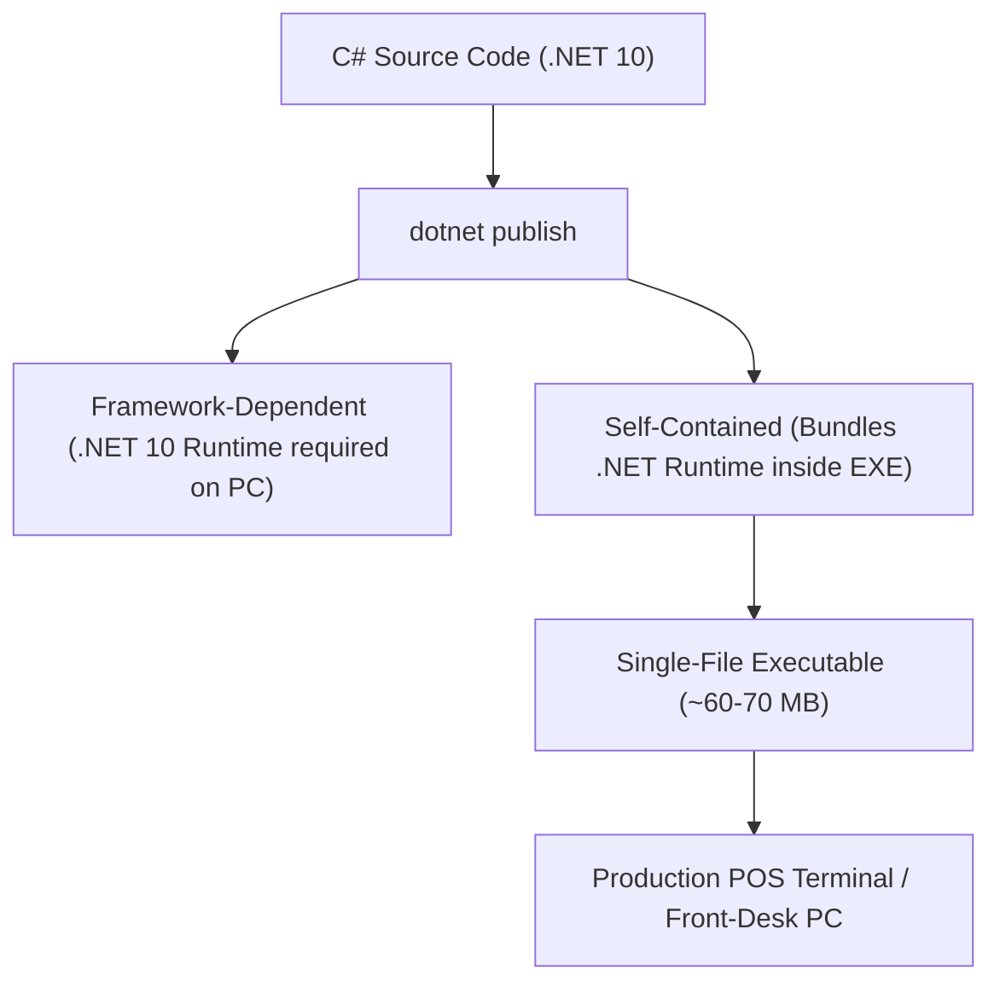

# Lesson 20: Production Packaging & Self-Contained Deployment

## 1. Overview

Delivering a Windows Forms application to end-user workstations or POS terminals requires predictable packaging. Modern .NET 10 enables compiling the application into a **Single-File Self-Contained Executable** that runs without requiring a pre-installed .NET Runtime on the target machine.

---

## 2. Publishing Strategies



---

## 3. CLI Publishing Commands

### 1. Single-File Self-Contained Deployment (Windows x64)

```powershell
dotnet publish src/HoReCa.WinForms/HoReCa.WinForms.csproj `
    -c Release `
    -r win-x64 `
    --self-contained true `
    -p:PublishSingleFile=true `
    -p:IncludeNativeLibrariesForSelfExtract=true `
    -p:EnableCompressionInSingleFile=true `
    -o ./publish/win-x64
```

### 2. Framework-Dependent Lightweight Deployment

If all client machines already have .NET 10 Runtime installed:

```powershell
dotnet publish src/HoReCa.WinForms/HoReCa.WinForms.csproj `
    -c Release `
    -o ./publish/framework-dependent
```

---

## 4. Crucial Publishing Settings in `.csproj`

Ensure `appsettings.json` is automatically copied to the output folder:

```xml
<ItemGroup>
  <None Update="appsettings.json">
    <CopyToOutputDirectory>PreserveNewest</CopyToOutputDirectory>
  </None>
</ItemGroup>
```

---

## 5. Summary & Graduation Checklist

Congratulations! You have completed the **WinForms HoReCa Mastery** curriculum. You now have the skills to build:
- Clean Architecture enterprise systems in modern Windows Forms.
- High-performance, flicker-free custom GDI+ controls.
- Full asynchronous concurrency with `IDbContextFactory` and Entity Framework Core 10.
- Touchscreen point-of-sale interfaces and KDS kitchen automation boards.
- Fiscal receipt generation and printing subsystems.
- Thorough automated unit and integration test suites.
