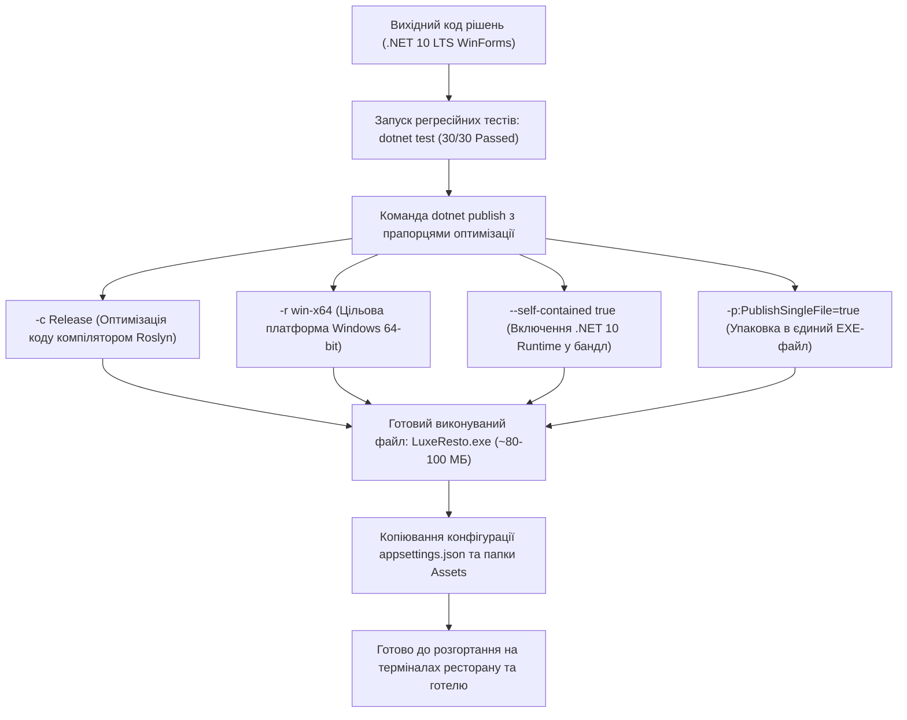

# Практичний гайд 20: Підготовка до продакшену, Single-File публікація та розгортання

## 1. Теоретична база та сценарії дистрибуції

На фінальному етапі розробки десктопного рішення для сектору HoReCa постає завдання розгортання:
- Застосунок повинен встановлюватися на сенсорні моноблоки касирів, робочі станції портьє та кухонні планшети з мінімальними вимогами до ІТ-персоналу.
- На клієнтських комп'ютерах **може бути не встановлений .NET SDK або .NET Runtime**.
- Застосунок повинен бути зібраний як єдиний виконуваний файл (*Single-File Executable*) з усіма вбудованими ресурсами (іконками, шрифтами, емблемою).

---

## 2. Архітектурна схема конвеєра публікації



---

## 3. Детальний розбір команди публікації

### 3.1. Команда збірки самодостатнього пакету:

```powershell
dotnet publish "src/HoReCa.WinForms/HoReCa.WinForms.csproj" `
    -c Release `
    -r win-x64 `
    --self-contained true `
    -p:PublishSingleFile=true `
    -p:IncludeNativeLibrariesForSelfExtract=true `
    -p:EnableCompressionInSingleFile=true `
    -o "./publish/win-x64"
```

### 3.2. Налаштування файлу проєкту: [`HoReCa.WinForms.csproj`](file:///C:/Users/Yurii/source/repos/- MASTERY/WinForms-HoReCa-Mastery/src/HoReCa.WinForms/HoReCa.WinForms.csproj)

```xml
<PropertyGroup>
    <OutputType>WinExe</OutputType>
    <TargetFramework>net10.0-windows</TargetFramework>
    <Nullable>enable</Nullable>
    <UseWindowsForms>true</UseWindowsForms>
    <ImplicitUsings>enable</ImplicitUsings>
    <ApplicationIcon>Assets\app.ico</ApplicationIcon>
</PropertyGroup>

<ItemGroup>
    <None Update="appsettings.json">
        <CopyToOutputDirectory>PreserveNewest</CopyToOutputDirectory>
    </None>
    <None Update="Assets\**">
        <CopyToOutputDirectory>PreserveNewest</CopyToOutputDirectory>
    </None>
</ItemGroup>
```

---

## 4. Підводні камені та типові помилки

> [!WARNING]
> **Шляхи до файлів у Single-File застосунках:**
> У Single-File виконуваному файлі `Assembly.GetExecutingAssembly().Location` повертає порожній рядок або тимчасову системну папку розпаковки (`Temp`). Завжди використовуйте `AppContext.BaseDirectory` для визначення фізичного розташування файлів поруч із `.exe` (наприклад, для папки `Assets` та бази `horeca_local.db`).

---

## 5. Практичний чек-лист для закріплення
1. [ ] Перевірити працездатність скомпільованого `.exe` на «чистій» машині без встановленого .NET SDK.
2. [ ] Переконатися, що папка `Assets/Images` скопійована поруч із виконуваним файлом.
3. [ ] Перевірити коректність створення файлу бази даних при першому запуску.
