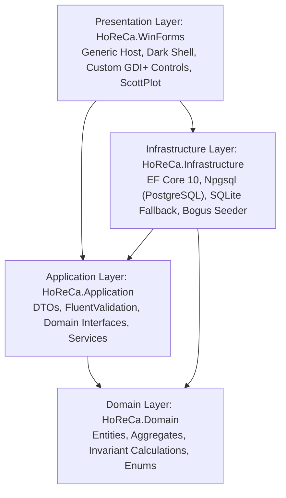
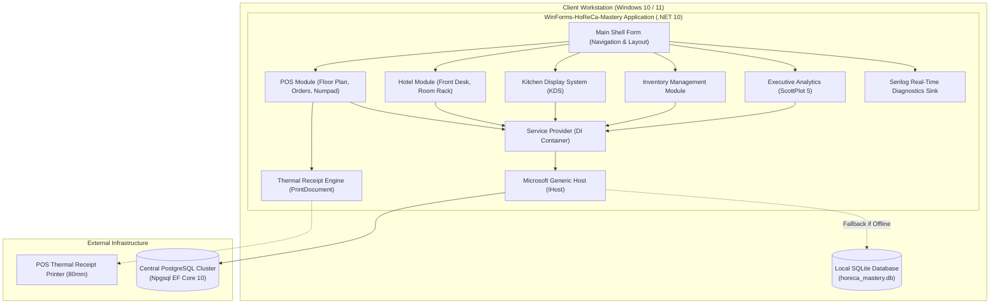
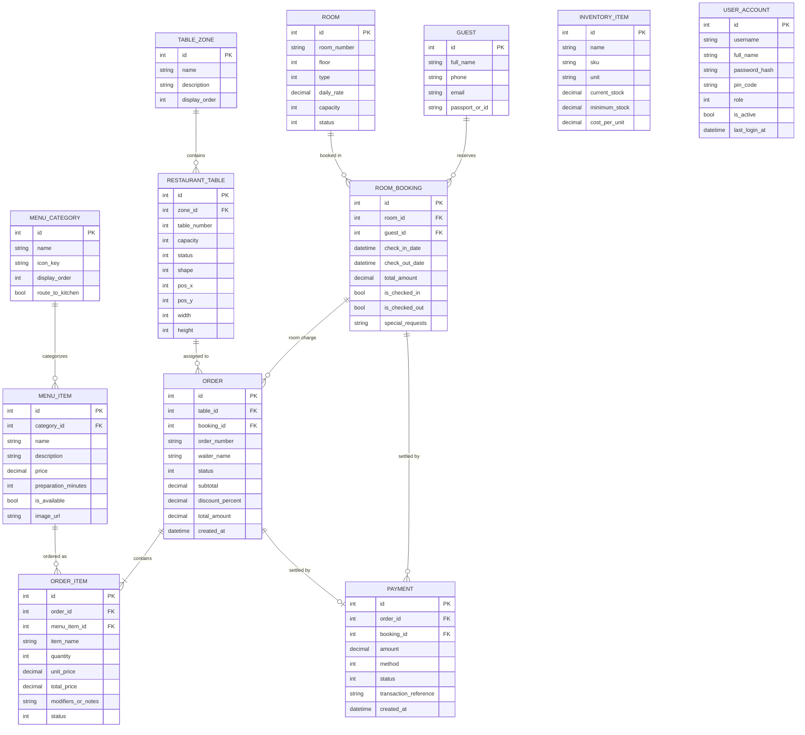

# WinForms HoReCa Mastery: Enterprise Hotel & Restaurant Management System

A production-grade, educational enterprise desktop solution built on **.NET 10** and **Windows Forms**, demonstrating modern software engineering practices, Clean Architecture, Microsoft Generic Host, Dependency Injection, and dual-database persistence (PostgreSQL / SQLite).

---

## Architecture Overview

The system is designed following **Clean Architecture** and **Domain-Driven Design (DDD)** principles to completely isolate business logic from presentation and database concerns.



---

## C4 Container Architecture



---

## Database Relational Model (ER Diagram)



---

## Demo Accounts & Rapid Testing

The application features a modern **Start Page & Login Dialog** (`LoginForm`) with **1-click quick login cards** for instant evaluation across 5 business roles:

| Role | Username | Default Password | Quick 4-Digit PIN | Access Scope & Responsibilities |
| :--- | :--- | :--- | :--- | :--- |
| **Адміністратор (Admin)** | `admin` | `admin123` | `1111` | Повний доступ до всіх модулів, BI-аналітика ScottPlot, аудит-журнали Serilog. |
| **Офіціант (Waiter)** | `waiter` | `waiter123` | `2222` | Інтерактивна карта залів, створення замовлень, touch-нумпад, закриття чеків. |
| **Рецепція (Receptionist)** | `reception` | `hotel123` | `3333` | Стійка реєстрації, 2D календарна шахівниця (Room Rack), поселення гостей. |
| **Шеф-кухар (Chef)** | `chef` | `chef123` | `4444` | Кухонний монітор (KDS), таймери приготування, аудіо-оповіщення страв. |
| **Менеджер складу (Store)** | `store` | `store123` | `5555` | Баланси залишків, контроль дефіциту, оприбуткування через модальне вікно. |

### Employee Registration
Users can also switch to the **"Реєстрація"** tab to create custom employee accounts. The registration workflow uses:
- FluentValidation validation (`RegisterUserRequestValidator`) enforcing 4-digit PIN masks and minimum length rules.
- SHA-256 salted password hashing (`PasswordHelper`).
- Direct database persistence in PostgreSQL or SQLite.


---

## Windows Forms Components Reference

Every core Windows Forms component is utilized in a realistic, production-ready scenario:

| Component | HoReCa Module | Implementation & Pedagogical Purpose |
| :--- | :--- | :--- |
| `DataGridView` | POS Terminal & Inventory | AutoGenerateColumns = false, FullRowSelect, custom CellPainting for low-stock badges. |
| `TreeView` | System Navigation | Hierarchical view of hotel floors, rooms, and restaurant zones. |
| `ListView` (TileView) | Hotel Front-Desk | High-DPI room card tiles displaying room category, price, and status. |
| `FlowLayoutPanel` | Kitchen Display (KDS) & Catalog | Responsive wrapping for KDS order tickets and menu dish cards. |
| `TableLayoutPanel` | Touch Cashier Numpad | Proportional 4x4 grid layout with quick-cash denomination buttons. |
| `SplitContainer` | POS Terminal Layout | Resizable splitter between interactive floor plan and active order details. |
| `MenuStrip` | Application Header | Top-level menu shortcuts, database switching, and diagnostic triggers. |
| `ToolStrip` | Floor Plan Actions | Action bar for toggling "Edit Layout", zooming, and filtering table zones. |
| `StatusStrip` | Shell Footer | Live system clock, database connectivity indicator, and managed memory monitor. |
| `ContextMenuStrip` | Interactive Tables & Rooms | Right-click context menus to create orders, change statuses, or inspect bookings. |
| `ErrorProvider` | Modal Dialogs | Non-blinking validation error alerts integrated with FluentValidation. |
| `MaskedTextBox` | New Booking Dialog | Structured input mask for Ukrainian phone numbers (`+38 (000) 000-00-00`). |
| `DateTimePicker` | Front Desk & Reservations | Date selection constrained to future dates with cross-field range validation. |
| `LoginForm` | Start Page & Authentication | 1-click role switcher cards, PIN-based rapid login, user registration workflow. |
| `PrintDocument` | Fiscal Subsystem | GDI+ 80mm thermal receipt rendering, page layout, and fiscal text generation. |
| `PrintPreviewDialog` | Payment Dialog | Preview thermal receipts before sending to physical hardware. |
| `RichTextBox` | Real-Time Diagnostics | Thread-safe Serilog sink target with ANSI LogLevel color-coding. |
| `ScottPlot.WinForms` | Executive Analytics | Hardware-accelerated 7-day revenue bar charts and KPI metrics. |
| `System.Windows.Forms.Timer` | KDS & Shell | Live ticket elapsed duration calculation and status bar clock updates. |

---

## Solution Structure

```
WinForms-HoReCa-Mastery/
├── WinForms-HoReCa-Mastery.slnx          # Solution file (.NET 10 slnx format)
├── src/
│   ├── HoReCa.Domain/                    # Domain Layer: Entities & Enums
│   │   ├── Common/BaseEntity.cs
│   │   ├── Enums/DomainEnums.cs
│   │   └── Entities/
│   │       ├── HotelEntities.cs
│   │       ├── RestaurantEntities.cs
│   │       └── InventoryAndPaymentEntities.cs
│   ├── HoReCa.Application/               # Application Layer: DTOs, Validators, Interfaces
│   │   ├── DTOs/ApplicationDtos.cs
│   │   ├── Validators/Validators.cs
│   │   └── Interfaces/ApplicationInterfaces.cs
│   ├── HoReCa.Infrastructure/            # Infrastructure: EF Core, PostgreSQL, SQLite, Seeder
│   │   ├── Persistence/HoReCaDbContext.cs
│   │   ├── Persistence/DbSeeder.cs
│   │   └── Services/
│   │       ├── TablePosService.cs
│   │       ├── RoomBookingService.cs
│   │       ├── AdditionalServices.cs
│   │       └── ReceiptTextFormatter.cs
│   └── HoReCa.WinForms/                  # Presentation Layer: WinForms, Host, Controls, Forms
│       ├── Common/ThemePalette.cs
│       ├── Common/BaseForm.cs
│       ├── Diagnostics/SerilogRichTextBoxSink.cs
│       ├── Printing/ReceiptPrinterEngine.cs
│       ├── Controls/
│       │   ├── FloorTableWidget.cs
│       │   ├── DishCardControl.cs
│       │   ├── RoomRackControl.cs
│       │   ├── CashierNumpadControl.cs
│       │   └── KitchenTicketControl.cs
│       ├── Forms/
│       │   ├── MainShellForm.cs
│       │   ├── PosTerminalForm.cs
│       │   ├── HotelFrontDeskForm.cs
│       │   ├── KitchenDisplayForm.cs
│       │   ├── InventoryForm.cs
│       │   ├── AnalyticsForm.cs
│       │   ├── PaymentDialogForm.cs
│       │   ├── NewBookingDialogForm.cs
│       │   └── LogsViewerForm.cs
│       ├── appsettings.json
│       └── Program.cs
├── tests/
│   └── HoReCa.Tests/                     # Automated Test Suite (16 Tests)
│       ├── UnitTests/
│       │   ├── OrderServiceTests.cs
│       │   ├── BookingValidatorTests.cs
│       │   ├── OrderValidatorTests.cs
│       │   └── InventoryAndPrinterTests.cs
│       └── IntegrationTests/
│           └── TablePosServiceTests.cs
└── Docs/
    ├── ARCHITECTURE.md                   # Architectural deep-dive & threading model
    ├── DATABASE_SCHEMA.md                # Full relational schema, column types & indexes
    └── Lessons/                          # 20-lesson step-by-step master course
        ├── 01-generic-host-and-di.md
        ├── 02-dual-database-persistence.md
        ├── 03-domain-modeling-horeca.md
        ├── 04-modern-dark-shell-navigation.md
        ├── 05-interactive-floor-plan-drag-drop.md
        ├── 06-pos-order-management-and-datagrid.md
        ├── 07-touch-cashier-numpad-tablelayout.md
        ├── 08-thermal-receipt-gdi-printdocument.md
        ├── 09-hotel-frontdesk-matrix-roomrack.md
        ├── 10-modal-dialogs-validation-errorprovider.md
        ├── 11-kitchen-display-system-flowlayout-timers.md
        ├── 12-inventory-stock-datagrid-cellpainting.md
        ├── 13-executive-analytics-scottplot-charts.md
        ├── 14-threadsafe-serilog-sink-richtextbox.md
        ├── 15-unit-testing-business-logic.md
        ├── 16-integration-testing-sqlite-inmemory.md
        ├── 17-asynchronous-ui-and-background-tasks.md
        ├── 18-custom-ownerdraw-and-flicker-free-gdi.md
        ├── 19-configuration-options-appsettings.md
        └── 20-production-deployment-and-packaging.md
```

---

## Step-by-Step Educational Curriculum

| Lesson | Title | Core Competencies |
| :---: | :--- | :--- |
| **01** | [Generic Host & Dependency Injection](Docs/Lessons/01-generic-host-and-di.md) | `IHostBuilder`, ServiceCollection, DI lifetimes, `ApplicationConfiguration.Initialize()`. |
| **02** | [Dual-Database Persistence](Docs/Lessons/02-dual-database-persistence.md) | EF Core 10, Npgsql (PostgreSQL), SQLite fallback, `IDbContextFactory` in desktop apps. |
| **03** | [Domain Modeling & Encapsulation](Docs/Lessons/03-domain-modeling-horeca.md) | Rich entities, DDD aggregates, invariant validation, monetary calculations. |
| **04** | [Modern Dark Shell & Navigation](Docs/Lessons/04-modern-dark-shell-navigation.md) | TopLevel = false form hosting, slate palette, system status bar, live timer clock. |
| **05** | [Interactive Floor Plan Drag & Drop](Docs/Lessons/05-interactive-floor-plan-drag-drop.md) | Custom UserControl, MouseDown/Move/Up coordinate math, persistent layouts. |
| **06** | [POS Order Management & DataGridView](Docs/Lessons/06-pos-order-management-and-datagrid.md) | `BindingList<T>`, DataGridView column definitions, real-time total updates. |
| **07** | [Touch-Friendly Cashier Numpad](Docs/Lessons/07-touch-cashier-numpad-tablelayout.md) | `TableLayoutPanel` percentage grid, touch-friendly dimensions, quick cash buttons. |
| **08** | [Thermal Receipt Printing & GDI+](Docs/Lessons/08-thermal-receipt-gdi-printdocument.md) | `PrintDocument`, `PrintPreviewDialog`, font metrics, fixed-width 40-col formatting. |
| **09** | [Hotel Front-Desk & Room Rack Matrix](Docs/Lessons/09-hotel-frontdesk-matrix-roomrack.md) | 2D calendar matrix, `ListView` TileView, room reservation state indicators. |
| **10** | [Modal Dialogs & ErrorProvider Validation](Docs/Lessons/10-modal-dialogs-validation-errorprovider.md) | `MaskedTextBox`, `DateTimePicker`, `ErrorProvider`, FluentValidation integration. |
| **11** | [Kitchen Display System (KDS)](Docs/Lessons/11-kitchen-display-system-flowlayout-timers.md) | `FlowLayoutPanel`, live order cards, elapsed time alerts, acoustic notifications. |
| **12** | [Inventory Management & CellPainting](Docs/Lessons/12-inventory-stock-datagrid-cellpainting.md) | DataGridView `CellPainting`, rounded status badges, stock deficiency warnings. |
| **13** | [Executive Analytics with ScottPlot 5](Docs/Lessons/13-executive-analytics-scottplot-charts.md) | High-performance charting, dark-themed revenue bar plots, KPI summary cards. |
| **14** | [Thread-Safe Serilog RichTextBox Sink](Docs/Lessons/14-threadsafe-serilog-sink-richtextbox.md) | Custom `ILogEventSink`, cross-thread UI dispatching via `BeginInvoke`, color logs. |
| **15** | [Unit Testing Business Logic](Docs/Lessons/15-unit-testing-business-logic.md) | xUnit, FluentAssertions, FluentValidation `TestHelper`, domain calculation tests. |
| **16** | [Integration Testing with SQLite In-Memory](Docs/Lessons/16-integration-testing-sqlite-inmemory.md) | In-memory relational database testing, transaction isolation, service testing. |
| **17** | [Asynchronous UI Patterns & Deadlocks](Docs/Lessons/17-asynchronous-ui-and-background-tasks.md) | Avoiding `.Result` deadlocks, non-blocking UI thread, `CancellationToken` support. |
| **18** | [Custom OwnerDraw & Flicker-Free GDI+](Docs/Lessons/18-custom-ownerdraw-and-flicker-free-gdi.md) | `ControlStyles.OptimizedDoubleBuffer`, anti-aliased graphics, reflection buffering. |
| **19** | [Configuration & Options Binding](Docs/Lessons/19-configuration-options-appsettings.md) | `appsettings.json`, `IOptions<T>`, strongly-typed enterprise settings. |
| **20** | [Production Packaging & Self-Contained Deployment](Docs/Lessons/20-production-deployment-and-packaging.md) | Single-file publish, native dependencies, self-contained deployment. |

---

## Quick Start Guide

### Prerequisites
- [.NET 10 SDK](https://dotnet.microsoft.com/download/dotnet/10.0) (or later)
- Windows 10 / 11 (64-bit)
- (Optional) PostgreSQL 15+ if testing central server mode (SQLite runs automatically out of the box).

### 1. Clone the Repository
```bash
git clone https://github.com/MrTomkaYurii/WinForms-HoReCa-Mastery.git
cd WinForms-HoReCa-Mastery
```

### 2. Run Automated Unit & Integration Tests
```bash
dotnet test
```

### 3. Launch the Application
```bash
dotnet run --project src/HoReCa.WinForms/HoReCa.WinForms.csproj
```
On first launch, the application will automatically create `horeca_mastery.db` (if PostgreSQL is not configured) and seed realistic tables, rooms, categories, menu items, and inventory items.

---

## License

This project is open-source and available under the **MIT License**.
