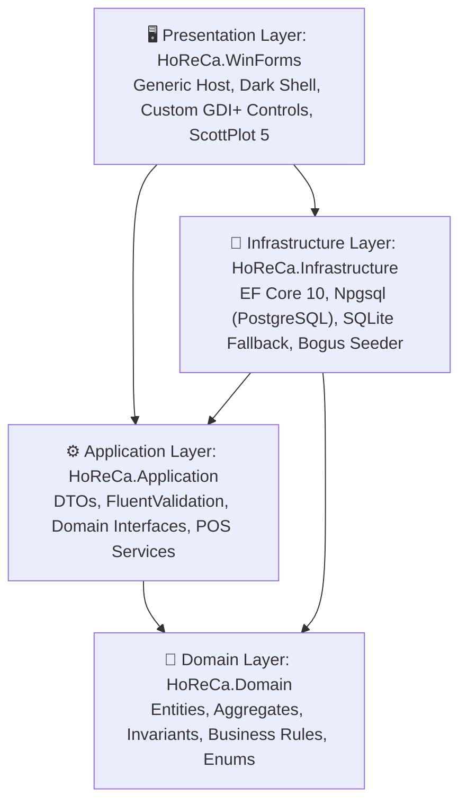
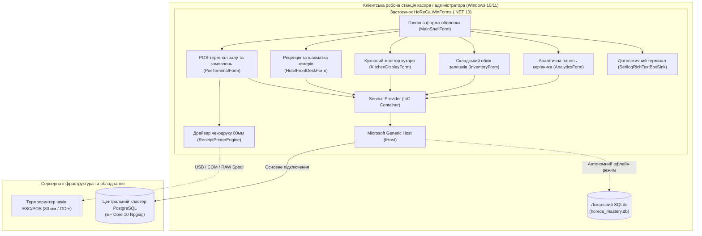
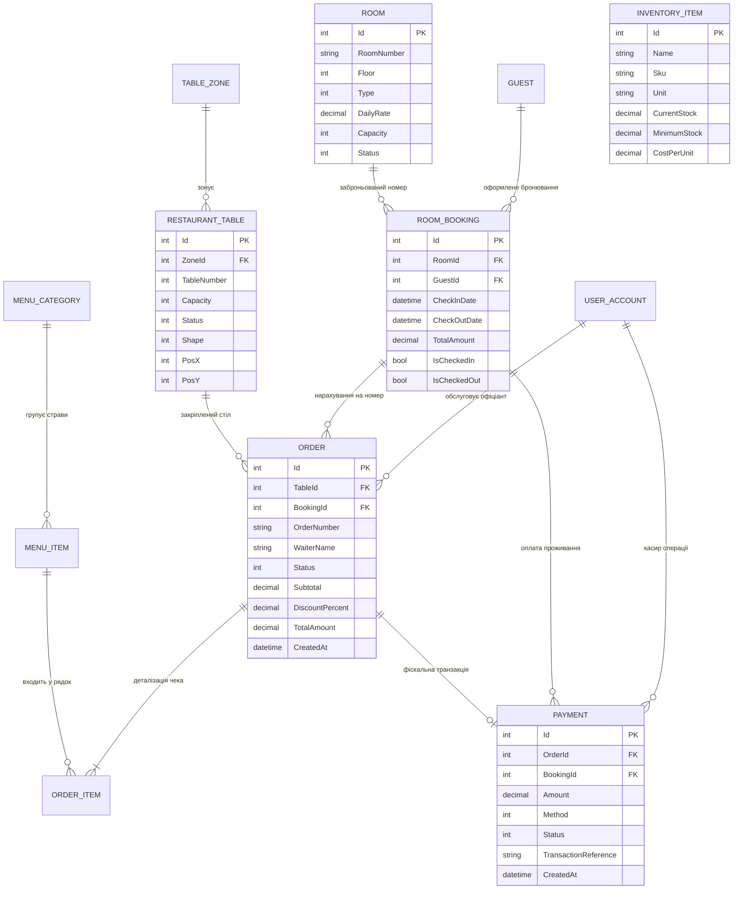

# 🏨 WinForms HoReCa Mastery: Комплексна ERP/POS-система ресторанно-готельного комплексу

Ласкаво просимо до **WinForms HoReCa Mastery** — флагманського навчально-виробничого проєкту на базі **.NET 10** та **Windows Forms**. Проєкт демонструє побудову відмовостійкої корпоративної десктопної екосистеми для індустрії гостинності (Hotel, Restaurant, Catering/Cafe) із застосуванням стандартів **Clean Architecture**, **Domain-Driven Design (DDD)**, **Microsoft Generic Host**, **Dependency Injection**, а також гібридної системи персистентності (**PostgreSQL 15+** та локальний офлайн-фолбек на **SQLite**).

---

## 📑 Зміст документації

1. [Архітектурна концепція (Clean Architecture & C4)](#-архітектурна-концепція)
2. [Діаграма сутностей та реляційна модель (ERD)](#-реляційна-модель-бази-даних)
3. [Демонстраційні ролі та швидкий вхід](#-демонстраційні-ролі-та-система-авторизації)
4. [Каталог компонентів Windows Forms](#-використання-компонентів-windows-forms)
5. [Структура рішення та посилання на код](#-структура-проєкту-та-вихідний-код)
6. [Навчальний курс (20 практичних гайдів)](#-навчальний-курс-20-покрокових-уроків)
7. [Інструкція зі встановлення та запуску](#-інструкція-зі-встановлення-та-запуску)
8. [Тестування та верифікація якості](#-тестування-та-контроль-якості)

---

## 🏛 Архітектурна концепція

Система побудована за принципами багатошарової **Чистої Архітектури (Clean Architecture)**. Шари ізольовані один від одного, а залежності спрямовані виключно всередину — до шару доменних правил.



### Рівень контейнерів (C4 Container Diagram)

У продакшн-середовищі POS-термінали та робочі станції адміністраторів працюють автономно. При втраті зв'язку з головним кластером PostgreSQL система плавно перемикається на локальну вбудовану базу даних SQLite, гарантуючи безперебійне обслуговування гостей.



Детальніше про життєві цикли сервісів, потокову модель STA та відсутність витоків пам'яті GDI+ читайте у [Docs/ARCHITECTURE.md](Docs/ARCHITECTURE.md).

---

## 🗄 Реляційна модель бази даних

Модель даних охоплює весь операційний цикл HoReCa: від бронювання готельних номерів і схеми розміщення столів ресторану до касових чеків, руху інгредієнтів на складі та аудиту персоналу.



Повний опис типів полів, зовнішніх ключів, унікальних індексів та стратегій міграцій наведено у [Docs/DATABASE_SCHEMA.md](Docs/DATABASE_SCHEMA.md).

---

## 👥 Демонстраційні ролі та система авторизації

У застосунку реалізовано інтерактивний стартовий екран входу ([`LoginForm`](file:///src/HoReCa.WinForms/Forms/LoginForm.cs)) з підтримкою швидкого перемикання 5 корпоративних ролей в один клік, введення 4-значного PIN-коду та повноцінної реєстрації нових співробітників:

| Роль | Логін | Пароль за замовчуванням | Швидкий PIN | Область доступу та обов'язки |
| :--- | :--- | :--- | :---: | :--- |
| 👑 **Керівник / Адміністратор** | `admin` | `admin123` | `1111` | Необмежений доступ до всіх модулів, ScottPlot BI-аналітика, аудит-журнал Serilog, зміна конфігурації. |
| 🍽 **Офіціант залу** | `waiter` | `waiter123` | `2222` | Інтерактивна карта залів (Drag-and-Drop), вибір страв із зображеннями, відкриття та розрахунок замовлень. |
| 🛎 **Адміністратор рецепції** | `reception` | `hotel123` | `3333` | Стійка реєстрації гостей, 2D календарна шахматка номерного фонду (Room Rack), поселення / виселення. |
| 👨‍🍳 **Шеф-кухар / Гарячий цех** | `chef` | `chef123` | `4444` | Кухонний монітор (KDS), динамічні таймери запізнення страв, звукові сповіщення про нові замовлення. |
| 📦 **Менеджер складу** | `store` | `store123` | `5555` | Моніторинг залишків на складі, підсвічування дефіцитних інгредієнтів, модальне оприбуткування партій. |

---

## 🎛 Використання компонентів Windows Forms

Проєкт спроєктований як фундаментальний підручник з практичного застосування стандартних та кастомних компонентів Windows Forms у складних високонавантажених сценаріях:

| Компонент WinForms | Модуль застосування | Архітектурне призначення та особливості реалізації |
| :--- | :--- | :--- |
| `DataGridView` | POS-термінал, Склад | `AutoGenerateColumns = false`, `FullRowSelect`, кастомна подія `CellPainting` для малювання кольорових бейджів дефіциту залишків. |
| `FlowLayoutPanel` | Кухонний монітор (KDS), Меню | Автоматичне плиточне перетікання та адаптивне розміщення карток замовлень і страв меню. |
| `TableLayoutPanel` | Сенсорний касовий нумпад | Відсоткова пропорційна сітка 4×4 із підтримкою великих сенсорних кнопок та купюр швидкої оплати. |
| `SplitContainer` | POS-термінал, Склад | Гнучкий розділювач між схемою залу ресторану та вмістом поточного відкритого замовлення. |
| `ListView` (TileView) | Стійка рецепції готелю | Високопродуктивне плиточне відображення номерного фонду з кольоровим кодуванням статусу прибирання та зайнятості. |
| `TreeView` | Навігація готелю | Ієрархічне дерево поверхів, категорій номерів та ресторанних залів. |
| `PrintDocument` & GDI+ | Фіскальний чекодрук | Точне векторне піксельне малювання термочека стандарту 80 мм з моноширинними колонками, штрихкодом та QR-кодом. |
| `PrintPreviewDialog` | Касовий розрахунок | Модальне вікно попереднього перегляду чека перед фізичним виведенням на принтер. |
| `ErrorProvider` | Модальні діалоги | Візуалізація помилок валідації без мерехтіння на базі правил `FluentValidation`. |
| `MaskedTextBox` | Діалог бронювання | Жорстка маска введення номерів телефонів України (`+38 (000) 000-00-00`). |
| `DateTimePicker` | Календар рецепції | Обмеження діапазону вибору дат, автоматична валідація тривалості проживання. |
| `StatusStrip` & `ToolStrip` | Головна оболонка | Індикація стану підключення до БД, монітор виділеної оперативної пам'яті (GC Heap) та системний годинник. |
| `RichTextBox` | Термінал діагностики | Безпечний для потоків Serilog Sink (`BeginInvoke`) із підсвічуванням рівня логування різними кольорами. |
| `ScottPlot.WinForms` | Панель аналітики | Апаратно прискорені інтерактивні графіки доходів, активності офіціантів, популярності страв та завантаженості столиків. |
| `System.Windows.Forms.Timer` | KDS та Оболонка | Секундні таймери перерахунку тривалості приготування страв та оновлення статусного рядка. |

---

## 📂 Структура проєкту та вихідний код

```
WinForms-HoReCa-Mastery/
├── WinForms-HoReCa-Mastery.slnx             # Файл рішення (.NET 10 slnx format)
├── src/
│   ├── HoReCa.Domain/                       # Шар ядра доменної моделі
│   │   ├── Common/BaseEntity.cs             # Базовий клас з аудитом дат (CreatedAt/UpdatedAt)
│   │   ├── Enums/DomainEnums.cs             # Статуси замовлень, номери, типи оплати
│   │   └── Entities/
│   │       ├── HotelEntities.cs             # Room, Guest, RoomBooking
│   │       ├── RestaurantEntities.cs        # RestaurantTable, TableZone, MenuItem, Order, OrderItem
│   │       └── InventoryAndPaymentEntities.cs # InventoryItem, Payment, UserAccount
│   ├── HoReCa.Application/                  # Шар прикладної бізнес-логіки
│   │   ├── DTOs/ApplicationDtos.cs          # Запити, відповіді, моделі списків
│   │   ├── Validators/Validators.cs         # FluentValidation-валідатори (Order, Booking, User)
│   │   └── Interfaces/ApplicationInterfaces.cs # Контракти сервісів та фабрик
│   ├── HoReCa.Infrastructure/               # Шар доступу до даних та зовнішніх служб
│   │   ├── Persistence/HoReCaDbContext.cs   # EF Core 10 DbContext з підтримкою PG/SQLite
│   │   ├── Persistence/DbSeeder.cs          # Генератор реалістичних тестових даних (Bogus)
│   │   └── Services/
│   │       ├── TablePosService.cs           # Обслуговування столів, відкриття/закриття чеків
│   │       ├── RoomBookingService.cs        # Бронювання номерів, перевірка перетину дат
│   │       ├── AdditionalServices.cs        # Складські операції, меню, авторизація
│   │       └── ReceiptTextFormatter.cs      # Моноширинне форматування чека 80 мм (ESC/POS)
│   └── HoReCa.WinForms/                     # Шар інтерфейсу користувача (Windows Forms)
│       ├── Common/ThemePalette.cs           # Єдина палітра кольорів та шрифтів (Dark Luxe Theme)
│       ├── Common/BaseForm.cs               # Базова форма з утилітами безпечного виклику Invoke
│       ├── Diagnostics/SerilogRichTextBoxSink.cs # Кастомний потік логів у RichTextBox
│       ├── Printing/ReceiptPrinterEngine.cs # GDI+ рендерер термочека 80 мм для PrintDocument
│       ├── Controls/
│       │   ├── FloorTableWidget.cs          # Кастомний інтерактивний віджет столу з Drag-and-Drop
│       │   ├── DishCardControl.cs           # Плитка страви меню з фото, ціною та бейджем
│       │   ├── RoomRackControl.cs           # 2D шахматка номерного фонду (GDI+ OwnerDraw)
│       │   ├── CashierNumpadControl.cs      # Сенсорний цифровий блок касира з швидкими банкнотами
│       │   └── KitchenTicketControl.cs      # Картка замовлення KDS з кольоровим таймером
│       ├── Forms/
│       │   ├── MainShellForm.cs             # Головне MDI/SDI вікно з боковою панеллю
│       │   ├── WelcomeStartForm.cs          # Вітальний екран із золотим гербом ресторану
│       │   ├── LoginForm.cs                 # Форма авторизації з PIN-кодом та ролями
│       │   ├── PosTerminalForm.cs           # Робоче місце офіціанта (Зали, Меню, Чек)
│       │   ├── HotelFrontDeskForm.cs        # Модуль рецепції готелю та поселення
│       │   ├── KitchenDisplayForm.cs        # Монітор кухаря (KDS) зі звуковим сповіщенням
│       │   ├── InventoryForm.cs             # Облік залишків на складі та оприбуткування
│       │   ├── AnalyticsForm.cs             # Інтерактивна ScottPlot-аналітика продажів
│       │   ├── PaymentDialogForm.cs         # Касове вікно розрахунку, решти та друку чека
│       │   ├── NewBookingDialogForm.cs      # Модальне вікно броні з масками та валідацією
│       │   └── LogsViewerForm.cs            # Вікно системного журналу подій у реальному часі
│       ├── appsettings.json                 # Конфігурація підключень до БД та логування
│       └── Program.cs                       # Точка входу: Generic Host, DI, ініціалізація теми
├── tests/
│   └── HoReCa.Tests/                        # Автоматизовані модульні та інтеграційні тести
│       ├── UnitTests/                       # Тести бізнес-правил, калькуляцій та валідаторів
│       └── IntegrationTests/                # Тести сервісів на базі SQLite In-Memory
└── Docs/
    ├── ARCHITECTURE.md                      # Детальний архітектурний посібник (STA, GDI, потоки)
    ├── DATABASE_SCHEMA.md                   # Специфікація таблиць БД, типів полів та індексів
    └── Lessons/                             # 20 структурованих теоретико-практичних гайдів
```

---

## 📚 Навчальний курс: 20 покрокових уроків

Кожен урок оформлений як фундаментальний підручник із теоретичним вступом, архітектурними схемами, аналізом підводних каменів, лістингами коду та чек-листом для самоперевірки:

| № | Назва уроку та пряме посилання | Основні теми та освоєні технології |
| :-: | :--- | :--- |
| **01** | [Microsoft Generic Host та Dependency Injection у WinForms](Docs/Lessons/01-generic-host-and-di.md) | `IHostBuilder`, `ServiceCollection`, життєві цикли `Scoped`/`Transient`/`Singleton`, безпечний старт `ApplicationConfiguration.Initialize()`. |
| **02** | [Гібридна персистентність: PostgreSQL та офлайн-фолбек на SQLite](Docs/Lessons/02-dual-database-persistence.md) | `IDbContextFactory`, `Npgsql`, підключення пулу з'єднань, автоматичний офлайн-фолбек на локальну SQLite базу. |
| **03** | [Моделювання предметної області HoReCa за принципами DDD](Docs/Lessons/03-domain-modeling-horeca.md) | Доменні сутності, агрегати, захист інваріантів, грошові типи `decimal`, відсутність аналітики в UI. |
| **04** | [Сучасний Dark Shell та модульна навігація без MDI](Docs/Lessons/04-modern-dark-shell-navigation.md) | Впровадження дочірніх форм через `TopLevel = false`, палітра `ThemePalette`, статусний рядок, таймер годинника. |
| **05** | [Інтерактивна схема залу ресторану з Drag-and-Drop](Docs/Lessons/05-interactive-floor-plan-drag-drop.md) | Кастомний `FloorTableWidget`, координатна математика `MouseDown/MouseMove/MouseUp`, збереження координат у БД. |
| **06** | [Керування замовленнями у POS-терміналі та оптимізація DataGridView](Docs/Lessons/06-pos-order-management-and-datagrid.md) | `BindingList<T>`, прив'язка даних, миттєвий підрахунок знижок, чайових та ПДВ, блокування колонок. |
| **07** | [Сенсорний цифровий блок касира на базі TableLayoutPanel](Docs/Lessons/07-touch-cashier-numpad-tablelayout.md) | Пропорційна сітка `TableLayoutPanel`, захист від помилок введення, сенсорні купюри швидкої оплати. |
| **08** | [Друк термочеків стандарту 80 мм засобами GDI+ та PrintDocument](Docs/Lessons/08-thermal-receipt-gdi-printdocument.md) | `PrintDocument`, `Graphics.DrawString`, моноширинні шрифти, пагінація, розрахунок висоти, штрихкоди. |
| **09** | [Стійка рецепції готелю та 2D-шахматка номерного фонду (Room Rack)](Docs/Lessons/09-hotel-frontdesk-matrix-roomrack.md) | Кастомна матриця номерів, кольорове кодування статусів (вільний, зайнятий, бронь, прибирання), `ListView` TileView. |
| **10** | [Модальні діалоги, маски введення та валідація через ErrorProvider](Docs/Lessons/10-modal-dialogs-validation-errorprovider.md) | `MaskedTextBox`, `DateTimePicker`, безшовна інтеграція з `FluentValidation`, валідація діапазонів без блокування. |
| **11** | [Кухонний монітор (KDS) на базі FlowLayoutPanel та динамічні таймери](Docs/Lessons/11-kitchen-display-system-flowlayout-timers.md) | Картки замовлень `KitchenTicketControl`, кольорова градація запізнення, звуковий сигнал `SystemSounds.Exclamation`. |
| **12** | [Складський облік та візуалізація залишків через DataGridView.CellPainting](Docs/Lessons/12-inventory-stock-datagrid-cellpainting.md) | Векторне перемальовування клітинок таблиці, заокруглені кольорові бейджі критичних залишків, захист від витоків пензлів GDI+. |
| **13** | [Управлінська аналітика та BI-дашборди на базі ScottPlot 5](Docs/Lessons/13-executive-analytics-scottplot-charts.md) | Апаратно прискорені бар-чарти, темна тема ScottPlot 5, фільтри за виручкою, офіціантами, столиками та стравами. |
| **14** | [Потокобезпечний Serilog Sink для RichTextBox у реальному часі](Docs/Lessons/14-threadsafe-serilog-sink-richtextbox.md) | Реалізація `ILogEventSink`, асинхронне перенаправлення логів у UI через `BeginInvoke`, кольорове форматування рівнів. |
| **15** | [Модульне тестування доменної логіки засобами xUnit та FluentAssertions](Docs/Lessons/15-unit-testing-business-logic.md) | Тестування розрахунку підсумків замовлень, валідаторів номерів телефонів та дат проживання без залежності від БД. |
| **16** | [Інтеграційне тестування бізнес-сервісів із SQLite In-Memory](Docs/Lessons/16-integration-testing-sqlite-inmemory.md) | Ізольоване in-memory середовище бази даних, перевірка транзакційності сервісів столів, броней та чеків. |
| **17** | [Асинхронні патерни в UI: уникнення дедлоків та фонові задачі](Docs/Lessons/17-asynchronous-ui-and-background-tasks.md) | Патерни `async/await` у WinForms, уникнення блокуючих викликів `.Result` / `.Wait()`, індикація завантаження через `ProgressBar`. |
| **18** | [Кастомне малювання без мерехтіння (Double Buffering) та GDI+](Docs/Lessons/18-custom-ownerdraw-and-flicker-free-gdi.md) | `ControlStyles.OptimizedDoubleBuffer`, правильне використання `GraphicsPath`, детерміноване звільнення `IDisposable` ресурсів. |
| **19** | [Конфігурація застосунку через appsettings.json та IOptions](Docs/Lessons/19-configuration-options-appsettings.md) | Ієрархічні налаштування принтерів, податкових ставок та тайм-аутів з підтримкою валідації конфігурації. |
| **20** | [Підготовка до продакшну, Single-File Publish та дистрибуція](Docs/Lessons/20-production-deployment-and-packaging.md) | Самодостатній реліз (`Self-Contained Single-File`), оптимізація розміру дистрибутива, налаштування Inno Setup інсталятора. |

---

## 🚀 Інструкція зі встановлення та запуску

### Системні вимоги
- Операційна система: **Windows 10 / 11** (x64 / ARM64).
- Середовище виконання: [.NET 10.0 SDK](https://dotnet.microsoft.com/download/dotnet/10.0) або новіше.
- (Опційно) Встановлений **PostgreSQL 15+**, якщо планується тестування клієнт-серверного кластера. Якщо PostgreSQL відсутній, застосунок за замовчуванням автоматично розгорне локальну базу даних SQLite.

### 1. Клонування репозиторію
```bash
git clone https://github.com/MrTomkaYurii/WinForms-HoReCa-Mastery.git
cd WinForms-HoReCa-Mastery
```

### 2. Запуск автоматизованих тестів
Перед запуском графічного інтерфейсу переконайтеся, що всі 30 тестів проходять успішно:
```bash
dotnet test
```

### 3. Запуск застосунку
```bash
dotnet run --project src/HoReCa.WinForms/HoReCa.WinForms.csproj
```
Під час першого запуску спрацює автоматичний сідер даних [`DbSeeder`](file:///src/HoReCa.Infrastructure/Persistence/DbSeeder.cs), який наповнить систему:
- Залами ресторану (Основний зал, Тераса, VIP-зал) та розставленими столиками.
- Каталогом страв і напоїв із реальними цінами та зображеннями.
- Номерним фондом готелю (Люкс, Напівлюкс, Стандарт) та поточними бронюваннями.
- Складськими запасами інгредієнтів.

---

## 🧪 Тестування та контроль якості

Проєкт містить повний набір модульних та інтеграційних тестів у проєкті [`HoReCa.Tests`](file:///tests/HoReCa.Tests/HoReCa.Tests.csproj):
- **UnitTests**:
  - `OrderServiceTests` — математика розрахунку знижок, чайових та підсумкових сум чеків.
  - `BookingValidatorTests` — перевірка валідності номерів телефонів, ПІБ гостей та коректності дат заїзду/виїзду.
  - `OrderValidatorTests` — валідація рядків замовлення та мінімальних лімітів.
  - `InventoryAndPrinterTests` — перевірка логіки списання залишків та форматування текстових чеків.
- **IntegrationTests**:
  - `TablePosServiceTests` — перевірка зміни статусів столів та додавання замовлень із реальною реляційною БД в пам'яті (SQLite In-Memory).

---

## 📜 Ліцензія

Проєкт поширюється під відкритою ліцензією **MIT License**. Ви можете вільно використовувати вихідний код у навчальних, дослідницьких та комерційних цілях.
